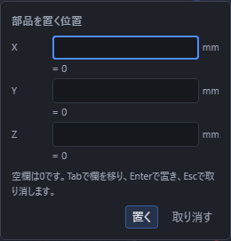

# 部品を配置する

アセンブリを開き、上の **組む** から **部品を置く** を選びます。保存してある `.pcad` ファイルを選ぶと、位置を入れる小さな欄が出ます。

X・Y・Zには数値または式を入力できます。Tabで次の欄へ移り、Enterで置き、Escで取り消します。最初の部品は組み立ての土台として固定されます。

同じファイルを何度選んでも別の部品として置けます。置いた後は左の一覧で名前、固定、表示を確かめられます。

空の部品から始めるときは、**組む** から **部品を作る** を選びます。位置を確かめて Enter を押すと、左の部品一覧に **部品1:1** のような連番付きの行が増え、その部品が選ばれます。形状はまだありません。部品の中身は組立を保存するときに同じ `.pcada` ファイルに保存されます。

位置を決める前に Esc を押すと、作成と配置をまとめて取り消せます。確定した後は **元に戻す** を1回押すと、その配置と空の部品を一緒に取り消せます。

## うまくいかないとき

- **いま選んでいる部品の配置を決めるか、取り消してください。** … 部品を置く操作の途中で、続けて部品の配置や規格部品・組の配置、差し替えを始めようとすると出ます。入力中の位置をEnterで確定するか、Escで取り消してからやり直してください。
- **ファイルを開けませんでした** … 選んだファイルが部品ファイルでない、壊れている、読み込めないときに出ます。組み立ては変わらないので、部品ファイルを選び直してください。

置いた部品の位置・固定・表示の状態は組み立てに保存され、開き直しても保たれます。
