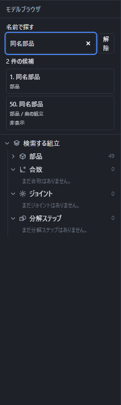

# 部品を置いて組み立てる

アセンブリでは、保存してある部品を何個でも置いて組み合わせられます。画面上部の **{{ui:toolbar.fileMenu.groupLabel}}** から **新しいアセンブリ** を選び、**組む** から配置を始めます。

## 部品を置く

**部品を置く**を押して `.pcad` ファイルを選ぶと、画面の中に X・Y・Z の欄が出ます。位置はミリメートルで、`10*2` のような式も使えます。空欄のまま Enter を押すと原点に置きます。

- Tab: 次の欄へ移る
- Enter: 部品を置く
- Esc: 置かずに取り消す

最初に置いた部品は自動で固定されます。組み立て全体の位置を決める土台として使えます。同じ部品をもう一度選んでも、別の部品として何個でも置けます。

ファイルを選ぶのをやめたとき、式が正しくないとき、ファイルを読めなかったときは、組み立ては変わりません。

部品が多くなったら、モデルブラウザの「{{ui:nameSearch.label}}」で名前を探せます。サブアセンブリの中も対象となり、同名の部品には所属を表示します。たとえば「右側 ボルト」と入力すると、両方の語を含む名前・所属の候補に絞れます。非表示や抑制中の部品も検索できます。

入力中は配置や選択を変えません。候補を押すと、必要な節と親の部品を開き、対象の行まで一覧を移動して選択します。Escまたは「{{ui:nameSearch.clear}}」で検索を解除します。入力欄の下矢印で候補へ移動し、TabとEnterでも選べます。

## 置いた部品を操作する

左の一覧で部品を1個選び、上の **{{ui:assembly.menu.build}}** を開きます。固定されていない部品では **{{ui:assembly.tool.fixComponent}}**、固定済みの部品では **{{ui:assembly.tool.unfixComponent}}** が表示されます。固定すると動かなくなり、解除すると再び動かせます。部品を選んでいないときや複数選んだときは、1個選ぶよう案内されます。

複製・削除・表示の切り替えには、部品の行の **⋮** を使います。この一覧でも固定を切り替えられます。

- **複製する**: 同じ部品を同じ位置にもう1個置きます。
- **削除する**: 組み立てから取り除きます。
- **{{ui:assembly.tool.fixComponent}}** / **{{ui:assembly.tree.unfix}}**: 動かない状態にするか、固定を外します。
- **{{ui:featureTree.hide}}** / **{{ui:featureTree.show}}**: 部品を隠すか、もう一度表示します。隠しても組み立てには残ります。

どの操作も1回の「元に戻す」で戻り、「やり直す」で元どおりにできます。

**別の部品の面に合わせて作図する({{ui:assembly.context.title}})**: 部品の基準点を、組立に置いた別の部品の面の中心へ合わせられます。基準点につないだ穴の中心や点も、一緒にその位置へ動きます。

1. 部品の画面で、「基準の軸・点・座標系を作る」の手順で、座標の値で決めた基準点を作ります。その基準点を1つ選び、右クリックの「{{ui:command.sketch.pointAtReference}}」でスケッチに点を置きます。この点を穴の中心などに使い、部品を保存します。
2. 組立にその部品を置き、左の一覧で1個選びます。右の「プロパティ」の「{{ui:assembly.context.title}}」で「{{ui:assembly.context.point}}」「{{ui:assembly.context.source}}」「{{ui:assembly.context.face}}」を選び、「{{ui:assembly.context.create}}」を押します。基準点が選んだ面の中心へ移り、穴などが作り直されます。
3. 参照する部品を動かしたり形を変えたりしても、基準点は**自動では追従しません**。合わせ直すときは「{{ui:assembly.context.update}}」を押します。別の面へ合わせ直すときは、面を選び直して「{{ui:assembly.context.replace}}」を押します。

参照できるのは別の部品の面(その面の中心)だけで、辺や頂点は選べません。作る・置き換える・更新するは、それぞれ1回の「元に戻す」で戻ります。基準点を書き込む部品を別の配置でも使っているとき、参照が循環するとき、参照する面が今の形から見つからないときなどは、欄の下に理由を出して断り、組立は変わりません。循環する参照を含む組立のファイルは開けません(「ファイルが壊れているため開けませんでした。」と出ます)。

## 部品を直接動かす

**4**で部品全体を選ぶ状態にし、固定されていない部品を左ボタンで引っぱると、合致を保てる向きへ直接動かせます。動かし始めたときの画面と平行な面に沿って動き、部品のつかんだ場所がポインターからずれないように追従します。

合致のために動けない向きへ引っぱった場合は、合致を保てる位置で止まります。固定された部品は動かず、画面下に固定を外すための案内が出ます。計算中、部品を置いている途中、合致を編集中のときは、それらを終えてから引っぱってください。

- 左ボタンを離す: 移動を確定する
- Esc: 移動前の位置へ戻して取り消す
- Altと左ボタン、または中ボタン: 移動を取り消して視点を動かす

引っぱっている途中の位置は文書へ書き込みません。左ボタンを離したときだけ、合致で一緒に動いた部品を含めて1回の操作として記録します。「元に戻す」を1回押すと全て移動前へ戻り、「やり直す」で同じ位置へ進みます。変わらなかった位置の式はそのまま残り、確定した位置だけが保存と自動保存の対象になります。

## 部品が多い組立を扱う

1000部品規模の組立を扱うときも、まず左の一覧で名前と所属を確認し、必要な部品を選びます。同じ部品を何か所かに置いた場合と、異なる形の部品を置いた場合は区別され、保存するとそれぞれの形と配置を保ちます。部品数だけで処理時間は決まらず、形の複雑さや端末によって読み込み・表示・保存にかかる時間が変わります。

名前が重なる場合は「{{ui:nameSearch.label}}」に部品名と所属の語を入れ、候補の所属を見て選びます。見たい部品を残してほかを「{{ui:featureTree.hide}}」にすると、位置関係を確認しやすくなります。非表示は削除ではなく、部品は組立に残ります。読み込みや形の更新が終わってから、合致やジョイントの操作に進んでください。

## 入れ子の組立の中を動かす

サブアセンブリは、組立の中に置いた別の組立です。左の部品一覧でその行を開くと、中の部品やさらに入れ子になった組立を確認できます。入れ子は最上位の組立の下に8段までで、自分自身を含むような循環した組合せは使えません。

1. 中にジョイントがあるサブアセンブリの行を選びます。
2. 右の「{{ui:assembly.subJoint.title}}」で、動かしたいジョイントの角度または移動量を入れます。角度は度、移動量はmmです。
3. 同じサブアセンブリを別の場所にも置いている場合は、所属を見て選び直します。一方の配置を動かしても、もう一方の配置の動きは変わりません。

これはその配置だけの動作確認です。元の部品の形や保存する配置を書き換えず、「元に戻す」の履歴も増やしません。動かした途中の位置は保存されず、開き直すと保存された配置に戻ります。計算中に止める場合は「{{ui:assembly.motion.cancel}}」を押します。解けない動きは案内を確認し、ジョイントの範囲や入力を直してください。

親の組立の回転と子の組立の回転・スライドをつなぐ方法は、[ジョイントの歯車・カムの連動](joint.md)を参照してください。連動した部品を直接引っぱる場合も、子の動きが範囲内なら一緒に動き、届かなければ動き全体を断って理由を表示します。連動の動作確認と、自由な部品を置き直す操作は分けてください。

## 部品どうしを合わせる

部品を2個以上置いたら、上の **合わせる** の一覧から **一致**、**同心**、**距離**、**角度**、**平行**、**接線**を選び、別々の部品から対象を1つずつ押します。面を選ぶときは **3**、辺は **2**、頂点は **1**、部品全体の選択へ戻すときは **4** を押します。選べる対象はマウスを重ねると光り、選んだ対象は別の色になります。

対象を先に選んでも作れます。例えば **3** を押して平らな面を2枚選び、Enterを押すと、向かい合わせで重ねる一致が付きます。2つの円筒を選ぶと同心が最初の候補になります。画面内の **合わせ方** から別の種類へ変更できます。対象を選び過ぎたときや選び直すときは、その場の欄の **対象を外す** を押します。

| 選ぶ組 | 使える合わせ方 |
| --- | --- |
| 平らな面2枚 | 一致、平行、距離、角度 |
| 点2つ、または点と平らな面 | 一致、距離 |
| 直線・基準軸・円筒の軸どうし | 同心、平行、角度 |
| 平らな面と基準軸 | 平行、角度 |
| 円筒の面と平らな面 | 接線 |

点と面、円筒と面はどちらを先に選んでも同じ組として扱います。円筒の面は中心の軸を使います。辺・頂点は画面上の近さで選ぶため、裏側のものも選べます。Altと左ボタンのドラッグは視点を動かすだけで、対象には加わりません。

部品の原点、X・Y・Z軸、XY・XZ・YZ面を使うときは、合わせる道具を開始し、左の一覧で部品を選んでから、画面内の小さな欄で基準を押します。次の部品も同じ順で選びます。

面の一致は **ずらす距離** が0で、負の値も使えます。距離は0以上、角度は1度より大きく179度より小さい値を入力します。角度の最初の値は90度です。`10*2` のような式を使え、式のまま保存されます。入力中に使えない理由が出た場合は値や対象を直してください。Tabで次の欄へ移り、Enterで確定し、Escで取り消します。

作った合致は左の **合致** の束に並びます。行の **⋮** から値の編集、向きの反転、削除ができます。それぞれ1回の「元に戻す」で戻せます。

対象にした面が部品の変更で見つからなくなった場合は、その合致の行に未解決の印と理由が出ます。計算でまだ確かめられていないときは **未確定**、両立しない可能性があるときは **両立を確認できません** と表示します。同時には成り立たないことを確かめられた場合だけ **矛盾** と表示します。画面下には計算が止まった理由や残る動きも出ます。解けなかった部品は直前に成立した位置を保ち、別の独立した組は解けた位置へ動きます。合致は消えないため、対象や値を直して続けられます。

## ボルトで締結する

2つの部品の穴にボルトを通して締めた状態を、1回の操作で作ります。2つの部品の穴と、その穴が始まる面を選ぶと、合うボルトの呼びと長さを提案します。

1. 上の **{{ui:assembly.menu.build}}** から **{{ui:assembly.boltedJoint.tool}}** を選びます。
2. 2つの部品の穴と、その穴が始まる面を、4つ選びます。
3. 提案を確かめ、必要なら欄を直します。
4. **{{ui:assembly.boltedJoint.commit}}** を押すかEnterを押します。2つ目の部品を動かして穴を合わせ、ボルト・ナット・座金を部品として足し、全部を互いに固定した1つの組にします。

穴は、それぞれの部品の画面で「[穴をあける](hole.md)」か「[ねじ穴をあける](thread.md)」を使って作っておきます。通し穴は、「穴をあける」の入力欄で **{{ui:numericInput.toggle.through}}** のつまみを入にした穴です。ねじ穴は貫通でも止まりでもかまいません。抑制していない部品が2個以上ないと、この項目は押せません。

### 面を4つ選ぶ

**{{ui:assembly.boltedJoint.tool}}** を選ぶと小窓が開きます。面を選んでいる間も小窓は開いたままで、画面下の状態欄に「ボルトで締結 1/4: …」のように、何面目かと次に選ぶ面が出ます。画面の部品の面を、次の順に押して選びます。

1. {{ui:assembly.boltedJoint.pickHoleA}}
2. {{ui:assembly.boltedJoint.pickFaceA}}
3. {{ui:assembly.boltedJoint.pickHoleB}}
4. {{ui:assembly.boltedJoint.pickFaceB}}

「穴の内側の面」は穴の円筒の面、「相手に当てる平らな面」はその穴が始まる平らな面です。2つ目の面は1つ目と、4つ目の面は3つ目と、それぞれ同じ部品から選びます。別の部品の面を押しても、選んだ数は進みません。1つ目と3つ目の面は、別々の部品から選びます。4つ選び終えると、提案ができたときは状態欄が「{{ui:assembly.status.boltedJointReady}}」になり、できなかったときは断りの理由が赤で出ます。

選ぶのをやめるときは、Escか **{{ui:assembly.boltedJoint.cancel}}** を押します。何も変わりません。

サブアセンブリの中の部品(入れ子の部品)の穴も、画面で押して選べます。この場合は部品を動かさないので、穴と面が最初から合っているときだけ締結でき、合っていないときは「{{ui:assembly.boltedJoint.reason.alignmentBlocked}}」と、合っていない理由が出ます。足した部品は一番上の組立に入ります。選ぶ順を間違えると「{{ui:assembly.boltedJoint.nested.order}}」と出ます。同じサブアセンブリの中の部品どうしや、合致・ジョイントで動きを決めたサブアセンブリの部品の穴を選ぶと、「{{ui:assembly.boltedJoint.nested.command}}」と断られます。選んでいる間に組立や部品が変わったときは、次の案内が出ます。

- **{{ui:assembly.boltedJoint.nested.document}}**
- **{{ui:assembly.boltedJoint.nested.partKey}}**
- **{{ui:assembly.boltedJoint.nested.occurrence}}**

### 部品が動く位置

2つ目の部品を、面どうしが接して2つの穴の軸が一致する位置へ動かします。動かすのは **{{ui:assembly.boltedJoint.commit}}** を押したときだけで、面を選んでいる間や提案を見ている間は、部品は動きません。向きは最小の回転で合わせ、穴の軸のまわりの向きは今のままです。動かす部品が、ほかの部品と互いに固定した組になっているときは、組ごと動きます。部品を動かす提案のときは、提案に「{{ui:assembly.boltedJoint.moves}}」と出ます。

- 2つ目の部品の組に固定された部品があるときは、代わりに1つ目の部品とその組を動かします。
- 両方の組に固定された部品があるときは、動かせません。穴と面がすでに合っていればそのまま締結でき、合っていなければ「{{ui:assembly.boltedJoint.reason.alignmentBlocked}}」と、合っていない理由が出ます。
- すでに同じ組になっている部品どうしも動かしません。
- 2つの部品(とそれぞれの組)に、抑制していない合致やジョイントが付いているときは、動かした後の位置でそれらが成り立つかを確かめます。合致を解き直しはしません。成り立たないときは「{{ui:assembly.boltedJoint.reason.existingConstraintConflict}}」、形を確かめられないときは「{{ui:assembly.boltedJoint.reason.existingConstraintUnresolved}}」と断り、何も変えません。

### ボルトの呼びと長さの提案

小窓の欄は次のとおりです。各欄は、マウスを置くかTabで移動すると説明が出ます。長さの欄にはmmの数か、`10*2` のような式を入力します。

| 欄 | 意味 |
|---|---|
| **{{ui:assembly.standardPart.dimensionSeries}}** | 六角ボルト・六角ナットの寸法表の系列です。**{{ui:assembly.standardPart.dimensionSeries.main}}** と **{{ui:assembly.standardPart.dimensionSeries.annexJA}}** から選びます。新しい締結の最初の選択は **{{ui:assembly.standardPart.dimensionSeries.main}}** で、同じ呼び径でも頭やナットの寸法が変わります。 |
| **{{ui:assembly.boltedJoint.nominal}}** | 通し穴どうしを締めるときのボルトの呼びです。最初の「{{ui:assembly.boltedJoint.nominalAuto}}」では、2つの穴の径がどちらも、通し穴の表(M6からM24)のただ1つの呼びの範囲に入るときだけ呼びが決まります。たとえば直径9 mmの穴はM8です。決まらないときは呼びを選びます。ねじ穴があるときは、呼びとピッチがねじ穴で決まります。 |
| **{{ui:assembly.standardPart.threadSeries}}** | **{{ui:assembly.standardPart.threadSeries.coarse}}** か **{{ui:assembly.standardPart.threadSeries.fine}}** です。呼びを選んだときに使い、ねじ穴の呼び・ピッチと合わないと断ります。 |
| **{{ui:assembly.boltedJoint.engagement}}** | ボルトをねじ込みたい長さです。ねじ穴があるときは入力が必要です。 |
| **{{ui:assembly.boltedJoint.bottomClearance}}** | 止まりのねじ穴の底に残す長さです。止まりのねじ穴のときは入力が必要です。 |
| **{{ui:assembly.boltedJoint.protrusion}}** | 通し穴どうしのとき、ナットの外へ最低限出したいボルトの長さです。最初の値は0です。 |
| **{{ui:assembly.boltedJoint.headWasher}}**・**{{ui:assembly.boltedJoint.nutWasher}}** | **{{ui:assembly.boltedJoint.washer.none}}**・**{{ui:assembly.boltedJoint.washer.plainWasher}}**・**{{ui:assembly.boltedJoint.washer.springWasher}}** から選びます。選んだときだけ座金を入れ、自動では入れません。ねじ穴の側には置けません。 |

欄を変えるたびに、小窓の **{{ui:assembly.boltedJoint.proposal}}** が計算し直されます。提案は1つで、次のように決まります。

- 通し穴どうしは、ボルトとナットで共締めします。ボルトの頭は1つ目の部品の側、ナットは2つ目の部品の側に付きます。
- 通し穴とねじ穴のときは、頭を通し穴の側に置き、ナットは足しません。ねじ穴の側の板の厚さは、締め付ける厚さに数えません。
- **{{ui:assembly.boltedJoint.grip}}** は、板の厚さと入れた座金の厚さの合計です(通し穴どうしは両方の板と座金)。
- ボルトの長さの下限は、通し穴どうしでは「締め付ける厚さ + ナットの高さ(最大値) + ナットの外へ出す長さ」、ねじ穴では「締め付ける厚さ + ねじ込み長さ」です。止まりのねじ穴では、さらに「締め付ける厚さ + (ねじ部の深さ − 底に残す長さ)」を上限にします。
- その範囲に入る推奨の呼び長さのうち、首下のねじのない部分が締め付ける厚さの中で終わる、いちばん短い長さを選びます。本体規格・並目のM3・M4・M5・M6・M8・M10・M12・M16・M20には、径ごとの推奨の呼び長さがあります。たとえばM8は40・45・50・55・60・65・70・80 mmです。それ以外の呼び(M14・M18)と、附属書JA・細目では、全径に共通の長さの一覧を使い、「{{ui:assembly.boltedJoint.fact.perDiameterLengthAvailability}}」と添えます。

たとえば、厚さ10 mmの板2枚に直径9 mmの通し穴があり、**{{ui:assembly.standardPart.dimensionSeries}}** も呼びも最初の選択のままなら、次のようになります。**{{ui:assembly.boltedJoint.grip}}** は20 mmです。**{{ui:assembly.boltedJoint.protrusion}}** が0なら、M8ナットの高さの最大値6.8 mmを足した26.8 mm以上で最も短い推奨の長さは40 mmです。小窓には「{{ui:assembly.boltedJoint.bolt}} M8 {{ui:assembly.boltedJoint.length}} 40」「{{ui:assembly.boltedJoint.nut}} M8」「{{ui:assembly.boltedJoint.grip}} 20」「{{ui:assembly.boltedJoint.protrusionResult}} 13.2」と出ます(13.2は 40 − 20 − 6.8)。ナットの座金を入れていないので、提案の下には「{{ui:assembly.boltedJoint.fact.bearingFaceDiameter}}」とも出ます。

ねじ穴の例では、厚さ20 mm・直径9 mmの通し穴の板と、ねじ部の深さ22 mmのM8並目の止まりのねじ穴の板を締めます。**{{ui:assembly.boltedJoint.engagement}}** を16、**{{ui:assembly.boltedJoint.bottomClearance}}** を1にすると、長さは 20 + 16 = 36 mm以上、20 + (22 − 1) = 41 mm以下で、推奨の長さは40 mmです。小窓には「{{ui:assembly.boltedJoint.bolt}} M8 {{ui:assembly.boltedJoint.length}} 40」「{{ui:assembly.boltedJoint.noNut}}」「{{ui:assembly.boltedJoint.engaged}} 20」と出ます。入力したねじ込み長さは最低限の長さで、実際にねじが掛かる長さはボルトの長さで決まります。**{{ui:assembly.boltedJoint.engagement}}** を22にすると、使えるねじ部が 22 − 1 = 21 mm なので、「{{ui:assembly.boltedJoint.reason.blindBottoming}}」と断られます。

ねじ穴があるときは、ボルトの呼びがねじ穴の呼びと一致する必要があります。一致しないと「{{ui:assembly.boltedJoint.reason.nominalMismatch}}」と断ります。穴の径だけで下穴と通し穴を同じものとは見なさず、穴をあけた道具(穴かねじ穴)で区別します。

提案の下には、確かめられていないことが1行ずつ出ます。

| 画面の文言 | 出る条件 |
|---|---|
| {{ui:assembly.boltedJoint.fact.perDiameterLengthAvailability}} | 寸法系が **{{ui:assembly.standardPart.dimensionSeries.annexJA}}** のとき、ピッチが **{{ui:assembly.standardPart.threadSeries.fine}}** のとき、または径ごとの推奨の呼び長さがない呼びのとき。 |
| {{ui:assembly.boltedJoint.fact.bearingFaceDiameter}} | ナットの側に座金を入れない通し穴どうしの締結のとき、または頭の側に座金を入れず、頭の座面の径が寸法表にない呼びのとき。 |
| {{ui:assembly.boltedJoint.fact.washerTableUnverified}} | 座金を入れて、その座金の寸法表の値が未確認のとき。 |
| {{ui:assembly.boltedJoint.fact.catalogRowUnverified}} | ボルトかナットの寸法表の値の一部が未確認のとき。 |

### 保存されるもの

**{{ui:assembly.boltedJoint.commit}}** を押す(またはEnterを押す)と、足したボルト・ナット・座金は規格部品として組立に入り、左の **{{ui:assembly.tree.components}}** に並びます。**{{ui:assembly.bom.title}}** にも「六角ボルト M8×40」「六角ナット M8」「平座金 M8」のように出て、同じ座金は1行にまとまり数量が増えます([部品表を確認する](bom.md))。足した部品は固定しません。

締結した2つの部品と足した部品は、互いに固定した1つの組になります。左の一覧では、組の部品に **{{ui:assembly.tree.fastened}}** の印が付きます。組ごと動き、組の中に固定した部品があれば組全体が動きません。

組立のファイルには、規格部品の種類・呼び寸法・長さなどの指定と部品の配置のほかに、締結の記録が保存されます。記録には、締結した2つの部品、選んだ穴と当てる面、小窓で入力した指定、足した部品が入ります。形は保存せず、開き直すたびに寸法表から組み立て直します。保存して開き直すと、組と部品の位置は締結したときと同じです。

### 直す・外す・消す・元に戻す

- **元に戻す**: 締結の確定は、位置合わせ・足した部品・組をまとめて、1回の「元に戻す」で戻ります。「やり直す」で同じ締結に戻ります。やめたとき、断られたときは、組立も履歴も変わりません。
- **直す**: 締結した部品(板・座金・ボルト・ナットのどれか)を1個選んでから **{{ui:assembly.boltedJoint.tool}}** を選びます。小窓は「{{ui:assembly.boltedJoint.editTitle}}」になり、「{{ui:assembly.boltedJoint.editPrompt}}」と案内します。面は選び直しません。欄を直して **{{ui:assembly.boltedJoint.commit}}** を押すと、ボルト・ナット・座金が新しい部品に入れ替わります。板・ほかの部品・合致・ジョイント・組は保たれ、1回の「元に戻す」で戻ります。
- **外す**: 締結した部品を1個選んで **{{ui:assembly.boltedJoint.release}}** を選ぶと、組を解きます。部品の位置は変わらず、ボルトなども残ります。直すための記録は消えます。1回の「元に戻す」で組に戻ります。
- **消す**: 部品の行の **⋮** から **削除する** で、ボルト・ナット・座金・板のどれかを消すと、その締結の記録も消えます。ほかの部品の組は残ります。

直せないときは、小窓に次の理由が出ます。

| 画面の文言 | 出る条件 |
|---|---|
| **{{ui:assembly.boltedJoint.issue.jointRecordMissing}}** | 記録を残す前に作った締結や、実際のねじ山を作ったねじ穴で選んだ締結のとき。 |
| **{{ui:assembly.boltedJoint.issue.jointPartsChanged}}** | 足した部品か板が消えたり抑制されたり、組が解かれたりしたとき。 |
| **{{ui:assembly.boltedJoint.issue.jointPartsConstrained}}** | 足した部品に合致やジョイントを付けたとき。 |
| **{{ui:assembly.boltedJoint.issue.jointGeometryChanged}}** | 締結の後に、板の位置や形が変わったとき。 |

### ボルトが断られるとき

理由は小窓に出て、状態欄にも赤で出ます。**{{ui:assembly.boltedJoint.commit}}** は押せず、組立も履歴も変わりません。値や選択を直すと提案に戻ります。

| 画面の文言 | 出る条件 |
|---|---|
| **{{ui:assembly.boltedJoint.reason.componentSuppressed}}** | 選んだ部品を抑制しているとき。 |
| **{{ui:assembly.boltedJoint.reason.sameComponent}}** | 2つの穴を同じ部品から選んだとき。 |
| **{{ui:assembly.boltedJoint.reason.staleSource}}** | 選んだ後や確定の直前に、部品の形や位置が変わったとき。 |
| **{{ui:assembly.boltedJoint.reason.holeFaceMissing}}** | 穴の面として円筒でない面を押したとき、または面が今の形に見つからないとき。 |
| **{{ui:assembly.boltedJoint.reason.holeFaceMismatch}}** | 押した面の径が、その部品の穴の指定と合わないとき。 |
| **{{ui:assembly.boltedJoint.reason.matingFaceMissing}}** | 当てる面として平らでない面を押したとき、または面が今の形に見つからないとき。 |
| **{{ui:assembly.boltedJoint.reason.holeNotOnMatingFace}}** | 穴が、選んだ当てる面から始まっていないとき。 |
| **{{ui:assembly.boltedJoint.reason.unsupportedHole}}** | ねじのない止まりの穴を選んだとき。 |
| **{{ui:assembly.boltedJoint.reason.alignmentBlocked}}** | 両方の組に固定した部品があって動かせず、穴と面がまだ合っていないとき。次の4つのうち合わないものが一緒に出ます。 |
| **{{ui:assembly.boltedJoint.reason.axesNotOpposed}}** | 2つの穴が向かい合っていないとき。 |
| **{{ui:assembly.boltedJoint.reason.axesNotCoaxial}}** | 2つの穴の軸がずれているとき。 |
| **{{ui:assembly.boltedJoint.reason.facesNotInContact}}** | 当てる面どうしが離れているとき。 |
| **{{ui:assembly.boltedJoint.reason.facesOverlap}}** | 当てる面どうしが食い込んでいるとき。 |
| **{{ui:assembly.boltedJoint.reason.bothHolesThreaded}}** | 2つの穴がどちらもねじ穴のとき。 |
| **{{ui:assembly.boltedJoint.reason.boltSizeUnspecified}}** | 通し穴どうしで、穴の径から呼びが1つに決まらないとき。 |
| **{{ui:assembly.boltedJoint.reason.nominalMismatch}}** | 選んだ呼びが、ねじ穴の呼びと違うとき。 |
| **{{ui:assembly.boltedJoint.reason.pitchMismatch}}** | 選んだ呼びのピッチ(並目・細目)が、ねじ穴のピッチと違うとき。 |
| **{{ui:assembly.boltedJoint.reason.unknownThread}}** | ねじ穴の呼びが寸法表にないとき。 |
| **{{ui:assembly.boltedJoint.reason.pitchNotInCatalog}}** | ねじ穴のピッチが、並目・細目のどちらにも当たらないとき。 |
| **{{ui:assembly.boltedJoint.reason.boltRowMissing}}** | その呼びのボルトが、選んだ寸法系の表にないとき。 |
| **{{ui:assembly.boltedJoint.reason.nutRowMissing}}** | その呼びのナットが、選んだ寸法系の表にないとき。 |
| **{{ui:assembly.boltedJoint.reason.insufficientClearance}}** | 通し穴の径が、ボルトの径以下のとき。 |
| **{{ui:assembly.boltedJoint.reason.holeLargerThanBearing}}** | 通し穴が大きく、頭・ナット・座金で覆えないとき。 |
| **{{ui:assembly.boltedJoint.reason.washerDoesNotFit}}** | 座金の穴にボルトが通らないとき。 |
| **{{ui:assembly.boltedJoint.reason.washerOnTappedSide}}** | ねじ穴の側に座金を入れたとき。 |
| **{{ui:assembly.boltedJoint.reason.engagementRequired}}** | ねじ穴があるのに、ねじ込み長さが空欄のとき。 |
| **{{ui:assembly.boltedJoint.reason.engagementExceedsThread}}** | 貫通のねじ穴で、ねじ込み長さが穴のねじ部より長いとき。 |
| **{{ui:assembly.boltedJoint.reason.blindClearanceRequired}}** | 止まりのねじ穴で、底に残す長さが空欄のとき。 |
| **{{ui:assembly.boltedJoint.reason.blindBottoming}}** | 止まりのねじ穴で、ねじ込み長さが「ねじ部の深さ − 底に残す長さ」を超えるとき。 |
| **{{ui:assembly.boltedJoint.reason.protrusionRequired}}** | 通し穴どうしで、ナットの外へ出す長さが空欄のとき。 |
| **{{ui:assembly.boltedJoint.reason.noStandardLengthFits}}** | 条件に合う推奨の呼び長さがないとき。 |
| **{{ui:assembly.boltedJoint.issue.value}}** | 長さの欄に、使えない値(負の数や計算できない式など)を入れたとき。 |
| **{{ui:assembly.boltedJoint.issue.holeFeatureUnknown}}** | 押した面がどの穴の面か決められないとき。 |
| **{{ui:assembly.boltedJoint.issue.stale}}** | 形の計算し直しの途中で面を押したとき。 |

次の理由は、通常の操作ではほとんど出ません。

- **{{ui:assembly.boltedJoint.reason.washerRowMissing}}**
- **{{ui:assembly.boltedJoint.reason.lengthAvailabilityMissing}}**
- **{{ui:assembly.boltedJoint.reason.threadEntryUnknown}}**
- **{{ui:assembly.boltedJoint.reason.missingSourceRevision}}**
- **{{ui:assembly.boltedJoint.reason.componentMissing}}**
- **{{ui:assembly.boltedJoint.reason.holeFeatureMissing}}**
- **{{ui:assembly.boltedJoint.reason.faceAxisMismatch}}**
- **{{ui:assembly.boltedJoint.reason.invalidPlacement}}**
- **{{ui:assembly.boltedJoint.reason.invalidWorldFrame}}**
- **{{ui:assembly.boltedJoint.reason.invalidDimension}}**
- **{{ui:assembly.boltedJoint.reason.invalidAxis}}**
- **{{ui:assembly.boltedJoint.reason.axisNotNormalized}}**
- **{{ui:assembly.boltedJoint.issue.needPicks}}**
- **{{ui:assembly.boltedJoint.issue.notFace}}**

### 締め付け力・摩擦と強度

この機能には、締め付け力(初期張力)・締め付けトルク・摩擦係数・ボルトの強度区分を入力する欄がなく、それらを保存も解析へ渡しもしません。小窓にも「{{ui:assembly.boltedJoint.fastenNote}}」と出ます。未指定の値を、解析の数値として作ることはありません。

ボルトの締め付け力を入れた解析は別の入口です。簡易強度計算の **{{ui:beam.preload.title}}** で、配置済みの部材・ボルト・接触を自分で選び、締付け力と物性を根拠とともに入力します([梁・軸・ボルトの簡易強度計算](strength.md))。

### ボルトの締結でできないこと

- 両方がねじ穴の締結(植込みボルトなど)はできません。
- 座ぐり・皿もみの穴、ねじのない止まりの穴は使えません。
- 足せるのは六角ボルト・六角ナット・平座金・ばね座金です。座金は片側に1枚までです。
- 強度区分の選択、強度・締め付け力・ねじ込みの十分さの確認はしません。
- ボルトとナットの寸法表はM3からM20です(**{{ui:assembly.standardPart.dimensionSeries.annexJA}}** にはM14とM18がありません)。これより太いボルトは使えません。
- 通し穴の表はM6からM24です。M3・M4・M5の通し穴は、呼びを選んだときだけ締結できます。M22とM24の範囲の穴は、ボルトの寸法表にないため断られます。

## すみ肉溶接を付ける

2つの部品が当たる角に、すみ肉溶接のビード(盛り上がり)を立体の部品として置きます。

1. 上の **{{ui:assembly.menu.build}}** から **{{ui:assembly.filletWeld.tool}}** を選びます。
2. 1つ目の部品の面、その部品の辺、2つ目の部品の面を、この順に選びます。
3. 脚長・ビードの始点と長さ・材質を入力し、予告を確かめます。
4. **{{ui:assembly.filletWeld.commit}}** を押すかEnterを押します。

2つの部品は動かさないので、先に「部品どうしを合わせる」などで、当たる位置に置いておきます。抑制していない部品が2個以上ないと、この項目は押せません。

### 面と辺を選ぶ

**{{ui:assembly.filletWeld.tool}}** を選ぶと小窓が開きます。選んでいる間も小窓は開いたままで、画面下の状態欄に「すみ肉溶接 1/3: …」のように、何番目かと次に選ぶものが出ます。画面の部品を、次の順に押して選びます。

1. {{ui:assembly.filletWeld.pickFirstFace}}
2. {{ui:assembly.filletWeld.pickEdge}}
3. {{ui:assembly.filletWeld.pickSecondFace}}

2つの面が直角のときも、斜めのときも置けます。2つの面が平行なときは置けず、平行に近いときは、脚長によっては断られます。斜めのときは、予告に **{{ui:assembly.filletWeld.interiorAngle}}** が出ます。2つ目の面が円筒のときは、全周の円筒の外面か内面を選びます。円筒では板の面が半径方向に立ち、辺が軸に沿っている必要があります。穴や切り欠きのある円筒面には、まだ対応していません。

円の辺に沿ってビードを置くときは、同じ **{{ui:assembly.menu.build}}** の **{{ui:assembly.circularFilletWeld.title}}** を使います(下の「円弧に沿うビード」)。

### 脚長と断面

ビードの断面は、2つの面の角に載る三角形です。2つの脚の長さは、mmの数か式で入力します。最初から入っている値はなく、2つの脚は違う長さでもかまいません。小窓の各欄は、マウスを置くかTabで移動すると説明が出ます。

- **{{ui:assembly.filletWeld.legOnSecond}}**: 2つ目の面の上で測る脚です。
- **{{ui:assembly.filletWeld.legOnFirst}}**: 1つ目の面の上で測る脚です。

直角のときの断面積は「脚長 × 脚長 ÷ 2」、斜めのときは「脚長 × 脚長 × sin(面の間の角度) ÷ 2」です。円筒では、2つ目の脚を円弧に沿って測り、断面は円弧を含む形になります。予告の **{{ui:assembly.filletWeld.legs}}** には、2つ目の面に沿う脚長、1つ目の面に沿う脚長の順に「6 / 8」のように出ます。

のど厚(断面の角から外側の面までの最短距離)は、入力欄にも予告にもありません。小窓には「{{ui:assembly.filletWeld.strengthNote}}」と出ます。図面の溶接記号には、脚長か公称のど厚を記入できます([溶接記号で施工する側・寸法・方法を伝える](welding.md))。

### 連続と断続のビード

**{{ui:assembly.filletWeld.mode}}** の欄で選びます。**{{ui:assembly.filletWeld.start}}** は、最初のビードを始める位置で、最初の値は0です。

- **{{ui:assembly.filletWeld.mode.continuous}}**: 1本のビードです。**{{ui:assembly.filletWeld.length}}** を空欄にすると、始点から辺の終わりまで置きます。
- **{{ui:assembly.filletWeld.mode.intermittent}}**: 複数のビードを置きます。**{{ui:assembly.filletWeld.lengths}}** と **{{ui:assembly.filletWeld.gaps}}** の欄に、数をそれぞれ「,」で区切って並べます。間隔の数は、長さの数より1つ少なくします。

長さと間隔は1本ずつ別の値にでき、不規則な配置もそのまま入力できます。個数と一定の間隔を指定して自動で並べる入力はありません。間隔は、前のビードの終わりから次のビードの始まりまでの長さで、0にすると端が接します。1つの溶接に置けるビードは100本までです。

始点は辺の一方の端から測ります。どちらの端かは2つの面の向きで決まり、置く前の画面には出ません。置いた後にビードの位置を見て、思っていた端と反対だったときは、「{{ui:assembly.filletWeld.editTitle}}」で始点を直します。

たとえば、長さ60 mmの辺に、次のように入力します。

| 欄 | 入力 |
|---|---|
| **{{ui:assembly.filletWeld.legOnSecond}}** | `6` |
| **{{ui:assembly.filletWeld.legOnFirst}}** | `8` |
| **{{ui:assembly.filletWeld.mode}}** | **{{ui:assembly.filletWeld.mode.intermittent}}** |
| **{{ui:assembly.filletWeld.start}}** | `4` |
| **{{ui:assembly.filletWeld.lengths}}** | `10, 18.5, 7.25` |
| **{{ui:assembly.filletWeld.gaps}}** | `6, 9.75` |

ビードは始点4・20・48.25 mmから置かれ、予告には「{{ui:assembly.filletWeld.legs}} 6 / 8」「{{ui:assembly.filletWeld.segmentCount}} 3」「{{ui:assembly.filletWeld.totalLength}} 35.75」「{{ui:assembly.filletWeld.nominalVolume}} 858」と出ます(858は 6 × 8 ÷ 2 × 35.75)。予告の下には、各ビードの足元が2つの部品の実際の面に載ることを確かめる説明と、強さを扱わない説明も出ます。最後の長さを20にすると、ビードが辺の端を越えるので「{{ui:assembly.filletWeld.reason.segmentOutsideContact}}」と断られます。

### 材質・体積・質量

**{{ui:assembly.filletWeld.material}}** は、最初は選ばれておらず、選ぶまで置けません。一覧は[材料と重さを調べる](mass-properties.md)の材料の表と同じで、**{{ui:material.steel}}**・**{{ui:material.aluminum}}** などから選びます。溶加材の材質は仮定せず、選んだ材質の密度で質量を数えます。

ビードは1本ごとに1つの部品として組立に入ります。名前は「すみ肉溶接 6×8 長さ10」のように、2つの脚と長さです(斜めのときは角度も入ります)。**{{ui:assembly.bom.title}}** にはビードが1本ごとに1行で出て、**{{ui:assembly.bom.column.mass}}** は、ビードの体積に選んだ材質の密度をかけた値です。たとえば **{{ui:material.aluminum}}** の6×8のビードで長さ10 mmなら、体積は 24 × 10 = 240 mm³(0.24 cm³)で、密度2.68 g/cm³ をかけた約0.64 gです。2つの部品の質量にビードは含まれないので、ビードの質量は部品表に1回だけ入ります。同じ当たりの区間が重なる2つ目の溶接は、質量を二重に数えないよう断ります。

### 保存・直す・消す・元に戻す

溶接した2つの部品とすべてのビードは、互いに固定した1つの組になり、左の一覧に **{{ui:assembly.tree.fastened}}** の印が付きます。部品の固定の有無は変えず、組の中に固定した部品があれば組全体が動きません。組立のファイルには、2つの脚長、各ビードの始点と長さ、材質、溶接した2つの部品、溶接線の位置が保存されます。形は保存せず、開き直すたびに組み立て直します。

- **元に戻す**: 溶接する・直す・消すは、それぞれ1回の「元に戻す」で戻ります。「やり直す」で同じ結果に戻ります。やめたとき、断られたときは、組立も履歴も変わりません。
- **直す**: ビードを1本、画面か左の一覧で選んでから **{{ui:assembly.filletWeld.tool}}** を選びます。小窓は「{{ui:assembly.filletWeld.editTitle}}」になり、「{{ui:assembly.filletWeld.editPrompt}}」と案内します。欄には保存した入力が入ります。**{{ui:assembly.filletWeld.commit}}** を押すと、すべてのビードが新しい部品に置き換わります。
- **消す**: 直す小窓の **{{ui:assembly.filletWeld.remove}}** を押すと、その溶接のビードがすべて消えます。ビードに残してあった溶接の入力(脚長・区間・材質・溶接した2つの部品)も一緒に消えます。2つの部品の互いの固定(組)は残ります。組を解くには、部品を1個選んで **{{ui:assembly.boltedJoint.release}}** を選びます。
- **開き直す**: 保存して開き直すと、直す小窓の欄は保存した入力で埋まります。

### 溶接が断られるとき

理由は小窓に出て、状態欄にも赤で出ます。**{{ui:assembly.filletWeld.commit}}** は押せず、組立も履歴も変わりません。値や選択を直すと予告に戻ります。

| 画面の文言 | 出る条件 |
|---|---|
| **{{ui:assembly.filletWeld.reason.componentSuppressed}}** | 選んだ部品を抑制しているとき。 |
| **{{ui:assembly.filletWeld.reason.sameComponent}}** | 2つの面を同じ部品から選んだとき。 |
| **{{ui:assembly.filletWeld.reason.staleSource}}** | 選んだ後や確定の直前に、部品の内容や位置が変わったとき(部品の版が変わったときを含みます)。 |
| **{{ui:assembly.filletWeld.reason.faceNotPlanar}}** | 1つ目の面が平面でないとき、または2つ目の面が平面でも全周の円筒の外面・内面でもないとき。 |
| **{{ui:assembly.filletWeld.reason.edgeNotStraight}}** | 辺として、直線でない辺を押したとき。 |
| **{{ui:assembly.filletWeld.reason.edgeNotOnFirstFace}}** | 選んだ辺が1つ目の面の上にないとき。 |
| **{{ui:assembly.filletWeld.reason.edgeNotOnSecondFace}}** | 選んだ辺が2つ目の面に接していないとき(接触なし)。 |
| **{{ui:assembly.filletWeld.reason.edgeNotAlongCorner}}** | 選んだ辺が、2つの面の角に沿っていないとき。 |
| **{{ui:assembly.filletWeld.reason.notConcaveCorner}}** | 選んだ面が、内側の角を作る側の面でないとき。 |
| **{{ui:assembly.filletWeld.reason.unsupportedJointAngle}}** | 2つの面が平行か、脚長に対して平行に近いとき。円筒で、板の面が半径方向に立っていないとき。 |
| **{{ui:assembly.filletWeld.reason.degenerateCrossSection}}** | 脚長が短すぎて断面が薄くなるとき。円筒では、断面が母材へ食い込むとき。 |
| **{{ui:assembly.filletWeld.reason.invalidDimension}}** | 脚長か長さが0以下のとき。 |
| **{{ui:assembly.filletWeld.reason.segmentOutsideContact}}** | ビードの始点が負になるとき、またはビードが辺の端を越えるとき。 |
| **{{ui:assembly.filletWeld.reason.segmentsOverlap}}** | 間隔が負で、ビードが前のビードと重なるとき。 |
| **{{ui:assembly.filletWeld.reason.segmentsUnordered}}** | 間隔が負で、ビードが前のビードの始点より手前に戻るとき。 |
| **{{ui:assembly.filletWeld.reason.overlapsExistingWeld}}** | 同じ2つの部品の同じ当たりで、すでにある別の溶接のビードと区間が重なるとき。 |
| **{{ui:assembly.filletWeld.reason.materialRequired}}** | 材質を選んでいないとき。 |
| **{{ui:assembly.filletWeld.reason.unknownMaterial}}** | 一覧にない材質のとき。 |
| **{{ui:assembly.filletWeld.reason.contactNotCovered}}** | ビードの足元が、部品の面の上に収まらないとき。 |
| **{{ui:assembly.filletWeld.reason.contactBoundaryCrossed}}** | ビードの足元を、面の端・穴・切り欠きが横切っているとき。 |
| **{{ui:assembly.filletWeld.reason.contactUndecidable}}** | 足元の近くに確かめられない曲線の境界があるとき、または部品の表示の分割が粗すぎるとき。 |
| **{{ui:assembly.filletWeld.reason.contactFaceUnavailable}}** | 部品の形(面の分割)を読めないとき。形の計算が終わっていないときなどです。 |
| **{{ui:assembly.filletWeld.reason.weldMissing}}** | 直す溶接が見つからないとき。 |
| **{{ui:assembly.filletWeld.reason.weldDamaged}}** | ビードを1本だけ動かした・組から外したなどで、直す溶接のビードの記録が食い違っているとき。「締結を外す」で組を解いた溶接もこうなります。 |
| **{{ui:assembly.filletWeld.issue.segmentCount}}** | 長さと間隔を並べて、ビードが101本以上になるとき。 |
| **{{ui:assembly.filletWeld.issue.gapCount}}** | 間隔の数が、ビードの長さの数より1つ少なくないとき。 |
| **{{ui:assembly.filletWeld.issue.value.legOnSecond}}** | 2つ目の面に沿う脚長の欄に、数でも式でもない値を入れたとき。 |
| **{{ui:assembly.filletWeld.issue.value.legOnFirst}}** | 1つ目の面に沿う脚長の欄に、数でも式でもない値を入れたとき。 |
| **{{ui:assembly.filletWeld.issue.value.start}}** | 始点の欄に、数でも式でもない値を入れたとき。 |
| **{{ui:assembly.filletWeld.issue.value.lengths}}** | 長さの欄に、数でも式でもない値を入れたとき。 |
| **{{ui:assembly.filletWeld.issue.value.gaps}}** | 間隔の欄に、数でも式でもない値を入れたとき。 |
| **{{ui:assembly.filletWeld.issue.stale}}** | 形の計算し直しの途中で面を押したとき。 |

次の理由は、通常の操作ではほとんど出ません。

- **{{ui:assembly.filletWeld.reason.missingSourceRevision}}**
- **{{ui:assembly.filletWeld.reason.selectionNotFound}}**
- **{{ui:assembly.filletWeld.reason.edgeNotOnFirstComponent}}**
- **{{ui:assembly.filletWeld.reason.tooManySegments}}**
- **{{ui:assembly.filletWeld.reason.componentMissing}}**
- **{{ui:assembly.filletWeld.reason.invalidPlacement}}**
- **{{ui:assembly.filletWeld.reason.invalidWorldFrame}}**
- **{{ui:assembly.filletWeld.reason.invalidVector}}**
- **{{ui:assembly.filletWeld.reason.vectorNotNormalized}}**
- **{{ui:assembly.filletWeld.issue.needPicks}}**

### 円弧に沿うビード

円の辺に沿ってビードを置くときは、**{{ui:assembly.menu.build}}** の **{{ui:assembly.circularFilletWeld.title}}** を使います。板の平らな面にある円の辺と、別の部品の円柱面の間に置きます。次の順に選びます。

1. {{ui:assembly.circularFilletWeld.pickPlane}}
2. {{ui:assembly.circularFilletWeld.pickEdge}}
3. {{ui:assembly.circularFilletWeld.pickCylinder}}

小窓の欄は次のとおりです。

| 欄 | 意味 |
|---|---|
| **{{ui:assembly.circularFilletWeld.radialLeg}}**・**{{ui:assembly.circularFilletWeld.normalLeg}}** | 2つの脚の長さです。mmの数か式で入力します。 |
| **{{ui:assembly.circularFilletWeld.radialDirection}}**・**{{ui:assembly.circularFilletWeld.normalDirection}}** | 脚を置く側です。半径方向は **{{ui:assembly.circularFilletWeld.outward}}** か **{{ui:assembly.circularFilletWeld.inward}}**、面に対しては **{{ui:assembly.circularFilletWeld.positive}}** か **{{ui:assembly.circularFilletWeld.negative}}** から選びます。 |
| **{{ui:assembly.filletWeld.mode}}**・**{{ui:assembly.filletWeld.start}}**・長さ・間隔 | 直線のビードと同じように、円の辺に沿ってmmで入力します。「{{ui:assembly.circularFilletWeld.fullCircleHint}}」 |
| **{{ui:assembly.filletWeld.material}}** | 材質を一覧から選びます。自動では決めません。 |

予告には、**{{ui:assembly.filletWeld.segmentCount}}**・**{{ui:assembly.filletWeld.totalLength}}**・**{{ui:assembly.circularFilletWeld.nominalVolume}}** と「{{ui:assembly.circularFilletWeld.contactConfirmed}}」が出ます。ボタンは **{{ui:assembly.filletWeld.commit}}**・**{{ui:assembly.circularFilletWeld.reselect}}**・**{{ui:assembly.filletWeld.cancel}}** です。

たとえば、板に半径10 mmの円柱が立っているとき、**{{ui:assembly.circularFilletWeld.radialLeg}}** を3、**{{ui:assembly.circularFilletWeld.normalLeg}}** を4、脚を置く側を **{{ui:assembly.circularFilletWeld.outward}}** と **{{ui:assembly.circularFilletWeld.positive}}**、始点を0、長さを `5*pi`(円周の4分の1)にすると、四分円のビードが1本でき、**{{ui:assembly.filletWeld.totalLength}}** は15.708、**{{ui:assembly.circularFilletWeld.nominalVolume}}** は103.673です。

円弧のビードを1本選んで **{{ui:assembly.circularFilletWeld.title}}**(または **{{ui:assembly.filletWeld.tool}}**)を選ぶと、「{{ui:assembly.circularFilletWeld.editTitle}}」が開きます。保存した面と辺は今の形に対して未確認なので、「{{ui:assembly.circularFilletWeld.editGuide}}」と出ます。3つを選び直してから確定します。

入力が足りないときや、接触を確かめられないときは、小窓に次の理由が出ます。

- **{{ui:assembly.circularFilletWeld.issue.picks}}**
- **{{ui:assembly.circularFilletWeld.issue.dimension}}**
- **{{ui:assembly.circularFilletWeld.issue.segments}}**
- **{{ui:assembly.circularFilletWeld.issue.material}}**
- **{{ui:assembly.circularFilletWeld.issue.geometry}}**
- **{{ui:assembly.circularFilletWeld.issue.stale}}**

### サブアセンブリの中の部品

サブアセンブリの中の部品(入れ子の部品)どうしも、画面で面と辺を押して溶接できます。この場合も部品は動かさず、ビードは一番上の組立に足されます。次のときは断られます。

- **{{ui:assembly.filletWeld.occurrence.same-owner-unsupported}}**
- **{{ui:assembly.filletWeld.occurrence.owner-constrained}}**
- **{{ui:assembly.filletWeld.occurrence.owner-pose-not-stored}}**
- **{{ui:assembly.filletWeld.occurrence.preview-changed}}**

次の理由は、通常の操作ではほとんど出ません。

- **{{ui:assembly.filletWeld.occurrence.occurrence-unavailable}}**
- **{{ui:assembly.filletWeld.occurrence.same-occurrence}}**
- **{{ui:assembly.filletWeld.occurrence.owner-unavailable}}**
- **{{ui:assembly.filletWeld.occurrence.invalid-pick}}**
- **{{ui:assembly.filletWeld.occurrence.geometry-rejected}}**
- **{{ui:assembly.filletWeld.occurrence.invalid-generated-components}}**

**{{ui:assembly.filletWeld.tool}}** を開いて何も選ばないうちに、サブアセンブリの中にもとからあるビードを押すと、そのサブアセンブリの溶接を直せます。「{{ui:assembly.filletWeld.sharedDefinition}}」の後に影響する配置の数が出て、「{{ui:assembly.filletWeld.sharedDefinitionConfirm}}」に印を付けるまで確定できません。

サブアセンブリの中の部品どうしで溶接したビードを直すとき、溶接と部品の結び付けの記録が見つからない・複数ある・食い違っているときは、次の理由が出ます。その溶接は消して置き直します。

- **{{ui:assembly.filletWeld.occurrence.weld-association-missing}}**
- **{{ui:assembly.filletWeld.occurrence.weld-association-ambiguous}}**
- **{{ui:assembly.filletWeld.occurrence.weld-association-damaged}}**

### 図面の溶接記号・強度の計算との関係

図面の溶接記号は図面の注記で、ここで置くビードとは別に記入します。ビードを置いても記号は作られず、記号を作ってもビードは作られません。ただし、組立から作った図面では、溶接記号の小窓の **{{ui:drawing.weld.link}}** で組立の溶接を1つ選ぶと、記号の寸法をその溶接の値と照合できます。詳しくは[溶接記号で施工する側・寸法・方法を伝える](welding.md)を見てください。

ビードの強さは、この機能では計算しません。強度の計算に使う入力は、簡易強度計算の側にあります。置いたビードを選んで、有効のど厚などを自分で入力します([梁・軸・ボルトの簡易強度計算](strength.md))。

### 溶接でできないこと

- ビードの強さ・のど厚の確認・溶加材の性質・熱は扱いません。
- 曲線の当たり、部分的な円筒面、円筒どうしの当たりは扱いません。
- 穴や切り欠きのある円筒面には、まだ置けません。
- ビードは直線の辺か、円の辺に沿うものだけです。
- 個数と一定の間隔を指定して自動で並べる入力はなく、長さと間隔を1本ずつ入力します。

## 保存する

組み立ては `.pcada` ファイルに保存します。配置の式、固定、表示の状態、置いた部品が一緒に残ります。詳しくは「保存する・開く」を参照してください。

## 入力欄の意味を確認する

部品の配置位置、合致やジョイントの条件、分解の方向と距離、部品表の表示条件、規格部品の寸法を選ぶ欄には操作の説明があります。マウスを置くか、Tabで欄へ移動して確認します。合致で参照を外す操作は部品の削除ではなく、対象の選び直しです。部品表の並べ替えは部品の配置を変えません。
