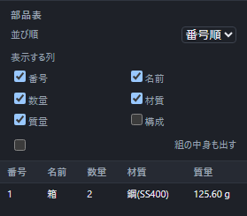

# 部品表を確認する

上の **部品表** を押すと、組み立てに使っている部品が右側の表に出ます。番号、名前、数量、材質、質量から表示する列を選べます。

並び順は番号、名前、数量、質量から選べます。サブアセンブリを1行として数えるか、中の部品まで展開するかも切り替えられます。

表の行を選ぶと対応する部品を画面で確かめられます。抑制した部品は数に含まれません。

## 鋼材・締結の金物・溶接のビードの行

鋼材も、締結で足したボルト・ナット・座金も、溶接のビードも、通常の部品と同じ1行として並びます。

鋼材の名前には鋼種・呼び寸法・長さが入ります(例「SS400 FB 50×6 長さ1000」)。長さや鋼種の列はないので、長さの違う鋼材は別の行になり、同じ鋼材を複数置くと数量に入ります。**{{ui:assembly.bom.column.material}}** の列は鋼種ではなく部品の材質で、S45CやSGPの鋼材でも「{{ui:material.steel}}」と出ます。素材購入長・完成長・総延長は部品表に出ないので、[規格部品を置く](standard-parts.md)の鋼材切断リストで確かめます。

ボルト・ナット・座金は、種類と呼びごとの行です。同じ座金を2枚使えば、数量2の1行になります。溶接のビードは区間ごとの部品で、名前は「すみ肉溶接 6×8 長さ10」のように脚長と長さが入ります。材質は溶接の窓で選んだ材質で、質量はビードの体積にその材質の密度を掛けて求めます。締結や溶接を「元に戻す」と、足した行も一緒に消えます。

## うまくいかないとき

- **表示する列を選んでください。** … 表示する列を1つも選んでいないと出て、表が出ません。列を1つ以上選ぶと表示されます。
- **部品がありません。** … 組み立てに部品を1つも置いていないときに出ます。

並び順・表示する列・組の中身を展開するかの設定は組み立てに保存され、開き直しても保たれます。番号・数量・質量など表の中身は保存せず、開くたびに数え直します。
