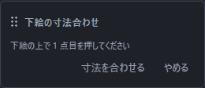
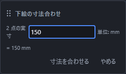
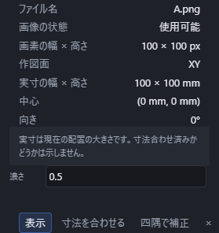

# 下絵を敷く

手描きのスケッチや、写真に撮った図面を作図面に敷いて、その上をなぞって描けます。この敷いた画像を**下絵**と呼びます。

**下絵は形になりません。** 材料にもならず、押し出しても厚みは付かず、体積にも入りません。なぞるための紙だと思ってください。

## 敷きかた

1. 敷きたい作図面(XY・XZ・YZ、または自分で作った作業平面)をツールバーで選びます。
2. ツールバーの「見た目」の一覧を開き、**「下絵」**を押します。
3. 画像のファイルを選びます。

選んだ画像がその作図面に貼られます。**PNG と JPEG が使えます。** 1 枚あたり 8MB までです。

何枚でも敷けます。作図面ごとに違う下絵を敷くこともできます。

## 大きさを合わせる

敷いたばかりの下絵は、実物の寸法とは合っていません。**図面の中で長さの分かっている 2 か所**を使って合わせます。

1. 右の「プロパティ」の**「下絵」**の節で、その下絵の**「寸法を合わせる」**を押します。
2. 画像の上で 1 点目を押します。
3. 2 点目を押します。
4. 出てきた欄に、その **2 点のあいだの実際の長さ**を打って Enter を押します。

下絵ぜんたいが、その長さに合う大きさへ拡大・縮小されます。たとえば「100mm と分かっている辺」の両端を指して `100` と打てば、その2点のあいだが100mmになります。画像のほかの部分も正しい寸法になるかは、元の画像の歪みによります。

**寸法合わせでは縦横の比を保ちます。** 斜め撮影による台形の歪みは、次の「四隅で補正」で別に直せます。

打ち直しは何度でもできます。もう一度「寸法を合わせる」を押せば、点の指定からやり直せます。取り消し(Ctrl+Z)1 回で前の大きさに戻ります。

## 斜め撮影の下絵を四隅で補正する

紙の図面などを斜めから撮って台形に見える場合は、右の「プロパティ」の**「下絵」**の節で、その下絵の**「四隅で補正」**を押します。下絵の写真上で、まっすぐな長方形にしたい領域の**左上、右上、右下、左下**をこの順に押し、「補正する」を押します。指定した四隅の内側が作業平面上の長方形として表示され、外側は表示されません。四隅の間も射影に沿って補正されます。

点を選んでいる間は「やめる」で中止できます。4 点が重なる、一直線に並ぶ、交差する、画像の外にある場合は補正を確定できません。写真を選び直したときも、新しい写真の四隅を選び直してください。

補正は表示の設定です。**元の PNG/JPEG のデータは書き換わりません。**「補正を解除」を押すと画像全体の表示に戻り、取り消し(Ctrl+Z)1 回で直前の補正に戻せます。実物の寸法まで合うとは限らないので、長さの分かっている 2 点で「寸法を合わせる」も行ってください。

## 大きさ・位置の確認と見え方の調整

右の「プロパティ」の「下絵」の節に、敷いてある下絵が並びます。表示される内容と、使える操作は次のとおりです。

| 欄 | 内容・操作 |
|---|---|
| ファイル名 | 読み込んだ画像の名前(読むだけ) |
| 画像の状態 | 読み込み中・使用可能・読込失敗・画像なし |
| 画素の幅 × 高さ | 読み込み後に表示する画像の画素数(px) |
| 作図面 | どの面に貼ってあるか(読むだけ) |
| 実寸の幅 × 高さ | 現在の配置の幅と高さ(mm または in)。変更は「寸法を合わせる」で行います |
| 中心 | 画像の中心の位置(読むだけ) |
| 向き | 作図面の中での角度(読むだけ) |
| 濃さ | 0〜1 を入力し、Enter または欄の外へ移動して確定します |
| 表示 | 一時的に隠します。消したわけではありません |
| × | その下絵を消します(取り消し 1 回で戻ります) |

**画素数は画像の細かさ、実寸は作図面上での大きさです。** 実寸が表示されていても、実物の寸法に合わせた証拠にはなりません。長さの分かっている 2 点で寸法を合わせてください。画像の読み込みが終わるまでは画素数を表示しません。

濃さの空欄や `0.` などの途中入力、日本語の変換中は元の濃さを保ちます。0〜1 の値だけを確定でき、Escape で入力を元に戻せます。確定した変更は Ctrl+Z 1 回で戻ります。

「寸法を合わせる」が使えないときは、その下に出る理由を確認してください。「読み込み中」は完了を待ち、「読込失敗」は **「再試行」** を押します。再試行だけでは下絵の配置や取り消し履歴は変わりません。失敗が続く場合は、元の PNG/JPEG が開けるか確認してから下絵を追加し直してください。「画像なし」は保存ファイルに画像が見つからない状態なので、元の画像を追加し直します。

**下絵をどう直しても、形の計算は走りません。** 濃さを動かしても、隠しても、待たされることはありません。

## なぞって描く

下絵を敷いたら、いつもどおり「線」「円」などの道具で上をなぞります。

**下絵の線には吸着しません。** 画像は絵であって線ではないので、下絵の線の上でぴたりと止まることはありません。代わりに、**方眼への吸着と、すでに描いた点への吸着はそのまま効きます**(「点にぴったり合わせる(吸着)」を見てください)。だいたいの位置をなぞってから、拘束や数値で仕上げるのが確実です。

下絵はスケッチの線より**必ず後ろ**に描かれるので、なぞった線が下絵に隠れることはありません。

## 保存

下絵は画像ごと部品のファイルに入ります。**開き直すと、画像も大きさも向きも濃さもそのまま**です。ほかの人にファイルを渡しても、下絵は一緒に届きます。

そのぶんファイルは画像の大きさだけ大きくなります。要らなくなった下絵を「×」で消して保存すると、その画像は保存したファイルに入りません。「表示」を切っただけの下絵は保存されます。

削除を取り消すときは Ctrl+Z を押します。たとえば A の下絵を削除し、B を追加した後に Ctrl+Z を2回押すと、A の画像と大きさが戻ります。その状態で保存すると、A を含むファイルになります。保存後に開き直すと取り消しの履歴は残らないため、戻したい下絵は開き直す前に取り消してから保存してください。

削除した画像も、取り消しややり直しで戻せる間はメモリーに残ります。履歴の上限を超えたときや、取り消した後に別の編集をしてやり直せなくなったときは、どの履歴からも使われなくなった画像を自動で手放します。表示を切っただけの画像や、まだ戻せる画像は残ります。すでに始まっている保存には影響しません。

## うまくいかないとき

| 出る文 | 直し方 |
|---|---|
| 対応していない画像です。 | PNG か JPEG に変換してから選び直します |
| 画像が大きすぎます。8MB までにしてください。 | 画像の解像度を下げて小さくしてから選び直します |
| 2 つの点が同じ位置です。離れた 2 点を指してください。 | 離れた 2 か所を指し直します |
| 実寸は 0 より大きい長さを入れてください。 | 0 や負の数ではなく、実際の長さを打ちます |

**下絵が見えない**ときは、「表示」が切れているか、濃さが 0 に近いか、別の作図面に貼ってあります。プロパティの一覧で確かめてください。

## 削除と取り消しを試す二つの例

**画像を取り消しで戻す例:** 赤い画像 A と青い画像 B を用意します。A を下絵に追加して寸法を確認し、A を「×」で削除します。B を追加してから、作図画面へ焦点を移して Ctrl+Z を2回押します。A の画像と元の寸法が戻ることを確かめて保存します。保存したファイルを開き直し、A が表示されることを確認します。開き直した後の履歴は新しく始まります。

**削除した画像を保存しない例:** B を下絵に追加してから「×」で削除し、保存します。保存したファイルを開き直し、下絵の一覧と表示に B が残っていないことを確認します。「表示」を切るだけの場合は、画像を残して保存します。表示を戻すと同じ画像を使えます。

この二つの例では、保存する直前の下絵の名前・表示状態・寸法を控え、開き直した後の一覧と表示を比べます。削除した B は「非表示」として残るのではなく、一覧にも画像にも残らないことを確認します。非表示を試す場合は別に保存し、一覧に残った同じ下絵の「表示」を入れて画像が戻ることを確認してください。

取り消しで戻せる画像をメモリーに残すことと、保存ファイルへ画像を入れることは別の扱いです。相手へ渡す前は、実際に保存したファイルを開き直して確認してください。
