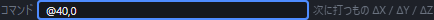

# キーボードだけでかく(コマンドの欄)

画面のいちばん下、ファイル名の右に**細長い入力欄**があります。ここに道具の名前や座標を打って Enter を押すと、マウスに触らずに形をかけます。長い線をきっちりの寸法でかきたいとき、同じ形を続けてかきたいときに、手をキーボードから離さずに済みます。

## 使いはじめ

1. 画面の何もないところ(3D の表示)をクリックしてから、**Space** を押します。欄に文字を打てる状態になります。欄を直接クリックしても同じです。
2. 道具の名前を打って Enter。たとえば `L` と打つと線分の道具になり、「始点」を聞く小さな欄が画面に出ます。
3. 座標を打って Enter。打った値は画面に出ている欄にもそのまま映るので、どちらを見ても同じ値です。
4. **Esc** を押すと欄が空になり、キーの操作が 3D の表示に戻ります。

## 座標の書き方

| 打ち方 | 意味 | 例 |
|---|---|---|
| `10,20` | 作図面の上の座標 | 横 10 mm、縦 20 mm のところ |
| `@40,0` | **直前の点からのずれ** | 直前の点から横へ 40 mm |
| `@30<90` | **直前の点から、距離と角度** | 直前の点から 30 mm、90°(真上)の向き |
| `r=5` | 名前の付いた欄に入れる | 半径を 5 mm にする |

- 数字のかわりに**式**を書けます。`10/2, 3^2` は (5, 9) になり、`root(8,3), 5` は (2, 5) になります。かっこの中のコンマは区切りとして数えません。
- 角度も式で書けます。`@10<45+15` は 60° の向きです。
- 式にパラメータの名前や単位を書いたとき、参照する名前・元の値・使用箇所の数と、誤りの位置は、道具の入力の窓の欄(下端のコマンドの欄ではなく、その場に出る入力欄)の下に出ます。見かたは[数値と式の入れ方](numeric-input.md#正しく書けているかの見かた)を見てください。
- 全角で打った `１０，２０` や `＠５，０` もそのまま受け付けます。
- 3D スケッチ(作図面なし)のときは `10,20,5` のように 3 つ書きます。距離と角度の書き方は、向きの基準になる作図面が無いので使えません。

名前の付いた欄は次の 5 つの頭文字で指せます。

| 打ち方 | 欄 |
|---|---|
| `r=` | 半径 |
| `d=` | 直径 |
| `a=` | 角度 |
| `l=` | 長さ |
| `n=` | 個数 |

**何も打たずに Enter** を押すと、欄に出ている値(空欄なら決められた値)のまま決まります。Enter を続けて押すだけでも形になります。

## 打てる道具の名前

日本語・英語・短縮のどれでも打てます。大文字と小文字は区別しません。

| 道具 | 打てる語 |
|---|---|
| 選択 | `選択` `select` `s` |
| 点 | `点` `point` `po` |
| 線分 | `線分` `line` `l` |
| 円弧 | `円弧` `arc` `a` |
| 点列 | `点列` `pointarray` `pa` |
| 面 | `面` `face` `fa` |
| 円 | `円` `circle` `c` |
| 2点円弧 | `2点円弧` `twopointarc` `ta` |
| 3点の円弧 | `3点の円弧` `threepointarc` `tpa` |
| 矩形 | `矩形` `長方形` `rectangle` `rec` |
| 正多角形 | `正多角形` `多角形` `polygon` `pol` |
| 長穴 | `長穴` `slot` `sl` |
| 楕円 | `楕円` `ellipse` `el` |
| スプライン | `スプライン` `spline` `spl` |
| オフセット | `オフセット` `offset` `o` |
| ミラー | `ミラー` `鏡像` `mirror` `mi` |
| 複写 | `複写` `copy` `co` |
| 直線配列 | `直線配列` `lineararray` `ar` |
| 円形配列 | `円形配列` `circulararray` `par` |
| フィレット | `フィレット` `fillet` `f` |
| 面取り | `面取り` `chamfer` `cha` |
| トリム | `トリム` `trim` `tr` |
| 延長 | `延長` `extend` `ex` |

`c` は円、`co` は複写です(よくある CAD と同じ割り当てにしてあります)。

点・線分・円弧・点列と、作図の道具(円・矩形・正多角形・長穴・楕円・スプラインなど)は、名前を打った時点で最初の欄が開きます。オフセット・ミラー・複写・配列・フィレット・面取り・トリム・延長は、**先にかいたものを選んでから**使う道具なので、名前を打つと道具が切り替わるだけです。対象を選んでから画面の上の一覧で始めてください。

## 立体の道具の名前

部品の画面では、立体の道具も名前で始められます。ツールバーの一覧から選んだ時と同じに始まり、選ぶ物が足りない時は理由が帯に出ます。

| 道具 | 打てる語 |
|---|---|
| 押し出し | `押し出し` `extrude` `ext` |
| 回転 | `回転` `revolve` `rev` |
| 縫合 | `縫合` `sew` |
| 和 | `和` `union` `uni` |
| 差 | `差` `subtract` `sub` |
| 積 | `積` `intersect` `int` |
| 球 | `球` `sphere` `sph` |
| 箱 | `箱` `box` |
| 円柱 | `円柱` `cylinder` `cyl` |
| 円錐 | `円錐` `cone` |
| トーラス | `トーラス` `torus` `tor` |
| 面をつなぐ | `面をつなぐ` `ruled` `rul` |
| ロフト | `ロフト` `loft` |
| ミラー(立体) | `立体のミラー` `mirrorsolid` `ms` |
| スイープ | `スイープ` `sweep` `swe` |
| ばね | `ばね` `spring` `spr` |
| 穴 | `穴` `hole` |
| ねじ穴 | `ねじ穴` `threadhole` `th` |
| R面取り | `R面取り` `solidfillet` `sf` |
| C面取り | `C面取り` `solidchamfer` `sc` |
| 直線パターン | `直線パターン` `linearpattern` `lp` |
| 円形パターン | `円形パターン` `circularpattern` `cp` |
| くり抜き | `くり抜き` `shell` `she` |
| 抜き勾配 | `抜き勾配` `draft` `dra` |
| リブ | `リブ` `rib` |
| 切断 | `切断` `cut` |

## 立体を選ぶ語

`選ぶ` か `sel` の後に、空白で区切って選ぶものを打ちます。

| 打ち方 | 選ぶもの |
|---|---|
| `選ぶ 直前` `sel last` | 最後に作った立体 |
| `選ぶ 全部` `sel all` | 全部の立体(和・差などで使われた立体は数えない) |
| `選ぶ 解除` `sel none` | 選択を外す |

例: `box` → Enter → Enter → `cyl` → Enter → Enter → `sel all` → `uni` で、箱と円柱の和ができます。

## 座標の表を貼る

1 行に `x,y`(3D スケッチでは `x,y,z`)を書いた表をコマンドの欄へ貼ると、点か折れ線を 1 回で作ります。

- 選択か点の道具の時は行ごとに点を、線分の道具の時は行を順につないだ折れ線を作ります。
- 区切りはコンマ・タブ・空白です。1 行目が数でなければ、見出しとして飛ばします。式も使えます。
- 1000 行まで貼れます。読めない行があれば、どれも作らずに、その行の番号と理由を出します。
- 元に戻す 1 回で、表から作った物が全部戻ります。

## 打っている途中の助け

- **候補**: 打ちかけの文字に合う道具の名前が、欄の上に最大 5 つ並びます。`Tab` を押すと 1 つ目が欄に入ります。候補をクリックしても入ります。
- **次に打つもの**: いま何を聞かれているか(「X」「Y」「半径」など)が欄の右に出ます。
- **前に打ったもの**: `↑` `↓` で、直前に打った 20 件をたどれます。同じ寸法をもう一度打つときに便利です。この控えは保存されないので、閉じると消えます。
- 打ち間違えたときは「そのような道具はありません」と下端の帯に出て、近い名前が添えられます。かいたものは変わりません。



## 例: L 字の 2 本の線をかく

```
L        ← 線分の道具にする
0,0      ← 始点
@40,0    ← 右へ 40 mm
@30<90   ← そこから真上へ 30 mm
Esc      ← 終わり
```

## 気をつけること

- 欄に文字を打っている間は、`1`〜`4`(選ぶものの切り替え)などの 3D の表示側のキーは効きません。打った文字がそのまま欄に入ります。
- 欄に文字を打っている状態で 3D の表示をクリックすると、まず**キーの操作が表示側へ戻ります**。そのクリックでは点は置かれないので、続けてもう一度クリックしてください。
- 別のファイルを開いたり新規にしたりすると、欄は空になります。

## うまくいかないとき

| 困りごと | 直し方 |
|---|---|
| 欄に文字を打っても入らない | 3D の表示を一度クリックしてから Space を押すか、欄を直接クリックしてから打ちます |
| 「そのような道具はありません」と出る | 添えられた近い名前を打ち直すか、「打てる道具の名前」の表で綴りを確かめます |
| 座標を打って Enter を押しても点が置かれない | 直前に 3D の表示をクリックしていないか確かめます。そのクリックはキーの操作を表示側へ戻しただけなので、もう一度座標を打ち直してください |
| `1`〜`4` など 3D の表示側のキーが効かない | 欄に文字を打っている間はそちらが優先されます。Esc を押して欄を空にすると表示側のキーに戻ります |
