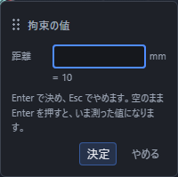
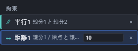

# 形を条件で決める(拘束)

線をかいたあとで「この 2 本は直角」「この線は長さ 40mm」のような条件を付けておくと、形が自動でその条件どおりに整います。あとで 1 か所だけ数を変えても、条件を保ったまま全体が追い直されます。この条件を**拘束**と呼びます。

拘束は**作図面の上のスケッチ**で使えます。3D スケッチでは使えません。

1 つのスケッチで拘束を解ける大きさには上限があります。くわしくは、この章の「大きなスケッチ(1,000 点)と上限」を見てください。

## 拘束を付ける

画面の上のツールバー、「スケッチ」のところに「拘束」のボタンがあります。押すと 18 種類の一覧が出ます。

付け方は 2 通りあり、どちらでも同じ結果になります。

- **先に選んでから**: ビューポートで線や点を選んでおいて、「拘束」から種類を押す。
- **先に道具を選んでから**: 「拘束」から種類を押して、そのあとビューポートで対象を順に押す。

必要な数だけ押すと、その場で拘束が付いて形が整います。もう一度同じところを押すと、その選択だけが外れます。やめたいときは Esc を押してください。

**線の端をねらって押すと、その端の点を指せます。** 線の真ん中あたりを押すと線そのもの、円の中心あたりを押すと中心の点になります。「2 本の線の端どうしをつなぐ」ときは端を押してください。

## 線を引くだけで自動で付く拘束

**線を引いていると、付けたそうな拘束をアプリが見つけて、その場で予告します。** 引き終わった瞬間にその拘束が付くので、あとから同じものを付け直す手間が要りません。

見つけるのは次の 5 つです。

| 拘束 | どんなとき |
|---|---|
| 水平 | ほとんど横向きに引いているとき |
| 垂直 | ほとんど縦向きに引いているとき |
| 一致 | 端が、すでにある点や線の端のすぐそばにあるとき |
| 接線 | 端が円・円弧の上にあり、その丸みに沿って引いているとき |
| 平行 | すぐ近くの線とほとんど同じ向きに引いているとき |

「直角」「同心」「等しい」「対称」は自動では付きません。狙いと違う拘束が付くことが多いためです。これらは「拘束」の一覧から自分で付けてください。

### 予告の印

付きそうな拘束は、その場所に**小さな印**で予告されます。印は 18 種類の拘束と同じ図柄なので、何が付くのかがひと目で分かります。

- 予告は**同時に 2 つまで**です。それ以上は、印が増えすぎて読めなくなるので出しません。
- 予告が出ているときにそのまま点を置くと、その拘束が付きます。
- **要らないときはマウスを少し動かしてください。** 予告が消えれば付きません。

いまのところ、予告が出るのは**線分を引いているとき**だけです。四角や円弧をかいているときは出ません。

### 一時的に止める

**Shift を押している間は、何も推定しません。** 「今回だけは自由に引きたい」というときに使ってください。指を離せばまた推定が始まります。

### 入切

画面いちばん下の帯に**「拘束の推定」**の入切があります。押すと止められ、もう一度押すと戻ります。**はじめは入っています。** 選んだ状態はこの端末に覚えられるので、次に開いたときも同じです。

### 数を打って引いたときは付きません

その場の欄に長さや角度を打ち込んで引いた線には、推定の拘束は付きません。打った数がそのまま形を決めるので、そこへ別の条件を重ねないためです。

## 拘束の種類

| 拘束 | 何を押すか | できること |
|---|---|---|
| 一致 | 点を 2 つ | 2 つの点を同じ場所に重ねる |
| 水平 | 線を 1 本 | 線を作図面の横向きにそろえる |
| 垂直 | 線を 1 本 | 線を作図面の縦向きにそろえる |
| 平行 | 線を 2 本 | 2 本を平行にする |
| 直角 | 線を 2 本 | 2 本を直角にする |
| 接線 | 線を 1 本と円・円弧を 1 つ | 線が円にちょうど触れるようにする |
| 同心 | 円・円弧を 2 つ | 2 つの中心を重ねる |
| 等しい | 線を 2 本、または円を 2 つ | 長さ(または半径)を同じにする |
| 対称 | 点を 2 つと、軸にする線を 1 本 | 線をはさんで向かい合わせにする |
| 固定 | 要素を 1 つ | その場に留めて動かなくする |
| 距離 | 点を 2 つ、または線を 1 本 | 長さを決める |
| 角度 | 線を 2 本 | なす角度を決める |
| 半径 | 円・円弧を 1 つ | 半径を決める |
| 直径 | 円・円弧を 1 つ | 直径を決める |

「固定」は、動かしたくないところを留めておくための拘束です。どこも留めていないと、形は条件を満たしたまま全体が横へずれることがあります。基準にしたい 1 点を固定しておくと落ち着きます。

## ほかの 4 種類の拘束

「拘束」の一覧には、「拘束の種類」の表にあるもののほかに、次の 4 種類があります(合わせて 18 種類)。一覧では、「中点」と「点を直線・円上へ」が「一致」の次に、「水平距離」と「垂直距離」が「距離」の前に並んでいます。付け方は、ここまでと同じ 2 通りです。

| 拘束 | 何を押すか | できること |
|---|---|---|
| 中点 | 点を 1 つと、線を 1 本 | 点を線の真ん中に置く |
| 点を直線・円上へ | 点を 1 つと、線を 1 本または円を 1 つ | 点を、線を延ばした直線の上か、円の線の上に置く |
| 水平距離 | 点を 2 つ、または線を 1 本 | 作図面の横軸に沿った距離を決める |
| 垂直距離 | 点を 2 つ、または線を 1 本 | 作図面の縦軸に沿った距離を決める |

この 4 種類は、線を引いたときに自動では付きません。「拘束」の一覧から自分で付けてください。付けられないときは、画面の下の帯に理由が出ます。付けた直後なら、取り消し(Ctrl+Z)1 回で付ける前の形に戻せます。

### 中点

点を、線の真ん中(両端から同じ距離の場所)に置きます。線や点をかくときに線の真ん中へ合わせる「吸着」の「中点」(「点にぴったり合わせる(吸着)」を見てください)とは別のものです。吸着は点を置く瞬間に位置を合わせるだけですが、この拘束は「点が真ん中にある」という条件を形に残すので、あとで線の端を動かしても、点は真ん中に保たれます。

- **何を押すか**: 点を 1 つと、線を 1 本。押す順番は問いません。点は、ほかの線の端や円の中心でもかまいません。
- **決まること**: 点と線の位置関係だけです。点が線の真ん中に重なり、線の長さや向きは決まりません。
- **数の入力**: ありません。押すとすぐに付きます。
- **付けられないもの**: 長さ 0 の線。まっすぐな線以外(円・円弧・楕円・スプラインなど)。
- **印**: 付くと、脇に「M」の記号が出ます。
- **外すには**: 付けた直後なら、取り消し(Ctrl+Z)1 回で戻ります。あとから外すときは、右のプロパティの「拘束」の一覧で「中点1」のような行の「×」を押します。

### 点を直線・円上へ

点を、線をまっすぐ延ばした直線の上、または円の線の上に置きます。

- **何を押すか**: 点を 1 つと、線を 1 本、または円を 1 つ。押す順番は問いません。円は、円の線のところを押して選びます(円の中心あたりを押すと、中心の点になります)。点は、ほかの線の端やほかの円の中心でもかまいません。
- **決まること**: 線を選んだときは、点がその線を両側へ延ばした直線の上にのります。線の端で止める必要はなく、点は線の外側にあってもかまいません。円を選んだときは、点が円の線の上にのります。どちらも、点が直線や円の線に沿って動けることは変わりません。位置まで決めたいときは、「水平距離」や「距離」などを重ねてください。
- **数の入力**: ありません。押すとすぐに付きます。
- **付けられないもの**: 円弧(一周していないもの)・楕円・スプライン。長さ 0 の線。円の中心にぴったり重なっている点。
- **印**: 付くと、脇に「P」の記号が出ます。
- **外すには**: 付けた直後なら、取り消し(Ctrl+Z)1 回で戻ります。あとから外すときは、右のプロパティの「拘束」の一覧で「点を直線・円上へ1」のような行の「×」を押します。

### 水平距離

2 つの点の位置の差のうち、作図面の横軸に沿った分(XY 面なら X 方向)を決めます。

- **何を押すか**: 点を 2 つ、または線を 1 本。先に線を 1 本だけ選んでから種類を押すと、その線の始点と終点が 2 つの点になります。押す順番に意味があります(下の「正負」を見てください)。
- **決まること**: 2 つの点の、横軸に沿った位置の差だけです。縦軸に沿ったずれは決まりません。2 点の間のまっすぐな長さを決める「距離」や、線を横向きにそろえる「水平」とは別の拘束です。
- **数の入力**: 押すと「拘束の値」の小さな入力が出ます。単位は mm です。何も入れずに Enter を押すと、いまの形から測った値になります(いまの形のまま固まります)。式や名前を付けた数値も使えます(次の「数を決める拘束」と同じです)。Esc を押すと、何も付けずにやめます。
- **正負**: 値は、2 つ目に選んだ点の位置から、1 つ目に選んだ点の位置を引いたものです。2 つ目の点が横軸のプラスの向き(XY 面なら X が大きいほう)にあればプラス、反対側にあればマイナスの値になります。「距離」と違って、0 やマイナスの数も入れられます。0 を入れると、2 つの点が作図面の縦向きに並びます。たとえば XY 面で、X が 3 の点 A と X が -2 の点 B を、A → B の順に選ぶと -5、B → A の順に選ぶと 5 です。
- **付けられないもの**: 「点を 2 つ、または線を 1 本」以外の組み合わせ。線そのものを 2 本選んだり、円・円弧・楕円・スプラインそのものを選んだりはできません(円・円弧・楕円は中心の点なら使えます)。
- **印**: 付くと、2 つの点の脇に「dU」の記号が出ます。
- **外すには**: 付けた直後なら、取り消し(Ctrl+Z)1 回で戻ります。あとから外すときは、右のプロパティの「拘束」の一覧で「水平距離1」のような行の「×」を押します。同じ行の数の欄を書き換えると、値だけを直せます。

### 垂直距離

2 つの点の位置の差のうち、作図面の縦軸に沿った分(XY 面なら Y 方向)を決めます。

- **何を押すか**: 点を 2 つ、または線を 1 本。先に線を 1 本だけ選んでから種類を押すと、その線の始点と終点が 2 つの点になります。押す順番に意味があります(下の「正負」を見てください)。
- **決まること**: 2 つの点の、縦軸に沿った位置の差だけです。横軸に沿ったずれは決まりません。2 点の間のまっすぐな長さを決める「距離」や、線を縦向きにそろえる「垂直」とは別の拘束です。
- **数の入力**: 押すと「拘束の値」の小さな入力が出ます。単位は mm です。何も入れずに Enter を押すと、いまの形から測った値になります(いまの形のまま固まります)。式や名前を付けた数値も使えます(次の「数を決める拘束」と同じです)。Esc を押すと、何も付けずにやめます。
- **正負**: 値は、2 つ目に選んだ点の位置から、1 つ目に選んだ点の位置を引いたものです。2 つ目の点が縦軸のプラスの向き(XY 面なら Y が大きいほう)にあればプラス、反対側にあればマイナスの値になります。「距離」と違って、0 やマイナスの数も入れられます。0 を入れると、2 つの点が作図面の横向きに並びます。たとえば XY 面で、Y が 4 の点 A と Y が 7 の点 B を、A → B の順に選ぶと 3、B → A の順に選ぶと -3 です。
- **付けられないもの**: 「点を 2 つ、または線を 1 本」以外の組み合わせ。線そのものを 2 本選んだり、円・円弧・楕円・スプラインそのものを選んだりはできません(円・円弧・楕円は中心の点なら使えます)。
- **印**: 付くと、2 つの点の脇に「dV」の記号が出ます。
- **外すには**: 付けた直後なら、取り消し(Ctrl+Z)1 回で戻ります。あとから外すときは、右のプロパティの「拘束」の一覧で「垂直距離1」のような行の「×」を押します。同じ行の数の欄を書き換えると、値だけを直せます。

## 数を決める拘束

距離・水平距離・垂直距離・角度・半径・直径の 6 つは、押したあとに数を聞く小さな入力が出ます。**何も入れずに Enter を押すと、いまの形をそのまま測った値**になります(いまの形のまま固まります)。水平距離と垂直距離の値は mm で、2 つ目に選んだ点の位置から 1 つ目に選んだ点の位置を引いたものなので、0 やマイナスの数も入れられます(くわしくは上の「水平距離」「垂直距離」を見てください)。

欄には式も書けます。`40/2` のような計算も、名前を付けた数値(「名前を付けた数値(パラメータ)」を見てください)もそのまま使えます。名前で書いておくと、表の 1 か所を変えるだけで形が追い直されます。

## 付いている拘束を見る

拘束が付くと、その要素の脇に小さな記号が出ます。記号は視点を回しても正面を向き、拡大しても同じ大きさで読めます。

| 記号 | 拘束 | 記号 | 拘束 |
|---|---|---|---|
| ● | 一致 | ▣ | 固定 |
| H | 水平 | ↔ | 距離 |
| V | 垂直 | ∠ | 角度 |
| ∥ | 平行 | R | 半径 |
| ⊥ | 直角 | ⌀ | 直径 |
| ⌒ | 接線 | ◎ | 同心 |
| = | 等しい | ⇔ | 対称 |
| M | 中点 | dU | 水平距離 |
| P | 点を直線・円上へ | dV | 垂直距離 |

記号の色で状態が分かります。

- ふつうの色: その条件は満たされています。
- 薄い色: 付けすぎです。ほかの拘束で同じことが決まっているので、消してかまいません。
- 赤: ほかの拘束と同時には成り立ちません。値を直すか、どれかを消してください(指している要素が消えた拘束も赤で出ます)。
- 別の色(固定): その要素はその場に留められていて、動きません。

記号を押すと、右のプロパティに出ている一覧でその拘束が選ばれます。

**同じ場所に複数の記号が重なるときは、横に少しずつずらして並びます。** 重なったままだと下の記号が押せなくなるため、ずらして全部を選べるようにしています。

## 完全に決まった要素の色

位置が 1 通りに決まった要素は、選んだりホバーしたりしていないとき、落ち着いた緑系の色で描かれます。ふつうの要素の色と見分けが付き、「あとどこか動くところが残っているか」がひと目で分かります。表示テーマを変えても、読みやすい濃さの緑になります。

緑になるのは、次のどちらかの点・線・円弧・楕円・スプラインです。

- 動かせる数が 1 つも無いもの(座標や半径をすべて式で書いた、「固定」を付けた、など)
- スケッチ全体で「すべて決まりました」になっているときの、すべての点・線・円弧・楕円・スプライン

一部だけが拘束で決まっていて、ほかに自由なところが残っているスケッチでは、決まっている側もふつうの色のままです。決まっていないものを、決まったように見せないためです。矩形・正多角形・長穴・点列・オフセット・複製・投影・断面や面は、もとの数値をいつでも書き換えられるので、緑になりません。

## 一覧で直す・消す

右のプロパティに「拘束」の一覧が出ます。1 行が 1 つの拘束で、記号・名前・何を指しているか、そして数を持つ拘束は値が並びます。

- **行を押す**: ビューポートのその記号が大きくなり、どこの拘束かが分かります。
- **値を書き換える**: 数の欄に打ち直すと、その場で形が追い直されます。式も書けます。
- **「×」を押す**: その拘束が消え、形がその条件から自由になります。取り消し(Ctrl+Z)1 回で戻せます。

**線や円を消すと、それを指していた拘束も一緒に消えます。** 消えた要素を指したままの拘束が残らないようにするためです。これも取り消し 1 回で元へ戻ります。

## あと何か所決まっていないか

「選択」の道具を使っているとき、画面の下の帯に、いまのスケッチの決まり具合が出ます。

- 「あと N か所決まっていません」: まだ自由に動けるところが N か所あります。N は点の数ではなく、位置や半径を決める数で数えた残りです(点 1 つで 2、円の半径で 1)。何も拘束のない線分 1 本なら 4 です。
- 「すべて決まりました」: 形が 1 通りに決まりました。
- 「付けすぎの拘束が N 件あります」: 同じことを 2 度言っている拘束があります。薄い記号の拘束を消せます。
- 条件どうしがぶつかっているとき: 帯が赤くなり、ぶつかっている拘束の名前つきで「直角1 と 平行1 は同時には成り立ちません。」のように理由が出ます。赤い記号の拘束を直してください。

条件がぶつかっていても、形が消えることはありません。解けなかったときは、計算が最後にたどり着いた形(条件にいちばん近づいた形)のまま画面に残るので、落ち着いて値を直せます。ほかの理由の文は、この章の「解けないときに出る文」にまとめています。

## 引っぱって形を変える

**選択の道具で点をつまんで動かすと、条件を保ったまま形が追い直されます。** 数を打ち直さずに、だいたいの形を手で決めたいときに使ってください。

- つまめるのは**点・線の端・円や円弧の中心**です。線の端から 12 画素ほどの範囲を押すと、その端をつまめます。
- 押したまま動かすと、条件を満たす範囲で形が付いてきます。ほかの点も、条件でつながっていれば一緒に動きます。大きなスケッチでは、動かしている途中の見た目の更新が遅れます(この章の「大きなスケッチ(1,000 点)と上限」を見てください)。
- **離したところで決まります。** 離した位置の計算が終わると、つながって動いた点の座標もまとめて新しい位置に書き換わります。書き換わるのは 1 回だけで、取り消し(Ctrl+Z)1 回で、つまむ前の形に戻ります。小さなスケッチではほぼ同時ですが、大きなスケッチでは計算が終わるまで待つことがあります。
- 途中でやめたいときは、離す前に **Esc** を押してください。形はつまむ前に戻り、文書にも取り消しの履歴にも何も残りません。
- 「吸着」を入にしているときは、動かしている間も、ほかの点や方眼に**吸い付きます**(合わせる先は、吸着の種別で選んだものです)。向きの案内線は出ません(引いている線が無いためです)。

引っぱっている間は、条件を先に満たしたうえで、まだ動ける余地のぶんだけ指の位置へ寄っていきます。たとえば「水平」を付けた線の端を斜めに引くと、線は水平のまま上下に動きます。「長さ 40mm」を付けた線の端を遠くへ引いても、線は 40mm のままです。もう一方の端が「固定」されていれば向きだけが変わり、固定されていなければ、もう一方の端も付いてきます。**条件が届かないところを指したときは、いちばん近いところで止まります。** そのあいだ、動かしている最中の見た目だけは、条件が少しゆるむことがあります(20mm 行き過ぎて引いたとき、長さが 0.002mm ほど伸びた測定があります)。離すと条件で解き直すので、ゆるみは残りません。

条件どうしがぶつかっているスケッチや、遠くへ引きすぎたときは、条件を満たしきれないことがあります。計算が終わらなかったときは、引っぱりを取りやめて形をつまむ前に戻し、文書と取り消しの履歴は変えずに、帯に次の文を出します。

> {{ui:statusBar.dragError}} {{ui:drag.error.solveFailed}}

拘束をまだ 1 つも付けていないスケッチでも、同じ操作で点を動かせます。

### つまめない点

次の点はつまめません。押すと、画面の下の帯に理由が出ます。

| つまめない点 | 帯に出ること | どうすれば動かせるか |
|---|---|---|
| 座標を式で書いた点(「相対」「極」の欄に式がある点も含む) | この点は式で決まっています | 座標をふつうの数に直す |
| 「固定」を付けた点 | この点は「固定」で留められています | 固定を外す |
| 点列・複製・オフセットなどで作られた点 | この点は決まりから作られています | もとの数値(間隔・個数など)を書き換える |
| 円・円弧の端 | 円弧の端は中心と半径から決まります | 中心をつまむ、または半径を書き換える |
| 3D スケッチの点 | 3D スケッチでは引っぱって形を変えられません | 作図面の上のスケッチで使う |

**位置を「相対」や「極」(基準からのずれ)で書いた点も、数で書いてあれば、そのままつまめます。** 線分の終点は、はじめは「直前の点からのずれ」で決まっていますが、そのままつまめます。離すと、ずれの数字だけが新しい位置に書き換わり、指定は「相対」「極」のまま残ります(「絶対」には変わりません)。帯に「この点は基準からのずれで書かれています」と出るのは、その点が作図面の上に乗っていないとき(作図面から浮いた点や、別の作図面の点)です。

## 拘束で決まった、いまの位置

拘束を付けたり値を書き換えたりして要素の位置が動くと、右のプロパティの座標欄の**下**に

> = (10, 6, 0)(拘束で決まった値)

のように、いま実際にある位置が別行で出ます。上の欄そのもの(打ち込んだ数や式)は変わりません。両方の数が違って見えるのは、欄が「打ち込んだ値」を、下の行が「拘束で整えたあとの値」を表しているからです。細かすぎる桁は読みやすいように丸めて出します。動いていないときは、この行は出ません。

## 大きなスケッチ(1,000 点)と上限

拘束を解く計算には、扱える大きさの上限があります。この節では、上限の数え方、超えたときに起きること、解けないときに出る文、1,000 点の例での速さ、拘束を付けられる要素、取り消しと式の扱いを説明します。

### 上限は「動かせる数」で数えます

拘束を解くときは、動かしてよい数(座標と半径)を数えます。点 1 つの位置は横と縦の 2 つで決まるので、点 1 つが 2 です。**上限は 2,000 個**で、点だけなら 1,000 点ぶんです。画面の文にある「1000 点」は、この 2,000 個を 2 で割った数です。

| 要素 | 数える個数 |
|---|---|
| 点 | 2 |
| 線分(始点と終点) | 4 |
| 円(中心と半径) | 3 |
| 円弧(中心・半径・始点・終点) | 7 |
| 楕円(中心・長半径・短半径) | 4 |

線分や円弧が混ざると、点の数より個数のほうが多くなります。線分だけなら 500 本までで、501 本で上限を超えます。線分の端どうしを「一致」でつないでも、端点は線分ごとに数えます。

次のものは、動かせないので数えません。拘束でも動きません。

- 座標や半径を式で書いたもの(座標のどれか 1 つが式なら、その点の 2 つとも数えません)
- 「固定」を付けた点
- 点列・複製・矩形・正多角形・長穴・オフセット・投影などの規則から作られた点
- 別の作図面の要素

この上限は、拘束を解くときにかかります。拘束を 1 つも付けていないスケッチは、解かずにそのまま描きます。

### 上限を超えたとき

動かせる数が 2,000 個を超えたスケッチに拘束があると、拘束は**解かれません**。形は拘束を付ける前のまま(拘束を無視した形)で描かれ、画面の下の帯が赤くなって、次の文が出ます(頭に「{{ui:statusBar.error}}」が付きます)。

> 拘束を付けられる要素が多すぎます(上限 1000 点)。スケッチを分けてください。

付けた拘束は消えません。このとき、拘束の記号はふつうの色のままですが、条件は満たされていません。スケッチを分けるなどして、動かせる数を上限以下にすると、また解かれます。

### 解けないときに出る文

解けない理由は、画面の下の帯と、プロパティの「拘束」の一覧に出ます。次の表は、画面に出る文のとおりです(○○・△△ には拘束の名前、N には数が入ります)。帯では、複数の文が「。」でつながって並ぶことがあります。

| 状況 | 帯に出る文 |
|---|---|
| まだ動かせるところが残っている | あと N か所決まっていません |
| 形が 1 通りに決まった | すべて決まりました |
| 同じことを 2 度言っている拘束がある | 付けすぎの拘束が N 件あります |
| 条件どうしがぶつかっている | ○○ と △△ は同時には成り立ちません。 |
| ぶつかる相手を挙げられない | ○○ は、いまの形では成り立ちません。 |
| 計算が答えに届かず、原因の拘束も絞れない | 拘束を満たす形が見つかりませんでした。拘束をいくつか外して試してください。 |
| 診断が終わらなかった | 拘束の階数を確定できませんでした。診断は未完了です |
| 指している要素が消えた | ○○が指している要素が見つかりません。要素が消されたか、別の作図面にあります。 |
| 長さ 0 の線や重なった点などに付けた | ○○は、長さ 0 の線分・重なった点・半径 0 の円には付けられません。 |
| 選んだ要素の組み合わせに付けられない | ○○は、選んだ要素の組み合わせには付けられません。 |

帯が赤くなるのは、失敗にあたる文(ぶつかる、満たせない、診断が終わらない、要素が見つからない、付けられない、上限を超えた)のときで、文の頭に「{{ui:statusBar.error}}」が付きます。失敗が 2 件以上あるときは、「計算に失敗しました(2 件):」のように件数が付き、先頭の理由だけが出ます。「あと N か所…」「すべて決まりました」「付けすぎ…」は失敗ではないので、赤くなりません。

- 原因として挙げる(赤く示す)拘束は、最大 3 件までです。すべての原因を挙げるとは限りません。
- プロパティの「拘束」の一覧では、その行にカーソルを重ねると、状態が一言で出ます。「{{ui:constraint.state.conflicting}}」「{{ui:constraint.state.redundant}}」「{{ui:constraint.state.dangling}}」の 3 つです。「{{ui:constraint.state.dangling}}」の行も、ぶつかっている行と同じ赤で出ます。
- 引っぱっている間は診断を出さず、離したあとの計算で出します。引っぱるたびに帯が赤くならないようにするためです。

### 1,000 点の例での速さ

1,000 点のスケッチで、実際に点を引っぱって測った値です。測ったのは、開発に使っている 1 台の Windows 11 のパソコン(ARM64、Snapdragon X Elite の 12 コア、メモリ約 32GB)で、Web版とデスクトップ版の画面の検査を実行したときです(2026 年 10 月 27 日の検査の記録)。お使いのパソコンでは変わります。

測った例は、点 1,000 個を、距離 1,997 本と縦距離 1 本(合わせて拘束 1,998 本)でつないだスケッチです。全体が 1 つの固い形で、決まっていないのは、横と縦の平行移動の 2 か所だけです。1 点をつまんで (0, 0) から (-20, -20) へ 10 回に分けて動かし、離しました。

| 測ったもの | Web版 | デスクトップ版 |
|---|---|---|
| 離してから、文書へ書き込まれて確定するまで | 0.104 秒 | 0.038 秒 |
| 動かしている間の、入力から形を描き終えるまで | 0.207〜0.444 秒(描かれたのは 3 回) | 0.166 秒(描かれたのは 1 回) |

「描き終えるまで」は、形を描く処理が終わった時刻までで、画面に映る時刻ではありません。どちらも、保存した座標は 1,000 点が同じだけ (-20, -20) へ動いた形で、1,998 本の長さの食い違いは 1e-9mm 以内でした。確定のあとには、文書全体の計算し直しが続きます。その時間は、この表に含まれません。

この例は、点を距離だけでつないだ、平行移動しかできない形です。このような形では、答えの見当を最初から付けられる場合があり、その場合は速く終わります。線分や円が混ざった形や、距離以外の拘束が混ざった形、形が大きく変わる計算には、この近道は使えません。たとえば、出発点が答えから少しずれた 1,000 点・2,000 個の例を解き直す計算(画面を使わない検査)は、同じパソコンで 7〜10 秒かかりました(3 回の測定で 10.2 秒・7.2 秒・9.1 秒。2026 年 10 月 24 日の測定)。

動かしている途中の見た目は、新しい位置の計算が終わるたびにしか更新されないので、大きなスケッチでは追従が遅れます。計算に時間がかかっている間でも、Esc で取りやめられます。上の例では、計算の途中で Esc を押してから、取りやめた形が描かれるまで 1 秒以内でした。

### 拘束を付けられる要素と、付けられない操作

拘束を付けられるのは、同じスケッチの**点・線分・円・円弧・楕円**です。円・円弧・楕円は、半径・直径・等しい・同心・接線では同じ「円」として扱われ、楕円では中心と長半径が対象になります。スプラインに付けられるのは「固定」だけです。

次の場合は、押したときに帯に理由が出て(頭に「{{ui:statusBar.constraintError}}」が付きます)、拘束は付きません。

| 付けられないもの | 帯に出る文 |
|---|---|
| 矩形・正多角形・長穴・オフセット・複製・投影のように、1 つの要素がいくつもの線を作るもの、および面 | {{ui:constraint.error.unsupportedElement}} |
| 3D スケッチの要素 | {{ui:constraint.error.freeSketch}} |
| 別のスケッチの要素 | {{ui:constraint.error.otherSketch}} |
| 動かせる数が 1 つも無い要素(座標がすべて式の線や、「固定」した点だけを選んだとき) | {{ui:constraint.error.allFrozen}} |

「接線」は、線分を両側へ延ばした直線と、円の線全体との条件です。線分の端や、円弧・楕円の形の範囲は見ません。そのため、接する点が線分や円弧の外にできることがあります。楕円は長半径の円として扱うので、細長い楕円に付けても、線が楕円に触れるとは限りません。

次のような拘束は用意していません。点と線の距離、2 つの円や円弧どうしの接線、長さの比や差、スプラインの接線のつながり、3D の拘束です。

### 取り消しと式

- **取り消し**: つまんで離した結果は、取り消し(Ctrl+Z)1 回でつまむ前の形にまとめて戻り、やり直し(Ctrl+Y)で同じ形に進みます。1,000 点の例でも同じで、取り消しとやり直しを 10 往復しても、文書・拘束・参照は元のままでした(検査で確認)。
- **取りやめ**: 離す前に Esc を押したとき、別の点をつかみ直したとき、別の文書に切り替えたとき、計算が失敗したときは、文書も取り消しの履歴も変わりません。
- **保存と開き直し**: 拘束と、寸法の式は、そのまま保存されます。開き直すと、保存された拘束から同じ形に解き直します。1,000 点の例では、保存して開き直しても、各点の座標は元の形から 1e-6mm 以内、距離の食い違いは 1e-9mm 以内でした。拘束が 14 種類だった頃の保存ファイルでも、同じ確認をしています。
- **式**: 寸法の値は式のまま保存されます。たとえば距離に `6+4` と書くと、値は 10 として解かれ、保存して開き直しても `6+4` のまま残って、同じ形になります。名前を付けた数値を使うと、表の値を変えるだけで形が追い直されます(「数を決める拘束」を見てください)。座標を式で書いた点は、拘束では動かず、上限にも数えません。

### 他の CAD との照合

水平と長さで決まる線、2 つの距離で決まる点、固定した線の中点という 3 つの小さな入力を、FreeCAD 1.0.2・SolveSpace 3.1・PointerCAD の拘束を解く計算に同じ条件で解かせ、答えを比べました。3 つの答えは、式で求めた座標と 1e-6mm 以内(最大の差は 3.1e-11mm)で一致し、残る動かせるところ(自由度)はどれも 0 でした。確かめたのはこの 3 つの小さな例だけです。ほかの拘束、1,000 点の速さ、操作のしやすさが同じだとは言えません。

## うまくいかないとき

- **帯に「拘束を付けられる要素が多すぎます」と出る**: 動かせる数が上限を超えています。この章の「大きなスケッチ(1,000 点)と上限」を見てください。
- **拘束を押しても何も起きない**: 帯に理由が出ています。「線を 2 本選んでください。」のように、何を押せばよいかが書かれています。
- **形が動かない**: その要素の位置が式で書かれているか、「固定」が付いています。式で書いた座標は拘束より優先され、拘束では動きません。位置を拘束にまかせたいときは、座標をふつうの数に直してください。
- **3D スケッチで使えない**: 「水平」「直角」は面の中でしか意味が決まらないため、作図面のあるスケッチでだけ使えます。
