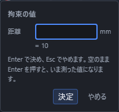
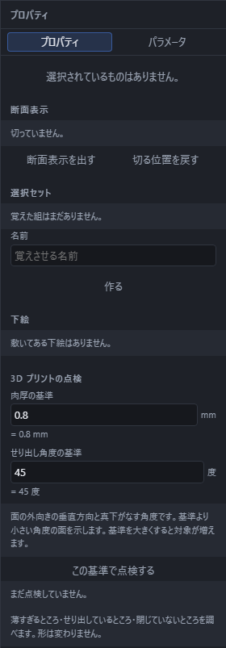

# 形を条件で決める(拘束)

線をかいたあとで「この 2 本は直角」「この線は長さ 40mm」のような条件を付けておくと、形が自動でその条件どおりに整います。あとで 1 か所だけ数を変えても、条件を保ったまま全体が追い直されます。この条件を**拘束**と呼びます。

拘束は**作図面の上のスケッチ**で使えます。3D スケッチでは使えません。

## 拘束を付ける

画面の上のツールバー、「スケッチ」のところに「拘束」のボタンがあります。押すと 18 種類の一覧が出ます。

付け方は 2 通りあり、どちらでも同じ結果になります。

- **先に選んでから**: ビューポートで線や点を選んでおいて、「拘束」から種類を押す。
- **先に道具を選んでから**: 「拘束」から種類を押して、そのあとビューポートで対象を順に押す。

必要な数だけ押すと、その場で拘束が付いて形が整います。もう一度同じところを押すと、その選択だけが外れます。やめたいときは Esc を押してください。

**線の端をねらって押すと、その端の点を指せます。** 線の真ん中あたりを押すと線そのもの、円の中心あたりを押すと中心の点になります。「2 本の線の端どうしをつなぐ」ときは端を押してください。

## 線を引くだけで自動で付く拘束

**線を引いていると、付けたそうな拘束をアプリが見つけて、その場で予告します。** 引き終わった瞬間にその拘束が付くので、あとから同じものを付け直す手間が要りません。

見つけるのは次の 5 つです。

| 拘束 | どんなとき |
|---|---|
| 水平 | ほとんど横向きに引いているとき |
| 垂直 | ほとんど縦向きに引いているとき |
| 一致 | 端が、すでにある点や線の端のすぐそばにあるとき |
| 接線 | 端が円・円弧の上にあり、その丸みに沿って引いているとき |
| 平行 | すぐ近くの線とほとんど同じ向きに引いているとき |

「直角」「同心」「等しい」「対称」は自動では付きません。狙いと違う拘束が付くことが多いためです。これらは「拘束」の一覧から自分で付けてください。

### 予告の印

付きそうな拘束は、その場所に**小さな印**で予告されます。印は 18 種類の拘束と同じ図柄なので、何が付くのかがひと目で分かります。

- 予告は**同時に 2 つまで**です。それ以上は、印が増えすぎて読めなくなるので出しません。
- 予告が出ているときにそのまま点を置くと、その拘束が付きます。
- **要らないときはマウスを少し動かしてください。** 予告が消えれば付きません。

いまのところ、予告が出るのは**線分を引いているとき**だけです。四角や円弧をかいているときは出ません。

### 一時的に止める

**Shift を押している間は、何も推定しません。** 「今回だけは自由に引きたい」というときに使ってください。指を離せばまた推定が始まります。

### 入切

画面いちばん下の帯に**「拘束の推定」**の入切があります。押すと止められ、もう一度押すと戻ります。**はじめは入っています。** 選んだ状態はこの端末に覚えられるので、次に開いたときも同じです。

### 数を打って引いたときは付きません

その場の欄に長さや角度を打ち込んで引いた線には、推定の拘束は付きません。打った数がそのまま形を決めるので、そこへ別の条件を重ねないためです。

## 拘束の種類

| 拘束 | 何を押すか | できること |
|---|---|---|
| 一致 | 点を 2 つ | 2 つの点を同じ場所に重ねる |
| 水平 | 線を 1 本 | 線を作図面の横向きにそろえる |
| 垂直 | 線を 1 本 | 線を作図面の縦向きにそろえる |
| 平行 | 線を 2 本 | 2 本を平行にする |
| 直角 | 線を 2 本 | 2 本を直角にする |
| 接線 | 線を 1 本と円・円弧を 1 つ | 線が円にちょうど触れるようにする |
| 同心 | 円・円弧を 2 つ | 2 つの中心を重ねる |
| 等しい | 線を 2 本、または円を 2 つ | 長さ(または半径)を同じにする |
| 対称 | 点を 2 つと、軸にする線を 1 本 | 線をはさんで向かい合わせにする |
| 固定 | 要素を 1 つ | その場に留めて動かなくする |
| 距離 | 点を 2 つ、または線を 1 本 | 長さを決める |
| 角度 | 線を 2 本 | なす角度を決める |
| 半径 | 円・円弧を 1 つ | 半径を決める |
| 直径 | 円・円弧を 1 つ | 直径を決める |

「固定」は、動かしたくないところを留めておくための拘束です。どこも留めていないと、形は条件を満たしたまま全体が横へずれることがあります。基準にしたい 1 点を固定しておくと落ち着きます。

## ほかの 4 種類の拘束

「拘束」の一覧には、「拘束の種類」の表にあるもののほかに、次の 4 種類があります(合わせて 18 種類)。一覧では、「中点」と「点を直線・円上へ」が「一致」の次に、「水平距離」と「垂直距離」が「距離」の前に並んでいます。付け方は、ここまでと同じ 2 通りです。

| 拘束 | 何を押すか | できること |
|---|---|---|
| 中点 | 点を 1 つと、線を 1 本 | 点を線の真ん中に置く |
| 点を直線・円上へ | 点を 1 つと、線を 1 本または円を 1 つ | 点を、線を延ばした直線の上か、円の線の上に置く |
| 水平距離 | 点を 2 つ、または線を 1 本 | 作図面の横軸に沿った距離を決める |
| 垂直距離 | 点を 2 つ、または線を 1 本 | 作図面の縦軸に沿った距離を決める |

この 4 種類は、線を引いたときに自動では付きません。「拘束」の一覧から自分で付けてください。付けられないときは、画面の下の帯に理由が出ます。付けた直後なら、取り消し(Ctrl+Z)1 回で付ける前の形に戻せます。

### 中点

点を、線の真ん中(両端から同じ距離の場所)に置きます。線や点をかくときに線の真ん中へ合わせる「吸着」の「中点」(「点にぴったり合わせる(吸着)」を見てください)とは別のものです。吸着は点を置く瞬間に位置を合わせるだけですが、この拘束は「点が真ん中にある」という条件を形に残すので、あとで線の端を動かしても、点は真ん中に保たれます。

- **何を押すか**: 点を 1 つと、線を 1 本。押す順番は問いません。点は、ほかの線の端や円の中心でもかまいません。
- **決まること**: 点と線の位置関係だけです。点が線の真ん中に重なり、線の長さや向きは決まりません。
- **数の入力**: ありません。押すとすぐに付きます。
- **付けられないもの**: 長さ 0 の線。まっすぐな線以外(円・円弧・楕円・スプラインなど)。
- **印**: 付くと、脇に「M」の記号が出ます。
- **外すには**: 付けた直後なら、取り消し(Ctrl+Z)1 回で戻ります。あとから外すときは、右のプロパティの「拘束」の一覧で「中点1」のような行の「×」を押します。

### 点を直線・円上へ

点を、線をまっすぐ延ばした直線の上、または円の線の上に置きます。

- **何を押すか**: 点を 1 つと、線を 1 本、または円を 1 つ。押す順番は問いません。円は、円の線のところを押して選びます(円の中心あたりを押すと、中心の点になります)。点は、ほかの線の端やほかの円の中心でもかまいません。
- **決まること**: 線を選んだときは、点がその線を両側へ延ばした直線の上にのります。線の端で止める必要はなく、点は線の外側にあってもかまいません。円を選んだときは、点が円の線の上にのります。どちらも、点が直線や円の線に沿って動けることは変わりません。位置まで決めたいときは、「水平距離」や「距離」などを重ねてください。
- **数の入力**: ありません。押すとすぐに付きます。
- **付けられないもの**: 円弧(一周していないもの)・楕円・スプライン。長さ 0 の線。円の中心にぴったり重なっている点。
- **印**: 付くと、脇に「P」の記号が出ます。
- **外すには**: 付けた直後なら、取り消し(Ctrl+Z)1 回で戻ります。あとから外すときは、右のプロパティの「拘束」の一覧で「点を直線・円上へ1」のような行の「×」を押します。

### 水平距離

2 つの点の位置の差のうち、作図面の横軸に沿った分(XY 面なら X 方向)を決めます。

- **何を押すか**: 点を 2 つ、または線を 1 本。先に線を 1 本だけ選んでから種類を押すと、その線の始点と終点が 2 つの点になります。押す順番に意味があります(下の「正負」を見てください)。
- **決まること**: 2 つの点の、横軸に沿った位置の差だけです。縦軸に沿ったずれは決まりません。2 点の間のまっすぐな長さを決める「距離」や、線を横向きにそろえる「水平」とは別の拘束です。
- **数の入力**: 押すと「拘束の値」の小さな入力が出ます。単位は mm です。何も入れずに Enter を押すと、いまの形から測った値になります(いまの形のまま固まります)。式や名前を付けた数値も使えます(次の「数を決める拘束」と同じです)。Esc を押すと、何も付けずにやめます。
- **正負**: 値は、2 つ目に選んだ点の位置から、1 つ目に選んだ点の位置を引いたものです。2 つ目の点が横軸のプラスの向き(XY 面なら X が大きいほう)にあればプラス、反対側にあればマイナスの値になります。「距離」と違って、0 やマイナスの数も入れられます。0 を入れると、2 つの点が作図面の縦向きに並びます。たとえば XY 面で、X が 3 の点 A と X が -2 の点 B を、A → B の順に選ぶと -5、B → A の順に選ぶと 5 です。
- **付けられないもの**: 「点を 2 つ、または線を 1 本」以外の組み合わせ。線そのものを 2 本選んだり、円・円弧・楕円・スプラインそのものを選んだりはできません(円・円弧・楕円は中心の点なら使えます)。
- **印**: 付くと、2 つの点の脇に「dU」の記号が出ます。
- **外すには**: 付けた直後なら、取り消し(Ctrl+Z)1 回で戻ります。あとから外すときは、右のプロパティの「拘束」の一覧で「水平距離1」のような行の「×」を押します。同じ行の数の欄を書き換えると、値だけを直せます。

### 垂直距離

2 つの点の位置の差のうち、作図面の縦軸に沿った分(XY 面なら Y 方向)を決めます。

- **何を押すか**: 点を 2 つ、または線を 1 本。先に線を 1 本だけ選んでから種類を押すと、その線の始点と終点が 2 つの点になります。押す順番に意味があります(下の「正負」を見てください)。
- **決まること**: 2 つの点の、縦軸に沿った位置の差だけです。横軸に沿ったずれは決まりません。2 点の間のまっすぐな長さを決める「距離」や、線を縦向きにそろえる「垂直」とは別の拘束です。
- **数の入力**: 押すと「拘束の値」の小さな入力が出ます。単位は mm です。何も入れずに Enter を押すと、いまの形から測った値になります(いまの形のまま固まります)。式や名前を付けた数値も使えます(次の「数を決める拘束」と同じです)。Esc を押すと、何も付けずにやめます。
- **正負**: 値は、2 つ目に選んだ点の位置から、1 つ目に選んだ点の位置を引いたものです。2 つ目の点が縦軸のプラスの向き(XY 面なら Y が大きいほう)にあればプラス、反対側にあればマイナスの値になります。「距離」と違って、0 やマイナスの数も入れられます。0 を入れると、2 つの点が作図面の横向きに並びます。たとえば XY 面で、Y が 4 の点 A と Y が 7 の点 B を、A → B の順に選ぶと 3、B → A の順に選ぶと -3 です。
- **付けられないもの**: 「点を 2 つ、または線を 1 本」以外の組み合わせ。線そのものを 2 本選んだり、円・円弧・楕円・スプラインそのものを選んだりはできません(円・円弧・楕円は中心の点なら使えます)。
- **印**: 付くと、2 つの点の脇に「dV」の記号が出ます。
- **外すには**: 付けた直後なら、取り消し(Ctrl+Z)1 回で戻ります。あとから外すときは、右のプロパティの「拘束」の一覧で「垂直距離1」のような行の「×」を押します。同じ行の数の欄を書き換えると、値だけを直せます。

## 数を決める拘束

距離・水平距離・垂直距離・角度・半径・直径の 6 つは、押したあとに数を聞く小さな入力が出ます。**何も入れずに Enter を押すと、いまの形をそのまま測った値**になります(いまの形のまま固まります)。水平距離と垂直距離の値は mm で、2 つ目に選んだ点の位置から 1 つ目に選んだ点の位置を引いたものなので、0 やマイナスの数も入れられます(くわしくは上の「水平距離」「垂直距離」を見てください)。

欄には式も書けます。`40/2` のような計算も、名前を付けた数値(「名前を付けた数値(パラメータ)」を見てください)もそのまま使えます。名前で書いておくと、表の 1 か所を変えるだけで形が追い直されます。

## 付いている拘束を見る

拘束が付くと、その要素の脇に小さな記号が出ます。記号は視点を回しても正面を向き、拡大しても同じ大きさで読めます。

| 記号 | 拘束 | 記号 | 拘束 |
|---|---|---|---|
| ● | 一致 | ▣ | 固定 |
| H | 水平 | ↔ | 距離 |
| V | 垂直 | ∠ | 角度 |
| ∥ | 平行 | R | 半径 |
| ⊥ | 直角 | ⌀ | 直径 |
| ⌒ | 接線 | ◎ | 同心 |
| = | 等しい | ⇔ | 対称 |
| M | 中点 | dU | 水平距離 |
| P | 点を直線・円上へ | dV | 垂直距離 |

記号の色で状態が分かります。

- ふつうの色: その条件は満たされています。
- 薄い色: 付けすぎです。ほかの拘束で同じことが決まっているので、消してかまいません。
- 赤: ほかの拘束と同時には成り立ちません。値を直すか、どれかを消してください。
- 別の色(固定): その要素はその場に留められていて、動きません。

記号を押すと、右のプロパティに出ている一覧でその拘束が選ばれます。

**同じ場所に複数の記号が重なるときは、横に少しずつずらして並びます。** 重なったままだと下の記号が押せなくなるため、ずらして全部を選べるようにしています。

## 完全に決まった要素の色

拘束(と固定した座標)だけで位置が 1 通りに決まった要素は、選んだりホバーしたりしていないとき、落ち着いた緑系の色で描かれます。ふつうの要素の色と見分けが付き、「あとどこか動くところが残っているか」がひと目で分かります。表示テーマを変えても、読みやすい濃さの緑になります。

## 一覧で直す・消す

右のプロパティに「拘束」の一覧が出ます。1 行が 1 つの拘束で、記号・名前・何を指しているか、そして数を持つ拘束は値が並びます。

- **行を押す**: ビューポートのその記号が大きくなり、どこの拘束かが分かります。
- **値を書き換える**: 数の欄に打ち直すと、その場で形が追い直されます。式も書けます。
- **「×」を押す**: その拘束が消え、形がその条件から自由になります。取り消し(Ctrl+Z)1 回で戻せます。

**線や円を消すと、それを指していた拘束も一緒に消えます。** 消えた要素を指したままの拘束が残らないようにするためです。これも取り消し 1 回で元へ戻ります。

## あと何か所決まっていないか

画面の下の帯に、いまのスケッチの決まり具合が出ます。

- 「あと N か所決まっていません」: まだ自由に動けるところが N か所あります。
- 「すべて決まりました」: 形が 1 通りに決まりました。
- 「付けすぎの拘束が N 件あります」: 同じことを 2 度言っている拘束があります。薄い記号の拘束を消せます。
- 「同時に成り立たない拘束が N 件あります」: 条件どうしがぶつかっています。赤い記号の拘束を直してください。

条件がぶつかっていても、形が消えることはありません。**最後にうまく解けた形のまま**画面に残るので、落ち着いて値を直せます。

## 引っぱって形を変える

**選択の道具で点をつまんで動かすと、条件を保ったまま形が追い直されます。** 数を打ち直さずに、だいたいの形を手で決めたいときに使ってください。

- つまめるのは**点・線の端・円や円弧の中心**です。線の端から 12 画素ほどの範囲を押すと、その端をつまめます。
- 押したまま動かすと、条件を満たす範囲で形が付いてきます。ほかの点も、条件でつながっていれば一緒に動きます。
- **離したところで決まります。** 取り消し(Ctrl+Z)1 回で、つまむ前の形に戻ります。
- 途中でやめたいときは、離す前に **Esc** を押してください。形はつまむ前に戻ります。
- 動かしている間は、ほかの点や方眼に**吸い付きます**。向きの案内線は出ません(引いている線が無いためです)。

条件は必ず守られます。たとえば「水平」を付けた線の端を斜めに引くと、線は水平のまま上下に動きます。「長さ 40mm」を付けた線の端を遠くへ引いても、線は 40mm のまま向きだけが変わります。**条件が届かないところを指したときは、いちばん近いところで止まります。**

拘束をまだ 1 つも付けていないスケッチでも、同じ操作で点を動かせます。

### つまめない点

次の点はつまめません。押すと、画面の下の帯に理由が出ます。

| つまめない点 | 帯に出ること | どうすれば動かせるか |
|---|---|---|
| 座標を式で書いた点 | この点は式で決まっています | 座標をふつうの数に直す |
| 「相対」「極」で位置を決めた点 | この点は基準からのずれで書かれています | 右のプロパティで「絶対」に切り替える |
| 「固定」を付けた点 | この点は「固定」で留められています | 固定を外す |
| 点列・複製・オフセットなどで作られた点 | この点は決まりから作られています | もとの数値(間隔・個数など)を書き換える |
| 円・円弧の端 | 円弧の端は中心と半径から決まります | 中心をつまむ、または半径を書き換える |
| 3D スケッチの点 | 3D スケッチでは引っぱって形を変えられません | 作図面の上のスケッチで使う |

**線分の終点は、はじめは「直前の点からのずれ」で決まっています。** そのままではつまめないので、右のプロパティで終点の指定を「絶対」に切り替えてください。切り替えても位置は変わりません。

## 拘束で決まった、いまの位置

拘束を付けたり値を書き換えたりして要素の位置が動くと、右のプロパティの座標欄の**下**に

> = (10, 6, 0)(拘束で決まった値)

のように、いま実際にある位置が別行で出ます。上の欄そのもの(打ち込んだ数や式)は変わりません。両方の数が違って見えるのは、欄が「打ち込んだ値」を、下の行が「拘束で整えたあとの値」を表しているからです。細かすぎる桁は読みやすいように丸めて出します。動いていないときは、この行は出ません。

## うまくいかないとき

- **拘束を押しても何も起きない**: 帯に理由が出ています。「線を 2 本選んでください。」のように、何を押せばよいかが書かれています。
- **形が動かない**: その要素の位置が式で書かれているか、「固定」が付いています。式で書いた座標は拘束より優先され、拘束では動きません。位置を拘束にまかせたいときは、座標をふつうの数に直してください。
- **3D スケッチで使えない**: 「水平」「直角」は面の中でしか意味が決まらないため、作図面のあるスケッチでだけ使えます。
