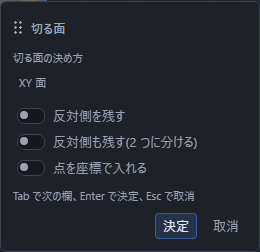

# 平面で切る

立体を、平らな面でまっすぐ切り分けます。ツールバーの「ソリッド」の区画で「加工」を押して一覧を開き、「切断」を押します。

平らな面のほかに、**閉じた輪郭**(円・楕円・閉じた面)、**開いた円弧・楕円弧**、**関数曲面**で切ることもできます。その切り方は、下の「輪郭・曲線・曲面で切る」にまとめています。

## 手順

1. 「選択」で、切りたい立体をクリックします(選ぶものが「立体」でないときは `4` を押します)。
2. 切る面のもとになる点・辺・面・作業平面を選びます(下の表を見てください)。何も選ばなければ XY 面で切ります。
3. 「加工」の一覧から「切断」を押します。
4. 画面に**切る面の予告の四角**と、残る側を指す矢印が出ます(出るのは平らな面で切るときだけです)。向きが思ったのと違うときは「反対側を残す」を入れます。
5. Enter を押すか「決定」を押します。切った形を確かめてから確定します(下の「うまくいかないとき」を見てください)。

立体を選ぶ前でも「切断」を押せます。対象が足りないときは、画面下の帯に選ぶものの案内が出ます。切りたい立体と、必要なら切る面のもとになる点・辺・面を選び、「加工」の一覧からもう一度「切断」を押すと入力欄が開きます。やめたいときは Esc を押します。予告の四角は消え、何も作られません。

## 切る面の決め方

**選んでいるものから自動で決まります。** 決め方を先に選ぶ必要はありません。表の「点」は、立体の頂点と、いま編集しているスケッチの点のことです。

| 選んでいるもの | どこで切るか |
|---|---|
| 点を 3 つ | その 3 点を通る面 |
| 点 1 つと辺 1 本 | その点を通り、辺に直角な面 |
| 点 1 つと面 1 枚 | その点を通り、その面に平行な面 |
| 点 1 つだけ | その点を通り、Z 軸に直角な面 |
| 作業平面 1 つ(点は選んでいない) | その作業平面そのもの |
| どれでもない | XY 面(「切る面の決め方」で XZ 面・YZ 面にも変えられます)。あとから離す距離を入れられます |

切る面が何も決まらないときだけ、基準の面(XY 面・XZ 面・YZ 面)で切ります。いま開いている作図面の向きは使いません。辺だけ・面だけを選んでも切る面は決まらないので、基準の面で切ってしまいます。辺や面で決めたいときは、点も一緒に選ぶか(上の表)、下の「決め方を自分で選ぶ」で決め方を選んでください。

### 決め方を自分で選ぶ

入力欄の「切る面の決め方」で、使う決め方を自分で選ぶこともできます。選んだ決め方に必要なものが足りないときは、勝手に別の決め方へすり替えず、理由を出して止まります。

平らな面で切る方法は、「立体の面」「3 点」「点と法線」「XYZ 軸に垂直な面」「任意の作業平面」の 5 つです。辺を使う方法は 2 通りあり、表では「辺の 2 方式」としています。

| 方法 | 決め方 | 選ぶもの・入れるもの | どこで切るか |
|---|---|---|---|
| 基準の面 | XY 面・XZ 面・YZ 面 | なし | 選んでいるものから決めます(上の表)。決める材料が無ければその面です |
| 立体の面 | 選んだ面 | 平らな面 1 枚 | その面そのもの。あとから離す距離を入れられます |
| 3 点 | 3 点 | 点 3 つ | その 3 点を通る面 |
| 点と法線 | 点と軸 | 点 1 つ | その点を通り、Z 軸に直角な面。「傾き」の欄で倒せます |
| 辺の 2 方式 | 点と辺 | 点 1 つと辺 1 本 | その点を通り、辺に直角な面(辺の向きが面の向きになります) |
| 辺の 2 方式 | 辺を含む面(辺と点) | 辺 1 本と点 1 つ | 辺と点の両方を通る面 |
| XYZ 軸に垂直な面 | X 軸に垂直な面・Y 軸に垂直な面・Z 軸に垂直な面 | 「位置」の欄 | その軸に直角で、軸の上の「位置」を通る面(X 軸なら x 座標が「位置」の面)。残る側は軸の向き(+X・+Y・+Z)です |
| 任意の作業平面 | 選んだ作業平面 | 作業平面 1 つ | その作業平面そのもの |

「位置」「傾き」と、下の「点の X」「点の Y」「点の Z」の欄は式で書けます(`10*2` のように)。

最後の「{{ui:numericInput.cutPlaneKind.profile}}」は、平らな面ではなく、作図の閉じた面・開いた円弧や楕円弧・関数曲面で立体を切る決め方です。使い方は、下の「輪郭・曲線・曲面で切る」にあります。

### 切る面のもとの選び方

- **立体の頂点**: `1` を押して選ぶものを「頂点」にしてから、頂点をクリックします。
- **スケッチの点**: いま編集しているスケッチの点を、Shift を押しながらクリックします(左のモデルブラウザの行でも選べます)。前のスケッチに同じ名前の点があるときは、取り違えないように使えません(理由が出ます)。
- **座標で入れる点**: 入力欄の「点を座標で入れる」を入れると、「点の X」「点の Y」「点の Z」の欄が出ます。座標の点は、選んだ点の後ろに並びます(「3 点」で 2 点を選んでいれば 3 点目)。使えるのは、決め方が「3 点」「点と辺」「辺を含む面(辺と点)」「点と軸」のときだけです。
- **辺**: `2` を押して選ぶものを「辺」にしてから、辺をクリックします。続けて立体と点を Shift を押しながら選びます。
- **面**: `3` を押して選ぶものを「面」にしてから、面をクリックします。
- **作業平面**: 左のモデルブラウザで、作業平面の行を Shift を押しながらクリックします。

座標で入れた点と、軸に垂直な面の「位置」は、左のモデルブラウザに「補助」の札が付いた基準点として残ります。その基準点を選んで右の「プロパティ」で座標の式を直すと、切る面も一緒に動きます。「元に戻す」(Ctrl+Z)を 1 回押すと、切断と一緒に消えます。

### 立体の中に点を置いてから切る

決まった場所で切りたいときは、先に点を置くのが確実です。

1. 作図面を選び、「点」の道具で切りたい高さに点をかきます(3D スケッチなら立体の中にも置けます)。
2. 「選択」に戻り、立体をクリックしてから、Shift を押しながらその点をクリックします。
3. 「切断」を押して「決定」を押します。

点の位置は式で書けるので、あとからプロパティで点を動かせば、切る場所も一緒に動きます。

### 傾けて切る

決め方を「点と軸」にすると、入力欄に「傾き」の欄が出ます。

- 傾きは 0 度以上 180 度未満です。0 度なら軸に直角のままです。
- 式で書けます(`15*2` のように)。
- 入力欄にあるのは「傾き」だけです。どちらへ倒すかを決める「{{ui:propertyPanel.tiltAzimuth}}」は入力欄には無く、はじめは 0 度です。倒す向きを変えたいときは、作ったあとで右の「プロパティ」の「{{ui:propertyPanel.tiltAzimuth}}」に度で入れます。「傾き」もプロパティで直せます。
- 「傾き」の欄があるのは「点と軸」だけです。「X 軸に垂直な面」などには傾きの欄がありません。斜めに切りたいときは、「3 点」や「辺を含む面(辺と点)」で決めることもできます。

## 残す側の決め方

切ると、切った面のどちら側かだけが残ります。

- 画面の**矢印が指しているほう**が残ります。
- 逆にしたいときは、入力欄か右の「プロパティ」の**「反対側を残す」**を入れます。押すたびに残る側が入れ替わり、体積も入れ替わります。
- 輪郭・曲線・曲面で切るときの残る側は、下の「輪郭・曲線・曲面で切る」で説明します。

### 反対側も残す(2 つに分ける)

入力欄の**「反対側も残す(2 つに分ける)」**を入れて決定すると、切断が 2 つできます。左のモデルブラウザに「切断1」「切断2」と並び、画面には 2 つの立体が残ります。合わせた体積は、切る前の立体と同じです。

2 つ目の切断を選ぶと、右の「プロパティ」に「対になっている切断」の行が出て、そこから相手へ移れます。

**いらないほうだけを消せます。** 消したいほうを左のモデルブラウザで選び、「⋮」から「削除」を押してください。残ったほうは、はじめから 1 つで切ったときと同じになります。

## 輪郭・曲線・曲面で切る

平らな面のかわりに、作図でかいた形や関数曲面で立体を切ることもできます。切るものは次の 3 つです。

| 切るもの | 立体と一緒に選ぶもの | 切る面 |
|---|---|---|
| 閉じた輪郭(円・楕円・閉じた面) | 作図の閉じた面 1 つ | 輪郭を作図面に垂直にまっすぐ伸ばした柱の側面 |
| 開いた円弧・楕円弧 | いま編集しているスケッチの円弧・楕円弧 | 弧を作図面に垂直にまっすぐ伸ばした、曲がった面 |
| 関数曲面 | 関数曲面 1 つ | 関数曲面そのもの |

どれも、入力欄の「切る面の決め方」を**「{{ui:numericInput.cutPlaneKind.profile}}」**にして決定します。

- **決め方を変えないと、選んだ輪郭・曲線・曲面は使われず、XY 面などの平らな面で切ってしまいます。** 入力欄を開いたら、まず決め方を確かめてください。
- 「{{ui:numericInput.toggle.cutPointByCoordinate}}」は使いません。入れたままにすると、理由が出て止まります。
- 切る面の予告は出ません。残る側は、下の各節のとおりに決まります。思った側と違ったときは、「元に戻す」(Ctrl+Z)で戻し、つまみを変えて切り直します。

### 閉じた輪郭で切る

円・楕円・四角など、作図で閉じた形を使って、立体を端から端まで貫いて切ります。穴をあけたり、輪郭の中だけを取り出したりできます。

1. 作図で、切りたい形をかきます。円・楕円のほか、線分・円弧・スプライン・関数曲線で囲んだ形でも構いません。
2. 「面」の道具で、その形を面にします([面を張る・色を変える](face-and-color.md))。
3. 「選択」で立体をクリックし、Shift を押しながら、その面をクリックします(左のモデルブラウザの行でも選べます)。
4. 「加工」の一覧から「切断」を押し、「切る面の決め方」を「{{ui:numericInput.cutPlaneKind.profile}}」にします。
5. 残す側を選んで、Enter を押します。

輪郭の**外側**は、輪郭を作図面に垂直にまっすぐ伸ばした柱の外、**内側**は柱の中のことです。柱は、立体を端から端まで貫く長さに自動でなります。

| 残したいもの | 入力欄のつまみ | できるもの |
|---|---|---|
| 輪郭の外側(はじめの設定。これまでの切り方) | どちらも入れない | 柱の中が取り除かれ、穴や切り欠きになります |
| 輪郭の内側 | 「反対側を残す」 | 柱の中だけが残ります |
| 外側と内側の両方(2 つに分ける) | 「反対側も残す(2 つに分ける)」 | 外側と内側が別々の立体になり、2 つの結果が並びます。合わせた体積は切る前と同じです |

両方を残すときに「反対側を残す」も入れると、2 つの並びが入れ替わるだけで、できる立体は同じです。

左のモデルブラウザには、切る形の「押し出し」の行と、切った結果の「差」(内側を残したときは「積」)の行ができます。両方を残したときは「差」と「積」が並びます。画面に見えるのは残した側の立体だけで、「元に戻す」(Ctrl+Z)は 1 回で全部戻ります。

あとから残す側を変えるときは、左のモデルブラウザで「差」(または「積」)の行を選び、右の「プロパティ」で「{{ui:numericInput.toggle.profileKeepInside}}」を切り替えます。2 つに分けたものには、この切り替えはありません。もとの輪郭(円の半径など)を直すと、切り口も一緒に変わります。

関数曲線を含む輪郭でも切れます([関数とXYZの範囲から曲線を作る](function-curve.md))。関数曲線は、関数作図で指定した許容誤差で近似した線として切ります。

次のときは切れません(出る文は、下の「うまくいかないとき」を見てください)。

- 輪郭が 1 つの平面の上にない、または自分自身と交わっている。
- 輪郭を伸ばした柱が、立体に届いていない。
- 輪郭が立体をまるごと囲んでいる。
- 閉じた面と一緒に、別の面や円弧・楕円弧も選んでいる。

### 開いた円弧・楕円弧で切る

閉じていない円弧・楕円弧を使って、立体を 2 つの側に切り分けます。弧を作図面に垂直にまっすぐ伸ばした、曲がった面で切ります。

1. 切りたい立体を横切るように、スケッチに円弧(「円弧」の道具)か楕円弧(「楕円」の道具で一部だけにします。[楕円をかく](ellipse.md))をかきます。開始角と終了角で、全周にならない開いた弧にします。弧の両端は、立体の表面の上か、立体の外に置きます。
2. 「選択」で立体をクリックし、Shift を押しながら、その弧をクリックします。弧は、いま編集しているスケッチのものを選びます(左のモデルブラウザの行でも選べます)。
3. 「加工」の一覧から「切断」を押し、「切る面の決め方」を「{{ui:numericInput.cutPlaneKind.profile}}」にします。
4. 残す側を選んで、Enter を押します。

弧を何本かつなげて 1 本の線にして切るときは、前の弧の終点と次の弧の始点が合うように、つながる順に選びます。

どちらが残るかは、弧の向き(開始角から終了角へ進む向き)で決まります。はじめの設定では、弧を進む向きに対して右側が残ります(XY 面なら真上から見たとき。ほかの作図面では、作図面の向きの側から見たときです)。たとえば XY 面に、開始角 0 度・終了角 180 度の半円をかくと、はじめの設定では半円の外側が残り、「反対側を残す」を入れると半円の内側が残ります。開始角と終了角を入れ替えると、残る側も入れ替わります。「反対側も残す(2 つに分ける)」を入れると、両側が別々の立体になり、左のモデルブラウザに「面による切断1」「面による切断2」が並びます。

弧の半径・角度・位置を直すと、切り口も一緒に変わります。

次の使い方は、対応していません。

- 線分・スプライン・関数曲線の線など、円弧・楕円弧以外の開いた線で切ること。線で閉じた面を作り、上の「閉じた輪郭で切る」を使います。
- 円や楕円の全周を、曲線のまま選んで切ること。囲んだ面を選びます。
- 弧の端を自動で延ばすこと。端が立体の中で止まると、立体を完全に分けられず断られます。
- 作図面に垂直でない向きへ伸ばすこと。
- いま編集していないスケッチの弧を使うこと。
- 切ったあとで、残す側を切り替えること。「プロパティ」に切り替えの欄はないので、「元に戻す」で戻して切り直します。

### 関数曲面で切る

関数作図で作った関数曲面を使って、立体を曲面の表側と裏側に切り分けます。

1. 「作図」→「関数作図」で、切りたい立体を横切る関数曲面を作ります([関数とXYZの範囲から曲面を作る](function-surface.md))。曲面は指定した XYZ の範囲の外へは延びないので、範囲は立体の外まで広げておきます。
2. 左のモデルブラウザで立体の行を選び、Shift を押しながら関数曲面の行をクリックします。
3. 「加工」の一覧から「切断」を押し、「切る面の決め方」を「{{ui:numericInput.cutPlaneKind.profile}}」にします。
4. 残す側を選んで、Enter を押します。

どちらが残るかは、曲面の向きで決まります。はじめの設定では、「座標軸から指定」で Z を式で求めた曲面なら曲面より上側が残り、「反対側を残す」を入れると下側が残ります。「反対側も残す(2 つに分ける)」を入れると上下が別々の立体になり、「面による切断1」「面による切断2」が並びます。切り口は、関数作図で指定した許容誤差で近似した曲面です。

- 切っても関数曲面は消えずに残ります。式や XYZ の範囲を直すと、切り口も一緒に変わります。
- 選ぶのは、立体 1 つと関数曲面 1 つだけです。曲面を 2 つ以上同時には選べないので、続けて切るときは 1 つずつ切ります。
- 曲面の範囲の端が立体の中で止まると、立体を完全に分けられず断られます。
- 「{{ui:functionPlot.closedSurface}}」と表示される閉じた形(球など)の関数曲面では切れません。「{{ui:functionPlot.openSurface}}」と表示される曲面を使います。
- 関数曲線(曲線だけ)で切ることは、対応していません。曲線に線を足して閉じた面にし、「閉じた輪郭で切る」を使います。
- 切ったあとで、残す側を切り替える欄は「プロパティ」にありません。

## 切ったあとに気を付けること

**切ったあと、前にあけた穴や面取りが付いてこないことがあります。** 切ると面や辺の形が変わるので、それらが「どの面・どの辺に掛けた加工か」を見失うことがあるためです。そのときは左のモデルブラウザに赤い印と理由が出るので、その加工を選んで、面や辺を選び直してください。**アプリは止まりません。**

順番を入れ替えられるときは、**先に切ってから穴や面取りを掛ける**ほうが安全です。

切りすぎたときは「元に戻す」(Ctrl+Z)で 1 つ前へ戻せます。「やり直す」(Ctrl+Y)で戻したぶんをやり直せます。

## 切る面を選び直す

作ったあとで別の場所で切りたくなったら、右の「プロパティ」の「切る面」を使います。

1. 画面で、新しく使いたい点・辺・面を選びます。
2. 右の「プロパティ」の**「いま選んでいるもので選び直す」**を押します。

材料が足りないときはボタンが押せず、その下に理由が出ます。対になっている 2 つの切断は、片方を選び直すともう片方の面も同じように変わります(ずれると 2 つが噛み合わなくなるためです)。

このボタンは、平らな面で切った切断にだけあります。輪郭・曲線・曲面で切った切断は、もとの輪郭・曲線・関数曲面を直して変えます。

## うまくいかないとき

切れないときは、入力欄が開いたまま理由が出て、図面は変わりません。決定したあと、切った形を確かめている間は「{{ui:numericInput.directEditConfirming}}」と出ます。切れたときだけ確定して入力欄が閉じます。「反対側も残す(2 つに分ける)」では、片方だけが切れて片方だけが残ることはなく、どちらかが切れなければ図面は変わりません。

| 出る文 | 直し方 |
|---|---|
| 対象になる立体が選ばれていません。 | 切りたい立体を 1 つクリックしてから押します |
| 切る面を決めるものが足りません。決め方に合わせて点・辺・面を選んでください。 | その決め方に必要な点・辺・面・作業平面を選びます |
| 3 つの点が一直線に並んでいます。別の点を選んでください。 | 一直線に並んでいない 3 点を選びます |
| まっすぐでない辺は切る面の基準にできません。直線の辺を選んでください。 | 円や円弧ではなく、まっすぐな辺を選びます |
| 平らでない面は切る面の基準にできません。平らな面を選んでください。 | 丸い面ではなく、平らな面を選びます |
| 点が辺の延長線の上にあるため、切る面の向きが決まりません。辺の線から外れた点を選んでください。 | 「辺を含む面(辺と点)」では、辺の線の上にない点を選びます |
| 切る面を決める値が数になっていません。式を直してください。 | 「位置」や「点の X」などの式を直します |
| 切る面を決める点が見つかりません。点を選び直してください。 | 消えた点の代わりに、別の点を選びます |
| 選んだ作業平面の位置が決まりません。作業平面を直すか、別の作業平面を選んでください。 | 左のモデルブラウザで作業平面の理由を見て直すか、別の作業平面を選びます |
| 前のスケッチに同じ名前の点があるため、この点では切る面を決められません。「点を座標で入れる」で座標を入れるか、別の点を選んでください。 | 点の座標を「点を座標で入れる」で入れるか、別の点を選びます |
| 選んだスケッチの点の位置が決まりません。作図の誤りを直してから選び直してください。 | スケッチの点の誤り(赤い印)を直してから選び直します |
| この決め方では、座標で入れた点を使いません。決め方を「3 点」「点と辺」「辺を含む面(辺と点)」「点と軸」のどれかにするか、「点を座標で入れる」を切ってください。 | 決め方を変えるか、「点を座標で入れる」を切ります |
| 選んだ点と座標で入れた点を合わせると、この決め方に要る点の数より多くなります。点の選択を減らすか、「点を座標で入れる」を切ってください。 | 選んでいる点を減らすか、「点を座標で入れる」を切ります |
| 切った先に立体が残りません。切断面の位置を見直してください。 | 切る面が立体から外れています。位置を直すか「反対側を残す」を入れます |
| 切ったら立体が残りませんでした。残す側を切り替えてください。 | 「反対側を残す」を入れます |

### 輪郭・曲線・曲面で切るとき

| 出る文 | 直し方 |
|---|---|
| {{ui:cutError.noProfile}} | 決め方を「{{ui:numericInput.cutPlaneKind.profile}}」にしているのに、立体のほかに切る曲線・面が選ばれていません。立体をクリックし、Shift を押しながら曲線や面を足します |
| {{ui:cutError.bladeSelectionAmbiguous}} | 閉じた面と曲線のどちらか一方にします。円弧・楕円弧以外の線(線分・スプライン・関数曲線の線)、いま編集していないスケッチの曲線、切るものでないものが混ざっているときも、この文が出ます。関数曲面で切るときは、立体 1 つと関数曲面 1 つだけを選びます |
| {{ui:cutError.bladeNotCurrent}} | 画面の計算が終わるのを待ってから、もう一度「切断」を押します。曲線は、いま編集しているスケッチのものを選びます。関数曲面を選んでいるときは、式の誤りなどで曲面の形ができていないときにも出ます |
| {{ui:cutError.bladeMustBeOpen}} | 全周の円・楕円は、「面」の道具で囲んだ面を作って、その面を選びます。開いた弧は、始点と終点が離れているものを選びます |
| {{ui:cutError.bladeDisconnected}} | 弧を何本か選ぶときは、前の弧の終点と次の弧の始点が合うように、つながる順に選びます |
| {{ui:cutError.profileInvalid}} | 輪郭の線が閉じていないか、作図に誤り(赤い印)があります。誤りを直してから選び直します |
| {{ui:cutError.profileNotPlanar}} | 輪郭の線が 1 つの作図面の上にあるものを選びます。別々の作図面の曲線を一緒に選んでいるときも出ます |
| {{ui:cutError.profileSelfIntersects}} | 線が交差して「8 の字」になっていないか見直し、交わらない形にします |
| {{ui:cutError.profileMissesTarget}} | 輪郭を作図面に垂直に伸ばした柱が、立体に届いていません。輪郭を立体に重なる位置へ動かします |
| 切る輪郭が立体に届かず、何も削れませんでした。輪郭の位置や大きさを見直してください。 | 輪郭の外側を残すとき(はじめの設定)に、柱が立体に重なりません。輪郭の位置や大きさを直します |
| 切る輪郭が立体に届かず、輪郭の内側に何も残りませんでした。輪郭の位置や大きさを見直してください。 | 輪郭の内側を残すとき(「反対側を残す」)に、柱が立体に重なりません。輪郭の位置や大きさを直します |
| 切る輪郭が立体をまるごと囲んでいて、何も削れませんでした。輪郭の位置や大きさを見直してください。 | 輪郭の内側を残すときに、輪郭が立体をまるごと囲んでいます。輪郭を立体より小さくします |
| 組み合わせた結果、立体が残りませんでした。 | 輪郭の外側を残すときに、輪郭が立体をまるごと囲んでいて、何も残りません。輪郭を立体より小さくします |
| 切断面が対象に届いていません。位置と範囲を見直してください。 | 曲線や曲面が立体から離れています。位置や、関数曲面の XYZ の範囲を見直します |
| 切断面が対象に接するだけで、立体を分けられません。 | 曲線や曲面が立体の表面に触れているだけです。立体の中を通るように動かします |
| 切断面の端が対象の中で止まるため、立体を完全に分けられません。 | 弧の端、または関数曲面の XYZ の範囲の端が、立体の中にあります。端が立体の表面の上か外に出るように、弧を伸ばすか、範囲を広げます |
| 切断の曲線または面が自分自身と交わっています。 | つないだ弧や曲面が交差しています。形を見直します |
| 切断面に対する断片の側を一意に決められません。 | 立体が離れた複数のかたまりでできていて曲線や曲面が一部にしか触れていないとき、または曲線や曲面が入り組んでいるときに出ます。すべてのかたまりを横切る、入り組んでいない形にします |
| 切断には向きのそろった開いた曲線または面が必要です。 | 体積を持つ閉じた関数曲面など、開いていない形では切れません。開いた曲面を使います |
| 面による切断を計算できませんでした。形と範囲を見直してください。 | 曲線や曲面の形、関数曲面の XYZ の範囲を見直します |
