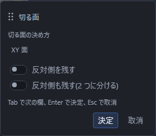

# 平面で切る

立体を、平らな面でまっすぐ切り分けます。ツールバーの「ソリッド」の区画で「加工」を押して一覧を開き、「切断」を押します。

## 手順

1. 「選択」で、切りたい立体をクリックします(選ぶものが「立体」でないときは `4` を押します)。
2. 切る面のもとになる点・辺・面・作業平面を選びます(下の表を見てください)。何も選ばなければ XY 面で切ります。
3. 「加工」の一覧から「切断」を押します。
4. 画面に**切る面の予告の四角**と、残る側を指す矢印が出ます。向きが思ったのと違うときは「反対側を残す」を入れます。
5. Enter を押すか「決定」を押します。

立体を選ぶ前でも「切断」を押せます。対象が足りないときは、画面下の帯に選ぶものの案内が出ます。切りたい立体と、必要なら切る面のもとになる点・辺・面を選び、「加工」の一覧からもう一度「切断」を押すと入力欄が開きます。やめたいときは Esc を押します。予告の四角は消え、何も作られません。

## 切る面の決め方

**選んでいるものから自動で決まります。** 決め方を先に選ぶ必要はありません。表の「点」は、立体の頂点と、いま編集しているスケッチの点のことです。

| 選んでいるもの | どこで切るか |
|---|---|
| 点を 3 つ | その 3 点を通る面 |
| 点 1 つと辺 1 本 | その点を通り、辺に直角な面 |
| 点 1 つと面 1 枚 | その点を通り、その面に平行な面 |
| 点 1 つだけ | その点を通り、Z 軸に直角な面 |
| 作業平面 1 つ(点は選んでいない) | その作業平面そのもの |
| どれでもない | XY 面(「切る面の決め方」で XZ 面・YZ 面にも変えられます)。あとから離す距離を入れられます |

### 決め方を自分で選ぶ

入力欄の「切る面の決め方」で、使う決め方を自分で選ぶこともできます。選んだ決め方に必要なものが足りないときは、勝手に別の決め方へすり替えず、理由を出して止まります。

| 決め方 | 選ぶもの・入れるもの | どこで切るか |
|---|---|---|
| XY 面・XZ 面・YZ 面 | なし | 選んでいるものから決めます(上の表)。決める材料が無ければその面です |
| X 軸に垂直な面・Y 軸に垂直な面・Z 軸に垂直な面 | 「位置」の欄 | その軸に直角で、軸の上の「位置」を通る面(X 軸なら x 座標が「位置」の面)。残る側は軸の向き(+X・+Y・+Z)です |
| 選んだ作業平面 | 作業平面 1 つ | その作業平面そのもの |
| 選んだ面 | 平らな面 1 枚 | その面そのもの。あとから離す距離を入れられます |
| 3 点 | 点 3 つ | その 3 点を通る面 |
| 点と辺 | 点 1 つと辺 1 本 | その点を通り、辺に直角な面(辺の向きが面の向きになります) |
| 辺を含む面(辺と点) | 辺 1 本と点 1 つ | 辺と点の両方を通る面 |
| 点と軸 | 点 1 つ | その点を通り、Z 軸に直角な面。「傾き」の欄で倒せます |

「位置」「傾き」と、下の「点の X」「点の Y」「点の Z」の欄は式で書けます(`10*2` のように)。

「選んだ閉じた輪郭で貫く」は、平らな面ではなく、作図の閉じた面の形で立体を貫いて切る決め方です。

### 切る面のもとの選び方

- **立体の頂点**: `1` を押して選ぶものを「頂点」にしてから、頂点をクリックします。
- **スケッチの点**: いま編集しているスケッチの点を、Shift を押しながらクリックします(左のモデルブラウザの行でも選べます)。前のスケッチに同じ名前の点があるときは、取り違えないように使えません(理由が出ます)。
- **座標で入れる点**: 入力欄の「点を座標で入れる」を入れると、「点の X」「点の Y」「点の Z」の欄が出ます。座標の点は、選んだ点の後ろに並びます(「3 点」で 2 点を選んでいれば 3 点目)。使えるのは、決め方が「3 点」「点と辺」「辺を含む面(辺と点)」「点と軸」のときだけです。
- **辺**: `2` を押して選ぶものを「辺」にしてから、辺をクリックします。続けて立体と点を Shift を押しながら選びます。
- **面**: `3` を押して選ぶものを「面」にしてから、面をクリックします。
- **作業平面**: 左のモデルブラウザで、作業平面の行を Shift を押しながらクリックします。

座標で入れた点と、軸に垂直な面の「位置」は、左のモデルブラウザに「補助」の札が付いた基準点として残ります。その基準点を選んで右の「プロパティ」で座標の式を直すと、切る面も一緒に動きます。「元に戻す」(Ctrl+Z)を 1 回押すと、切断と一緒に消えます。

### 立体の中に点を置いてから切る

決まった場所で切りたいときは、先に点を置くのが確実です。

1. 作図面を選び、「点」の道具で切りたい高さに点をかきます(3D スケッチなら立体の中にも置けます)。
2. 「選択」に戻り、立体をクリックしてから、Shift を押しながらその点をクリックします。
3. 「切断」を押して「決定」を押します。

点の位置は式で書けるので、あとからプロパティで点を動かせば、切る場所も一緒に動きます。

### 傾けて切る

決め方を「点と軸」にすると、入力欄に「傾き」の欄が出ます。

- 傾きは 0 度以上 180 度未満です。0 度なら軸に直角のままです。
- 式で書けます(`15*2` のように)。作ったあとで、右の「プロパティ」の「傾き」と「傾ける向き」でも直せます。

## 残す側の決め方

切ると、切った面のどちら側かだけが残ります。

- 画面の**矢印が指しているほう**が残ります。
- 逆にしたいときは、入力欄か右の「プロパティ」の**「反対側を残す」**を入れます。押すたびに残る側が入れ替わり、体積も入れ替わります。

### 反対側も残す(2 つに分ける)

入力欄の**「反対側も残す(2 つに分ける)」**を入れて決定すると、切断が 2 つできます。左のモデルブラウザに「切断1」「切断2」と並び、画面には 2 つの立体が残ります。合わせた体積は、切る前の立体と同じです。

2 つ目の行には、対になっていることが分かる印が付きます。右の「プロパティ」でも「対になっている切断」から相手へ移れます。

**いらないほうだけを消せます。** 消したいほうを左のモデルブラウザで選び、「⋮」から「削除」を押してください。残ったほうは、はじめから 1 つで切ったときと同じになります。

## 切ったあとに気を付けること

**切ったあと、前にあけた穴や面取りが付いてこないことがあります。** 切ると面や辺の形が変わるので、それらが「どの面・どの辺に掛けた加工か」を見失うことがあるためです。そのときは左のモデルブラウザに赤い印と理由が出るので、その加工を選んで、面や辺を選び直してください。**アプリは止まりません。**

順番を入れ替えられるときは、**先に切ってから穴や面取りを掛ける**ほうが安全です。

切りすぎたときは「元に戻す」(Ctrl+Z)で 1 つ前へ戻せます。「やり直す」(Ctrl+Y)で戻したぶんをやり直せます。

## 切る面を選び直す

作ったあとで別の場所で切りたくなったら、右の「プロパティ」の「切る面」を使います。

1. 画面で、新しく使いたい点・辺・面を選びます。
2. 右の「プロパティ」の**「いま選んでいるもので選び直す」**を押します。

材料が足りないときはボタンが押せず、その下に理由が出ます。対になっている 2 つの切断は、片方を選び直すともう片方の面も同じように変わります(ずれると 2 つが噛み合わなくなるためです)。

## うまくいかないとき

| 出る文 | 直し方 |
|---|---|
| 対象になる立体が選ばれていません。 | 切りたい立体を 1 つクリックしてから押します |
| 切る面を決めるものが足りません。決め方に合わせて点・辺・面を選んでください。 | その決め方に必要な点・辺・面・作業平面を選びます |
| 3 つの点が一直線に並んでいます。別の点を選んでください。 | 一直線に並んでいない 3 点を選びます |
| まっすぐでない辺は切る面の基準にできません。直線の辺を選んでください。 | 円や円弧ではなく、まっすぐな辺を選びます |
| 平らでない面は切る面の基準にできません。平らな面を選んでください。 | 丸い面ではなく、平らな面を選びます |
| 点が辺の延長線の上にあるため、切る面の向きが決まりません。辺の線から外れた点を選んでください。 | 「辺を含む面(辺と点)」では、辺の線の上にない点を選びます |
| 切る面を決める値が数になっていません。式を直してください。 | 「位置」や「点の X」などの式を直します |
| 切る面を決める点が見つかりません。点を選び直してください。 | 消えた点の代わりに、別の点を選びます |
| 選んだ作業平面の位置が決まりません。作業平面を直すか、別の作業平面を選んでください。 | 左のモデルブラウザで作業平面の理由を見て直すか、別の作業平面を選びます |
| 前のスケッチに同じ名前の点があるため、この点では切る面を決められません。「点を座標で入れる」で座標を入れるか、別の点を選んでください。 | 点の座標を「点を座標で入れる」で入れるか、別の点を選びます |
| 選んだスケッチの点の位置が決まりません。作図の誤りを直してから選び直してください。 | スケッチの点の誤り(赤い印)を直してから選び直します |
| この決め方では、座標で入れた点を使いません。決め方を「3 点」「点と辺」「辺を含む面(辺と点)」「点と軸」のどれかにするか、「点を座標で入れる」を切ってください。 | 決め方を変えるか、「点を座標で入れる」を切ります |
| 選んだ点と座標で入れた点を合わせると、この決め方に要る点の数より多くなります。点の選択を減らすか、「点を座標で入れる」を切ってください。 | 選んでいる点を減らすか、「点を座標で入れる」を切ります |
| 切った先に立体が残りません。切断面の位置を見直してください。 | 切る面が立体から外れています。位置を直すか「反対側を残す」を入れます |
| 切ったら立体が残りませんでした。残す側を切り替えてください。 | 「反対側を残す」を入れます |
