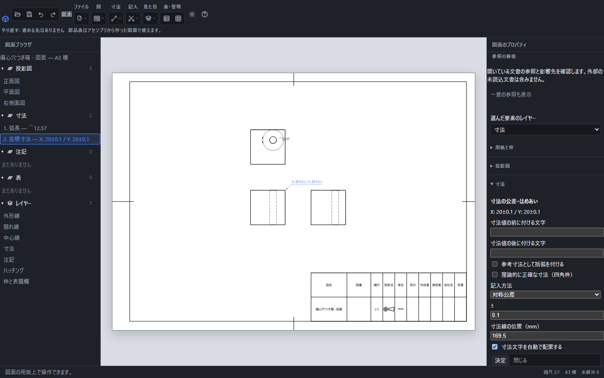

# 図面に寸法を記入する

寸法の値は元の3D形状から測ります。図の縮尺や配置を変えても実寸は変わりません。寸法値そのものを打ち替える欄はありません。元の寸法を変えるときは、部品の式やパラメータを編集して図面を更新します。

円周の弧長12.57と、基準点からX=20・Y=20の座標寸法を記入した画面。右側で座標寸法へ対称公差±0.1を設定しています。

## 辺を選んで記入する

1. 図の上で直線の辺をクリックします。
2. Enterを押すと、その辺の長さが記入されます。
3. 作成した寸法を選ぶと、右側で公差・文字の位置・前後の補足を編集できます。

先に「寸法」のメニューで測り方を選び、その後に対象をクリックしても記入できます。2つの頂点を測る場合は、1点目では確定せず、2点目を選ぶと確定します。対象を先に複数選ぶ場合はShiftを押して追加します。同じ図の中で選んでください。

## 測り方の違い

| 測り方 | 選ぶもの | 表示する値 |
| --- | --- | --- |
| 長さ | 直線の辺1本、または頂点2つ | 元の3D空間での距離。斜めに見て短く投影されても実寸です |
| 水平寸法・垂直寸法 | 直線の辺1本、または頂点2つ | その図の横軸・縦軸方向の実寸 |
| 角度 | 平行でない直線の辺2本 | 元の辺の方向から求めた角度 |
| 直径・半径 | 円または円弧 | φまたはRを付けた実寸 |
| 弧長 | 円弧または円の辺 | 弧に沿った実長。円全周なら円周長。値の前に⌒が付きます |
| 球の直径・球の半径 | 球の表面 | SφまたはSRを付けた実寸 |
| 座標寸法 | 基準にする頂点、測る頂点の順 | 基準からの符号付きX・Y成分。たとえばX: 20 / Y: 20 |

Enterで測り方を指定しない場合、円は直径、円弧は半径、直線は長さ、2本の直線は角度など、選んだ対象から決まります。弧長や座標寸法は「寸法」で明示してから選びます。

## 位置と文字

寸法文字をドラッグすると位置を変えられます。長さ・厚さ・座標寸法は、右側で「寸法線の位置」を数値で設定することもできます。「寸法文字を自動で配置する」を外すと、用紙上の横・縦位置をmmで指定できます。半径や角度、弧長の寸法線は文字の位置に合わせて配置します。文字の高さは用紙の設定を使います。

複数の寸法はCtrlまたはShiftを押して文字を順に選び、キーを離して選択した文字の1つをドラッグすると一緒に移動できます。移動中にEscを押すと取り消します。確定後の「元に戻す」1回で、まとめて移動した寸法がすべて戻ります。

「寸法値の前に付ける文字」「寸法値の後に付ける文字」は数量や補足に使います。「参考寸法として括弧を付ける」を入れると全体を括弧で囲みます。これらの指定は測定値を変更しません。

## 部品を編集・保存し直しても同じ辺を測る

寸法は、選んだ辺や面を「どの立体の、どの辺か」という形の履歴で覚えています。部品の寸法を変えて辺の位置や長さが変わっても、保存して開き直しても、同じ辺を測り続けます。同じ位置・同じ大きさの別の立体の辺へ移ることはありません。

STEPなどから読み込んだ立体は作った履歴がないため、保存した位置・長さ・向きから辺を探し直します。似た辺が複数あって1つに決められないときは、推測せず「？」のままにします。

## 直せない・記入できないとき

対象が足りない、異なる図を混ぜた、平行な辺へ角度を指定した場合は、画面下に理由が出ます。元の辺や面が削除され、対応する形を特定できなくなった寸法は「？」になります。値を0に置き換えたり、別の辺へ勝手につなぎ直したりはしません。

形を編集した後、似た辺や面が複数あり、元の対象を1つに決められない場合も「？」になります。画面下の未解決件数と、左側の「寸法」一覧の「!」を確認してください。保存した元の対象は残るため、元の部品の編集を戻して図面を更新すると、再び解決することがあります。

現在の形へ付け直すときは、右側の「参照の修復」を使います。寸法を作り直さずに、選んだ参照先だけを交換できます。

1. 「参照の修復」で、直したい寸法の「消失」や「曖昧」の行を押します。
2. 「元の参照（保存時の情報）」と「現在の候補（重ねると強調）」を見比べ、「影響する寸法・合致・加工・外観」も確認します。図面では候補を強調できない場合があり、その理由が出ます。
3. 正しい候補を押し、「この参照で確定」を押します。公差・文字・配置はそのまま残ります。
4. 計算が終わったら「修復後の影響先」と寸法の値を確認します。反対側の対象や図に問題が残れば、参照が「一意」でも寸法は「？」のままです。

計算中は修復を始められません。候補を開いた後に文書や形が変わったら、「候補を更新」を押して選び直します。保存後に1つに特定できない候補では確定できません。候補がないときは、元の加工や部品を確認してください。確認する影響先は開いている文書だけで、読み込んでいない外部文書は含みません。

確定前は「修復を取り消す」でやめられ、寸法も履歴も変わりません。確定した修復は「元に戻す」1回で戻せます。

作成、確定した編集、ドラッグ、削除は「元に戻す」で戻せます。寸法の入力を中止する場合はEscです。削除は寸法を選んでDeleteを押します。

[公差とはめあい](dimension-tolerance.md)・[自動寸法](dimension-auto.md)・[用紙と縮尺](drawing-scale.md)
