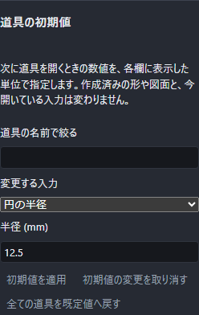
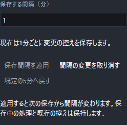

# 画面の見た目を変える

画面のいちばん上の右端、丸に「?」の図柄のヘルプのボタンのとなりにある歯車のボタンを押すと「表示設定」が開きます。ここで画面全体の配色と、文字やボタンの大きさを変えられます。

開いている間も、うしろで作図したり視点を動かしたりできます。閉じるときは Esc キーを押すか、設定の外側をクリックしてください。

## 配色を選ぶ(テーマ)

5 種類の中から選べます。見本を押すと、その場ですぐ切り替わります。アプリを開き直す必要はありません。

| 名前 | 見た目 |
|---|---|
| ダーク | 暗い下地に明るい文字。最初はこれです |
| ライト | 明るい下地に暗い文字 |
| ダークモダン | ダークと同じ暗さで、角の丸みを大きく、余白を広く、区画をうっすら浮かせます |
| ライトモダン | ライトと同じ明るさで、丸みと余白はダークモダンと同じです |
| モダン | 中間の明るさの灰色を下地にした配色。丸みと余白はモダンの 2 つと同じです |

見本は画面の縮図になっていて、上の帯・左右の区画・3D の表示部が、そのテーマの色でそのまま描かれています。いま使っているものは青い枠で囲まれます。

3D の表示部の中(方眼、XYZ の軸、かいた点や線、立体、指した色や選んだ色)も一緒に変わります。明るい配色では方眼と線が濃くなり、暗い配色では薄くなるので、どちらでも見やすさは変わりません。

キーボードだけでも選べます。Tab キーで見本まで進み、矢印キーで隣の見本へ移ると、移ったところで切り替わります。

## 大きさを変える(拡大率)

文字とボタンの大きさを 90% から 150% までの 5 段から選べます。押すとすぐに変わります。画面が小さくて字が読みにくいときは大きく、たくさん並べて見たいときは小さくしてください。

大きくすると、画面の上のボタンの並びが 2 段になることがあります。窓の横幅を広げると 1 段に戻ります。

## 視点の操作を変える

「{{ui:settings.camera.title}}」では、「{{ui:settings.camera.orbit}}」「{{ui:settings.camera.pan}}」「{{ui:settings.camera.zoom}}」のそれぞれに、割当を1つか2つ指定できます。欄は「割当 1」と「割当 2」の2つで、3つ目はありません。各欄で「{{ui:settings.camera.left}}」「{{ui:settings.camera.middle}}」「{{ui:settings.camera.right}}」「{{ui:settings.camera.wheel}}」のどれかを選び、Alt・Shift・Ctrl・「{{ui:settings.camera.meta}}」のチェックで修飾キーの組合せを指定します。使わない欄は「{{ui:settings.camera.none}}」にできますが、各操作に少なくとも1つの割当が必要です。

最初の割当と、他のCADに近づけた割当は次の表のとおりです。「{{ui:settings.camera.presets}}」の4つのボタンを押すと、押したボタンと同じ名前の3行の割当が入力欄に入ります。入れ替わるのは割当だけで、感度と反転は変わりません。「{{ui:settings.camera.preset.pointercad}}」が最初の割当です。

| 画面のボタン | 操作 | 割当 1 | 割当 2 |
|---|---|---|---|
| {{ui:settings.camera.preset.pointercad}} | {{ui:settings.camera.orbit}} | {{ui:settings.camera.middle}} | Alt＋{{ui:settings.camera.left}} |
| {{ui:settings.camera.preset.pointercad}} | {{ui:settings.camera.pan}} | {{ui:settings.camera.right}} | Shift＋{{ui:settings.camera.middle}} |
| {{ui:settings.camera.preset.pointercad}} | {{ui:settings.camera.zoom}} | {{ui:settings.camera.wheel}} | Ctrl＋{{ui:settings.camera.wheel}} |
| {{ui:settings.camera.preset.solidworks}} | {{ui:settings.camera.orbit}} | {{ui:settings.camera.middle}} | {{ui:settings.camera.none}} |
| {{ui:settings.camera.preset.solidworks}} | {{ui:settings.camera.pan}} | Ctrl＋{{ui:settings.camera.middle}} | {{ui:settings.camera.none}} |
| {{ui:settings.camera.preset.solidworks}} | {{ui:settings.camera.zoom}} | {{ui:settings.camera.wheel}} | Shift＋{{ui:settings.camera.middle}} |
| {{ui:settings.camera.preset.fusion}} | {{ui:settings.camera.orbit}} | Shift＋{{ui:settings.camera.middle}} | {{ui:settings.camera.none}} |
| {{ui:settings.camera.preset.fusion}} | {{ui:settings.camera.pan}} | {{ui:settings.camera.middle}} | {{ui:settings.camera.none}} |
| {{ui:settings.camera.preset.fusion}} | {{ui:settings.camera.zoom}} | {{ui:settings.camera.wheel}} | {{ui:settings.camera.none}} |
| {{ui:settings.camera.preset.onshape}} | {{ui:settings.camera.orbit}} | {{ui:settings.camera.right}} | {{ui:settings.camera.none}} |
| {{ui:settings.camera.preset.onshape}} | {{ui:settings.camera.pan}} | {{ui:settings.camera.middle}} | Ctrl＋{{ui:settings.camera.right}} |
| {{ui:settings.camera.preset.onshape}} | {{ui:settings.camera.zoom}} | {{ui:settings.camera.wheel}} | {{ui:settings.camera.none}} |

他のCADの名前がついた3つの割当は、そのCADの主なマウス操作に近づけたもので、キーボード操作や回転の中心など、そのCADの動きをすべて再現するものではありません。3Dの拡大・縮小は画面の中心を基準に行い、マウスの位置へ寄っていく動きはしません。ボタンで入れた割当は「{{ui:settings.camera.apply}}」を押すまで保存されません。保存されるのは割当で、どのボタンから入れたかは残りません。

修飾キーは、指定したものだけを押したときに一致します。たとえばAlt＋{{ui:settings.camera.left}}の割当にShiftも押すと一致しません。以前のAlt＋Shift＋{{ui:settings.camera.left}}による平行移動は、最初の割当に含まれません。使う場合は「{{ui:settings.camera.pan}}」のどちらかの欄をその組合せへ変更してください。割当にない修飾キー付きホイールは、視点を拡大・縮小しません。

次の設定は適用できません。理由が画面に表示されます。

- 同じ入力と修飾キーの組合せを、2か所に割り当てる設定
- 各操作の割当が0個になる設定
- Altを含まない「{{ui:settings.camera.left}}」(左ボタンと、ShiftやCtrlを加えた左ボタンは、選択や作図に使います。割り当てるにはAltが必要です)
- 「{{ui:settings.camera.wheel}}」を「{{ui:settings.camera.orbit}}」や「{{ui:settings.camera.pan}}」に割り当てる設定(ホイールは「{{ui:settings.camera.zoom}}」だけに使えます)
- 0.1〜10倍の範囲を外れた感度

次の操作には対応していません。設定する欄がなく、視点の操作になりません。2つ以上のボタンを組み合わせたドラッグと、画面を指で直接触れて行う操作(タッチ画面)です。「{{ui:settings.camera.meta}}」を含む割当は選べますが、WindowsキーやCommandキーなど、OSが先に受け取るキーはPointerCADへ届かないことがあり、その場合は働きません。キーの割当で使えないキーは[変更できないキー](./shortcuts.md#変更できないキー)を見てください。

拡大・縮小の速さは「{{ui:settings.camera.wheelSensitivity}}」と「{{ui:settings.camera.dragSensitivity}}」で別々に指定でき、「{{ui:settings.camera.invertWheel}}」「{{ui:settings.camera.invertDrag}}」で向きも反転できます。回転・平行移動の速さを変える設定ではありません。タッチパッドの2本指スクロールはホイールと同じ入力として扱い、指を離した後にOSが送り続ける動き(慣性)も止めません。速すぎるときは「{{ui:settings.camera.wheelSensitivity}}」を下げてください。

視点をドラッグしている間にホイールを回しても、拡大・縮小はせず、ドラッグを優先します。マウスのボタンを押している間は、ホイールによる拡大・縮小も働きません。ドラッグは、ボタンを離したとき、押しているボタンの組合せが変わったとき、ウィンドウが別のものに切り替わったときに終わります。始めた後で修飾キーを離しても、始めた操作を続けます。割当は重複できないので、1回の入力で働く視点の操作は1つに決まります。

「{{ui:settings.camera.apply}}」で反映します。「{{ui:settings.camera.defaults}}」は割当・感度・反転を初期値へ戻す準備なので、続けて適用してください。次に始める視点操作から使われ、進行中のドラッグは開始時の設定を保ちます。4分割表示にも同じ設定を使いますが、平面・正面・右側面の向きは回転しません。右クリックの道具一覧とドラッグの区別は保ちます。

操作設定には「元に戻す」がありません。適用や取消は部品・組立・図面の内容にも、それぞれの「元に戻す」の履歴にも入らないので、文書の「元に戻す」は設定を戻さず、直前の文書の編集だけを戻します。適用した設定を戻したいときは、割当を入れ直すか「{{ui:settings.camera.defaults}}」や他のボタンで入れ直して、もう一度「{{ui:settings.camera.apply}}」を押してください。適用していない編集は、「{{ui:settings.camera.cancel}}」を押すか設定を閉じると捨てられます。

適用した操作設定は、使っている端末の表示設定へ保存され、部品ファイルには入りません。保存できなかったとき(保存領域が使えないときなど)はお知らせが出ず、開いている間は適用した設定で操作できますが、アプリを開き直すと前回保存できた設定(保存できたことがなければ初期の割当)に戻ります。保存された視点の操作設定だけが読み取れないときは、視点の操作だけが初期の割当に戻り、配色などほかの設定は保たれます。

入力中に別の操作で視点の操作設定が変更された場合、古い入力で上書きせず理由を表示します。「{{ui:settings.camera.cancel}}」で下書きを捨て、最新の設定を確認して入力し直してください。他の設定で選んだ配色などはそのまま保ちます。

図面を開いているときは、同じ設定の「{{ui:settings.camera.pan}}」と「{{ui:settings.camera.zoom}}」が図面の表示の移動と拡大・縮小に使われます。ホイールではマウスのある位置、ドラッグでは押し始めた位置を中心に拡大・縮小します。紙の上に奥行きはないので、「{{ui:settings.camera.orbit}}」の割当は図面では働きません。表示を動かしても、図面の内容、紙の上の位置、元に戻す履歴、書き出した結果は変わりません。表示の位置と大きさは図面に保存されず、図面を開き直すと最初の状態に戻ります。通常の左ボタンによる選択と、注記・寸法・投影図の移動はこれまでどおりです。

詳しい視点操作は[画面を回す・動かす・拡大する](./viewport.md)を見てください。

## 道具の初期値を変える

「{{ui:settings.toolDefaults.title}}」では、新しく道具を開いたときに数値欄へ入る式を変えられます。検索で道具を絞り、一覧から入力段階を選んで値を直し、「{{ui:settings.toolDefaults.apply}}」を押してください。長さは mm、角度は度、個数は整数で指定します。`12.5` のような数のほか、`板厚 * 2` のような現在の部品のパラメータ式や、`rad(pi/2)` のような式も使えます。

点を置く道具には、絶対座標、相対座標、極座標ごとに別の初期値があります。たとえば絶対座標の X を変えても、相対座標の ΔX や極座標の距離は変わりません。

適用した値は、その後に新しく開く道具から使われます。すでに開いている道具は、開いたときの初期値を最後の入力段階まで保ちます。途中で選択肢を変えて新しい欄が現れたときも同じです。入力した値や、画面をクリックして決めた点を初期値で上書きすることはありません。すでに作った形、部品の再計算、Undo の履歴も変わりません。

画面表示を inch にしていても、この設定の長さは mm です。道具を開いた後に手入力する長さは、これまでどおり画面表示の単位で解釈されます。角度は度で、ラジアンを使うときは `rad(...)` と書きます。

「{{ui:settings.toolDefaults.cancel}}」は適用前の編集を捨てます。「{{ui:settings.toolDefaults.reset}}」は全項目を製品の初期値へ戻す準備をするので、続けて「{{ui:settings.toolDefaults.apply}}」を押してください。適用した内容は使っている端末に保存されます。

部品をひな形として保存すると、押し出し距離、穴径、R面取り半径、面取り距離、円の半径の5項目が式のままひな形へ入ります。ひな形から新しい部品を始めると、その5項目が端末の設定へ戻ります。ひな形のパラメータを使った式は、そのひな形の部品で計算できることを確認してから反映します。

板金では、板厚、内半径、K係数、フランジの長さと角度、開始・終了オフセット、曲げリリーフの位置・幅・深さの10項目を変えられます。新しい板金道具を開いたときだけ使います。既存の板金を編集するときは保存済みの式を保ちます。フランジと指定線曲げの内半径・K係数は、上書きを切っている間はこれまでどおり基板の値を継承し、上書きを新しく入れたときに初期値を使います。

板金の長さ欄は、初期値が入った段階ではその値の単位 mm を表示します。欄を手で書き換えると、現在選んでいる表示単位での入力へ切り替わります。式に `mm` や `in` を直接書けば、その単位を使います。

図面では、注記と記号の文字高、表面の粗さ、公差の値、溶接の大きさ、表の行の高さと文字高、線の太さ、寸法列の間隔を設定できます。紙上の長さはmm、粗さはμmです。図面を開いて設定する式には、その図面で定義したパラメータを使います。文字高などの書式は計算した数値で、粗さ・公差・溶接の大きさは元の式で入力欄へ入ります。

作成済みの注記、記号、表、レイヤーを編集する場合は保存済みの値を優先します。表の文字高を設定していない場合は、その図面やひな形の文字高を引き継ぎます。入力画面を開いた後に設定を変えても、入力中の値は変わりません。

## 選んだ内容の残りかた

選んだ配色と大きさ、道具の初期値は、**使っている端末に保存され**、次に開いたときも同じ設定で始まります。**部品のファイルには入りません**。ただし、ひな形へ保存する5項目は、ひな形から始めたときに同じ初期値を復元するため、ひな形の内容に含まれます。

図面の印刷や書き出しの見た目は、ここで選んだ配色の影響を受けません。

## 自動保存の間隔を変える

「表示設定」の下にある「{{ui:settings.autoSave.title}}」で、作業の控えを残す間隔を1～60分の整数で指定できます。最初は5分です。「{{ui:settings.autoSave.minutes}}」を入力して「{{ui:settings.autoSave.apply}}」を押してください。「現在は○分ごと」の表示で適用済みの間隔が分かります。

入力中はまだ間隔は変わりません。「{{ui:settings.autoSave.cancel}}」や、設定を閉じる操作で入力を取り消せます。「{{ui:settings.autoSave.defaults}}」は入力欄を5へ戻すので、変更する場合は続けて「{{ui:settings.autoSave.apply}}」を押します。0、小数、60を超える数、数字以外の文字は受け付けません。

適用すると、その時点から新しい間隔で次の自動保存を待ちます。既に始まっている保存と、前回の控えは残ります。同じ間隔を再通知したり、配色を変えたりしても、次の保存を先送りしません。変更がない文書は書き直しません。保存に失敗した場合も前回の控えは残り、次の周期に編集内容の保存を再試行します。

この間隔は端末に残り、アプリを開き直した後の部品・組立・図面に使います。部品の形、寸法、式や保存ファイルの内容は変わりません。設定の入力欄でF1を押すと、この説明が開きます。

拡大率を上げて設定が縦に長くなったときは、設定の中を上下にスクロールして入力欄とボタンへ移動できます。

## 設定欄の操作説明

道具の初期値とキー割当の検索欄・選択欄・適用や取消のボタンには、操作の説明があります。マウスを置くか、Tabで欄へ移動して確認します。初期値の変更は次に始める道具へ使い、既にある形と入力途中の値を変えません。元へ戻す操作も、適用前は取り消せます。
