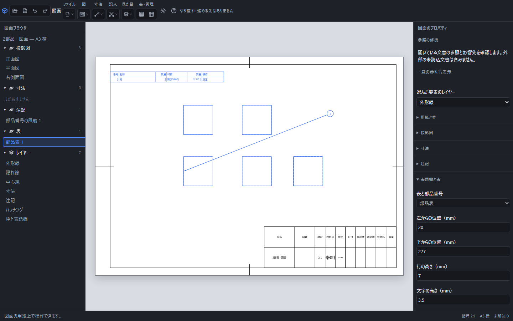

# 図面に部品表と部品番号を置く

組み立ての図面に、配置した部品から集計した一覧と部品番号を記入します。部品の図面では部品表を使えません。

同じ箱を2個置いた組図。部品表は数量2を集計し、表の行を選ぶと対応する箱と番号1の風船が青くなります。

## 部品表を配置する

1. 組み立てから作った図面で、上の「部品表」を押します。
2. 右側で、用紙の左・下からの位置、行の高さ、文字の高さをmmで入力します。
3. 「部品表の列」で必要な列を選びます。番号・名前・個数・材質・質量に加え、構成名も表示できます。
4. 「表を配置」を押します。

部品表の数値は元の組み立てから集計します。同じ形でも、構成が違う部品は区別します。材質や形が不足して質量を求められない場合は、0と表示しません。元の部品や組み立ての情報を修正してください。

## 列と行を整える

列名の横の矢印で列の順を変えます。列幅はmmで指定し、空欄では既定の幅を使います。「行の順番」で上から下・下から上を選びます。

「並べ替える項目」では番号・名前・個数・質量を選べます。「大きい順・逆順に並べる」で逆順にします。表示する行を並べ替えても、その部品に対応する風船番号は保ちます。

配置済みの表を選ぶと同じ欄で編集できます。「表を更新」で確定します。表が用紙内に収まらない場合は、画面下の理由に従って位置・列幅・文字の高さを調整してください。

## 鋼材の行と鋼材切断リスト

図面の部品表でも、鋼材は1行の部品として並びます。名前に鋼種・呼び寸法・長さが入る(例「SS400 FB 50×6 長さ1000」)ので、長さや鋼種の列はありません。材質の列は鋼種ではなく部品の材質で、S45CやSGPの鋼材でも「{{ui:material.steel}}」と出ます。長さの違う鋼材は別の行になります。

鋼材だけを長さと数量で一覧するときは、右側の **{{ui:assembly.steel.stockList}}** にチェックを入れてから「{{ui:drawing.table.add}}」を押します。配置済みの部品表を選んでチェックを入れ、「{{ui:drawing.table.update}}」を押して切り替えることもできます。チェックにカーソルを重ねると、集計の範囲と、素材購入長・完成長の扱いを説明する文が出ます。表は **{{ui:assembly.steel.shape}}**(呼び寸法つき)・**{{ui:assembly.steel.material}}**・**{{ui:assembly.steel.csv.productStandard}}**・**{{ui:assembly.steel.stockLength}} (mm)**・**{{ui:assembly.steel.quantity}}**・**{{ui:assembly.steel.finishedLength}} (mm)** の6列になり、「{{ui:drawing.table.columns}}」「{{ui:drawing.table.direction}}」「{{ui:drawing.table.sortBy}}」は使いません。列の幅は決まっていて、表の幅は170 mmです。規格の欄には、「寸法・製品規格 / 材料規格」の番号に続けて、カタログの版と形状生成の版が出ます。

素材購入長と完成長は別の列です。加工のあとの完成長を確かめられない鋼材には「{{ui:assembly.steel.finishedUnknown}}」と出ます。集計できない配置は、先頭の欄が「{{ui:assembly.steel.csv.omitted}}」で、最後の欄に理由が入った行として並びます(配置の名前は出ません)。総延長の列と合計の行、供給の条件、規格の発行年は図面の表に出ないので、[規格部品を置く](standard-parts.md)の小窓の切断リストやCSVで確かめます。この表の行は図面に保存せず、元の組み立てから集計します。PDFなどへ書き出すときも、画面と同じ表が出ます([図面の保存と出力](drawing-export.md))。風船の番号は通常の部品表の番号で、鋼材切断リストには番号の列がありません。

## 部品番号の風船を置く

「表題欄と表」を開き、「部品番号の風船」を押します。図の部品の辺または面を選び、続けて番号を置く位置をクリックします。先に部品の辺を選んでから道具を押しても置けます。

辺を指す引出線の先端は矢印、面を指す先端は黒丸です。同じ部品の別の場所へ同じ番号を置くこともできます。番号を手入力して別の部品へ付け替える操作ではありません。番号は対応する部品の情報に追従します。

## 対応を確認する・移動する・削除する

部品表の行を押すと、対応する図の部品と風船を強調します。表や風船はドラッグで移動できます。風船は選択後の右側で位置を数値入力して「決定」することもできます。

「選んだ表・風船を削除」は明示的に選択した表や風船を削除します。表の行を押して対応表示された風船は、表と一緒には削除されません。追加・変更・移動・削除は「元に戻す」で戻せます。

図面の画面で Delete または Backspace を押すと、選んでいる風船・表・寸法をまとめて削除し、「元に戻す」1回で全部を戻せます。何も選んでいないときや、文字欄・日本語変換中は文書を変えません。投影図とレイヤーは削除せず、状態表示へ『投影図とレイヤーは Delete・Backspace では削除しません。レイヤーはレイヤーの設定の「レイヤーを削除」から消します。』と理由を出します。

編集を続けるときは.pcaddで保存します。配布するときは、元の部品が正しく読み込まれていることを確認してPDFなどへ書き出します。

[組み立ての部品表](bom.md)・[穴表と改訂欄](drawing-table.md)・[図面の保存と出力](drawing-export.md)
