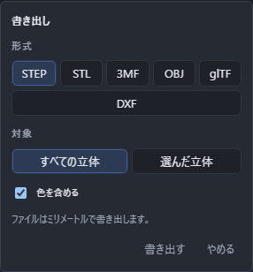
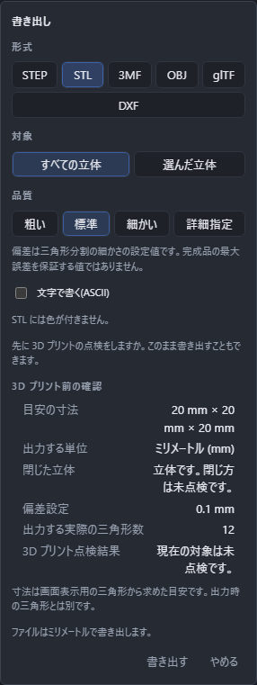

# 書き出す(ほかのソフトへ渡す)

作った立体を、ほかの CAD や 3D プリントのソフトが読める形にして書き出せます。

## 書き出しかた

いちばん上の、保存のボタンの右にある▾の付いたボタン(**{{ui:toolbar.fileMenu.groupLabel}}**)を押すと一覧が開きます。その中の**書き出す**を選ぶと、画面の中に小さなパネルが浮かびます。上から順に決めて、いちばん下の**書き出す**を押してください。

決めるところが分からないときは、そのまま Enter を押しても構いません。よく使う組み合わせがはじめから選んであります。

書き出しの待機中は「やめる」かパネルを閉じると取り消せます。対象・品質・文書・選択を変えた場合も、前の条件での待機を取り消します。新しい条件を確認して、もう一度「書き出す」を押してください。すでに保存されたファイルは消えません。OBJ の 2 ファイルの途中で取り消した場合も、保存済みのファイルは残ります。

## 形式

6 つから選びます。

| 形式 | 向いている用途 | 色 |
|---|---|---|
| STEP | ほかの CAD へ渡して、続きを作ってもらう | 付く |
| STL | 3D プリント | 付かない |
| 3MF | 3D プリント(色も渡したいとき) | 付く |
| OBJ | 絵にする、見てもらう | 付く |
| glTF | ウェブで見せる、絵にする | 付く |
| DXF | 平らな図形を、ほかの CAD や加工の機械へ渡す | 付かない |

**STEP だけは、丸みや曲面をそのままの形で渡せます。** STL・3MF・OBJ・glTF は、形を細かい三角形の集まりに直してから書き出します。あとで寸法を直してもらうつもりなら STEP を選んでください。

**DXF だけは立体ではなく、いま編集しているスケッチの平らな図形を書き出します。** 決めるところも下の「対象」以降とは変わるので、詳しくは[DXF を読み書きする](dxf.md)を見てください。

## 対象

**すべての立体**と、**選んだ立体**のどちらかを選べます。はじめは「すべての立体」です。

一部だけを渡したいときは、書き出す前に画面で立体を選んでから、「選んだ立体」にしてください。

DXF を選んだときは、対象は「いま編集しているスケッチ」に決まっているので、この 2 つは出ません。

## 品質

**粗い / 標準 / 細かい / 詳細指定**から選びます。はじめは「標準」です。STL・3MF・OBJ・glTF を選んだときだけ出ます。既存の 3 品質の値は変わりません。詳細指定では、0 より大きい有限の数をミリメートルで入力します。0、負の数、数字ではない文字、無限大は使えません。

丸い面を細かい三角形で表すほど、本物の丸みに近づきます。そのぶんファイルは大きくなります。

- **粗い**: 大きさや置き場所をざっと確かめたいとき。
- **標準**: たいていの用途はこれで足ります。3D プリントもふつうはこれで十分です。
- **細かい**: 表面のなめらかさをそのまま見せたいとき。ファイルはかなり大きくなります。

三角形を作るときの線形偏差と角度の組は、粗い `0.5 mm / 0.5 rad`、標準 `0.1 mm / 0.2 rad`、細かい `0.02 mm / 0.1 rad` です。たとえば面の隙間をつなぐ修復の初期幅 `0.01 mm` に対し、標準の出力偏差は `0.1 mm` です。これらは役割の違う指定値なので、小さい方が製品全体の精度になるとは判断できません。出力偏差は、保存後の三角形と元の曲面・辺との間の保証最大誤差や、プリンタでできる寸法の保証値ではありません。元の曲面・辺を備えた形の測定値はその形から、STL などの三角形の寸法は三角形から得るので、数値の出所も分けて確かめてください。

詳細指定では長さの偏差だけを入力し、角度は直前に選んだ品質の値を使います。細かくするほど三角形が増え、処理時間と容量も増えます。出力は合計 100 万枚の三角形と 25 秒を暫定の上限とし、計算できる追加配列と出力容量は 512 MiB 以内に制限します。上限に達したときは書き出しを止めます。

## 3D プリント前の確認

STL または 3MF を選ぶと、同じ書き出しパネルに寸法、出力単位、閉じた立体か、偏差設定、出力時の実際の三角形数、現在の 3D プリント点検結果をまとめて示します。確認の後は、そのまま「書き出す」を押せます。保存先の選択をやめても文書は変わりません。

寸法は画面表示用の三角形から求める目安です。インチ表示ならインチで示しますが、STL と 3MF の出力単位はミリメートルです。出力時の三角形数は、出力用の分割中は「計算中」、実数を得られなかったときは「未計算」と表示します。表示した実数は、そのまま書き出しに使う計算結果から得ます。対象の立体や品質などを変えると計算し直します。画面用の枚数や点検用の枚数を、出力時の実数として表示しません。点検結果は現在の文書と対象の立体に合うものだけを示します。点検が途中で止まった場合もその旨を表示します。

## 文字で書く

STL を選んだときだけ出ます。はじめは切ってあります。

切ってあるとファイルは小さくなります。入れると、中身を文字として読める形になり、テキストエディタで開けます。中身を人の目で確かめたいときだけ入れてください。

### 原点から遠い形の精度

「文字で書く(ASCII)」を切った STL は、座標を 32 ビットの浮動小数点数で保存する Binary STL です。表せる有効桁はおよそ 7 桁なので、原点から遠い位置ほど、小さな寸法差を表せなくなります。小さな形や薄い部分がつぶれることがあり、「細かい」や「詳細指定」で三角形を増やしても、この座標の桁数は増えません。画面できれいに見えることも、書き出した STL の精度の保証にはなりません。

座標の文字の値を確認したいときは、形式を STL にして「文字で書く(ASCII)」に印を付けて書き出してください。文字の座標は小数点以下 6 桁で書かれます。ただし、書き出し用の三角形を作る段階でも 32 ビットの座標を使うため、ASCII に切り替えても、すでに失われた細部は戻りません。小数点以下の桁数は、元の曲面との誤差や加工精度を保証する値ではありません。

元の曲面を持つ立体をほかの CAD へ渡すなら、同じパネルで形式を STEP に切り替えてください。読み込んだ三角形の形は STEP に書き出せません。STL を使う場合は、受け取るソフトでも寸法と細い部分を確かめてください。

## 色を含める

STEP・3MF・OBJ・glTF を選んだときだけ出ます。**はじめから入っています。**

立体に付けた色、面ごとに付けた色のどちらも、そのまま渡せます。柄・透け具合・つやは渡せません。柄を付けた面は、柄の下の色だけが渡ります。

**STL には色が付きません。** STL を選ぶと、パネルに「STL には色が付きません。」と 1 行出ます。色も一緒に渡したいときは 3MF を選んでください。

## 単位

書き出すファイルはいつも**ミリメートル**です。glTF だけは、その形式の決まりに合わせて**メートル**で書き出します。パネルの下のほうに、どちらで書き出すかが 1 行出ます。

画面の表示をインチにしていても、書き出すファイルの中身は変わりません。

## 書き出せないとき

押す前に赤い字で理由が出て、**書き出す**が押せなくなります。

| 出る言葉 | 直し方 |
|---|---|
| 書き出せる立体がありません。 | 立体を作るか、「すべての立体」に切り替えてください。 |
| 面だけの立体は STL に書き出せません。 | 中身のある立体にするか、STEP・OBJ・glTF を選んでください。 |
| 読み込んだ三角形の形は STEP に書き出せません。STL・3MF・OBJ・glTF なら書き出せます。 | STL・3MF・OBJ・glTF のどれかを選んでください。 |
| 書き出せる図形がありません。スケッチに線や円を描いてから書き出してください。 | DXF を選んだときに出ます。スケッチに図形を描いてください。 |
| この形は平らではないので DXF に書き出せません。 | DXF を選んだときに出ます。平らな面の上で描き直してください。 |

いくつかある立体のうち一部だけが書き出せないときは、止めずに書き出し、残りを書いたことと落とした理由を下の帯に出します。

## OBJ を選んだとき

OBJ は**ファイルが 2 つ**できます。形のファイルと、色のファイルです。名前は決まっていて、2 つそろっていないと色が付きません。保存の場所を 2 回聞かれるので、**両方とも同じ場所に、名前を変えずに**保存してください。

## 書き出したあとに出る言葉

書き出した後、下の帯に案内が出ることがあります。

- 「面積が 0 の三角形を n 枚除きました。」 …… 丸い面のてっぺんなどで、面積の無い三角形ができることがあります。そのままだと開けないソフトがあるので、除いてから書き出しています。形は変わりません。
- 「この形式では品質の指定は効きません。」 …… STEP はもともと曲面のまま渡すので、品質の指定を使いません。
