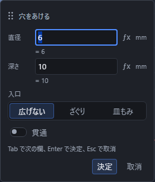
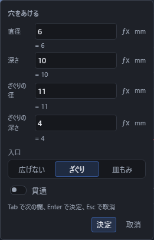

# 穴をあける

立体に丸い穴をあけます。

## 手順

1. 「選択」の道具のまま、穴をあけたい**面**をクリックします。
2. Shift を押しながら、穴の**中心にする点**をクリックします(あらかじめ点の道具でかいておいたスケッチの点を使います)。
3. ツールバーの「ソリッド」区画で「加工」を押して一覧を開き、「穴」を押します。
4. 入力欄が出るので、「直径」と「深さ」を入れて Enter を押します。

面や点を選ぶ前でも「穴」を押せます。対象が足りないときは、画面下の帯に選ぶものの案内が出ます。面をクリックし、Shift を押しながら中心の点を追加して、「加工」の一覧からもう一度「穴」を押すと入力欄が開きます。やめるときは Esc を押します。

## 「貫通」の意味

入力欄の「貫通」のつまみを入にすると、深さの欄は消え、立体を反対側まで突き抜ける穴になります。切にすると、入れた深さぶんだけの止まり穴になります。

## 入口を広げる(ざぐり・皿もみ)

ねじの頭を沈めたいときは、入力欄の「入口」で穴の入口の形を選びます。はじめは「広げない」です。

| 選ぶもの | 形 | 出る欄 |
|---|---|---|
| 広げない | まっすぐな穴のまま | なし |
| ざぐり | 入口を円柱の形に広げる。六角穴付きボルトの頭を沈めるときに使います | ざぐりの径・ざぐりの深さ |
| 皿もみ | 入口を円錐の形に広げる。皿頭のねじを面と平らにそろえるときに使います | 頭の径・開き角 |

- ざぐりの径・頭の径は、**穴の直径より大きく**します。小さいと広がらないので断られます。
- 皿もみの開き角は、皿頭のねじならふつう 90 度です。0 度より大きく 180 度未満で入れます。
- 円錐の深さは頭の径と開き角から自動で決まるので、入れる欄はありません。

入口の形は、あとから右の「プロパティ」でも選び直せます。選び直すと欄も入れ替わり、値は既定へ戻ります。ねじ穴でもまったく同じように使えます。

## 点列を選ぶと、いっぺんに何個も

穴の中心には、点が並んだ「点列」も選べます。点列を 1 つ選んで「穴」を押すと、並んでいるすべての点に同じ大きさ・深さの穴が一度にあきます。等間隔の穴をボタンひとつで並べたいときに使ってください。

## 傾けたいとき

まっすぐな穴ができたあとで、右の「プロパティ」でその穴を選ぶと、「傾き」と「傾ける向き」を数値で入れられます。ここは、その場の入力欄には出てこないので、穴を作ったあとにプロパティから直してください。

## うまくいかないとき

「穴」を押しても何も起きないとき、または画面下の帯に理由が出たときは、次を確かめてください。

| 出る文 | 直し方 |
|---|---|
| 穴をあける面が選ばれていません。 | 面をクリックしてから、もう一度「穴」を押します |
| 穴の中心にする点が選ばれていません。 | Shift を押しながら、中心にする点をクリックします |
| 穴をあけたら立体が残りませんでした。径か深さを小さくしてください。 | 直径や深さの数字を小さくして作り直します |

## 平面の面内X・Yで穴の位置を指定する

平面を選んで穴またはねじ穴を開き、{{ui:numericInput.choice.holePlacement}}で
{{ui:numericInput.holePlacement.planeFace}}を明示的に選びます。
既定の{{ui:numericInput.holePlacement.points}}は従来の中心点・点列を使う方法です。
面内指定と中心点の選択、円筒側面指定は同時に使えません。

入力画面に出る選択面の原点（部品座標、mm）、X方向、Y方向を確認し、
{{ui:numericInput.field.holePlanarX}}と{{ui:numericInput.field.holePlanarY}}へ
符号付きの長さまたは長さの式を入力します。位置は「原点 + X×X方向 + Y×Y方向」です。
原点は面のトリム範囲外にもあり、外向き法線が逆の面ではY方向も変わります。
部品の世界X/Yや2辺からの距離を意味しません。現在の平面基準を確認できないときは理由を表示します。

直径・深さ・ねじの呼び・入口の形は既存の欄で指定します。空欄や不正な式は確定できません。
取消は文書へ追加しません。作成後はプロパティの面内X/Yで元式を編集できます。
保存したfeatureに位置が複数あるときは「位置1」「位置2」等を選び、選んだ位置だけを編集します。
位置選択だけでは文書やUndo履歴を変更しません。不正な下書きは位置切替で破棄されます。

## 3D画面で面内の原点と方向を確かめる

平面を1面だけ選ぶと、3D画面に{{ui:viewport.planarOrigin}}の丸と、
そこから{{ui:viewport.planarPositiveX}}・{{ui:viewport.planarPositiveY}}へ伸びる線が出ます。
線の先が正方向、負のX/Yはそれぞれ逆方向です。線の長さは面の大きさに応じた表示用で、1mmの物差しではありません。
入力欄の部品座標・X/Y方向と同じ、選択面の実際の基準を示します。

原点が面のトリム範囲外でも、面の中心へ移して表示しません。原点や線が現在の画面外にある場合は、
入力欄の座標を確認して視点を動かしてください。この案内のために視点や表示範囲を自動変更しません。
選択変更・複数選択・再計算中・基準の所有が失効したときは案内を消します。
案内を見る操作は文書・測定結果・Undo履歴・保存参照を変えません。
