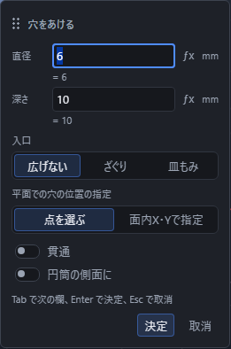
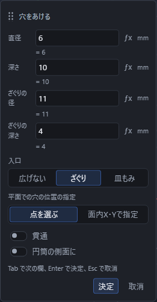

# 穴をあける

立体に丸い穴をあけます。平らな面にあける方法を先に説明します。円柱や管の丸い側面にあけるときは、この章の最後の「円筒の側面に穴をあける(高さと角度)」を見てください。

## 手順

1. 「選択」の道具のまま、穴をあけたい**面**をクリックします。
2. Shift を押しながら、穴の**中心にする点**をクリックします(あらかじめ点の道具でかいておいたスケッチの点を使います)。
3. ツールバーの「ソリッド」区画で「加工」を押して一覧を開き、「穴」を押します。
4. 入力欄が出るので、「直径」と「深さ」を入れて Enter を押します。

面や点を選ぶ前でも「穴」を押せます。対象が足りないときは、画面下の帯に選ぶものの案内が出ます。面をクリックし、Shift を押しながら中心の点を追加して、「加工」の一覧からもう一度「穴」を押すと入力欄が開きます。やめるときは Esc を押します。

## 「貫通」の意味

入力欄の「貫通」のつまみを入にすると、深さの欄は消え、立体を反対側まで突き抜ける穴になります。切にすると、入れた深さぶんだけの止まり穴になります。

## 入口を広げる(ざぐり・皿もみ)

ねじの頭を沈めたいときは、入力欄の「入口」で穴の入口の形を選びます。はじめは「広げない」です。

| 選ぶもの | 形 | 出る欄 |
|---|---|---|
| 広げない | まっすぐな穴のまま | なし |
| ざぐり | 入口を円柱の形に広げる。六角穴付きボルトの頭を沈めるときに使います | ざぐりの径・ざぐりの深さ |
| 皿もみ | 入口を円錐の形に広げる。皿頭のねじを面と平らにそろえるときに使います | 頭の径・開き角 |

- ざぐりの径・頭の径は、**穴の直径より大きく**します。小さいと広がらないので断られます。
- 皿もみの開き角は、皿頭のねじならふつう 90 度です。0 度より大きく 180 度未満で入れます。
- 円錐の深さは頭の径と開き角から自動で決まるので、入れる欄はありません。
- 円筒の側面にあける穴では、ざぐりは使えますが、皿もみは使えません。くわしくは、この章の最後の「円筒の側面に穴をあける(高さと角度)」を見てください。

入口の形は、あとから右の「プロパティ」でも選び直せます。選び直すと欄も入れ替わり、値は既定へ戻ります。ねじ穴でもまったく同じように使えます。

## 点列を選ぶと、いっぺんに何個も

穴の中心には、点が並んだ「点列」も選べます。点列を 1 つ選んで「穴」を押すと、並んでいるすべての点に同じ大きさ・深さの穴が一度にあきます。等間隔の穴をボタンひとつで並べたいときに使ってください。

## 傾けたいとき

まっすぐな穴ができたあとで、右の「プロパティ」でその穴を選ぶと、「傾き」と「傾ける向き」を数値で入れられます。ここは、その場の入力欄には出てこないので、穴を作ったあとにプロパティから直してください。

円筒の側面にあけた穴は傾けられません。「傾き」と「傾ける向き」の欄は表示されますが、変更はできません。

## うまくいかないとき

「穴」を押しても何も起きないとき、または画面下の帯に理由が出たときは、次を確かめてください。

| 出る文 | 直し方 |
|---|---|
| 穴をあける面が選ばれていません。 | 面をクリックしてから、もう一度「穴」を押します |
| 穴の中心にする点が選ばれていません。 | Shift を押しながら、中心にする点をクリックします |
| 穴をあけたら立体が残りませんでした。径か深さを小さくしてください。 | 直径や深さの数字を小さくして作り直します |

## 平面の面内X・Yで穴の位置を指定する

平面を選んで穴またはねじ穴を開き、「{{ui:numericInput.choice.holePlacement}}」で「{{ui:numericInput.holePlacement.planeFace}}」を明示的に選びます。既定の「{{ui:numericInput.holePlacement.points}}」は従来の中心点・点列を使う方法です。面内指定と中心点の選択、円筒側面指定は同時に使えません。

入力画面に出る選択面の原点（部品座標、mm）、X方向、Y方向を確認し、「{{ui:numericInput.field.holePlanarX}}」と「{{ui:numericInput.field.holePlanarY}}」へ符号付きの長さまたは長さの式を入力します。位置は「原点 + X×X方向 + Y×Y方向」です。原点は面のトリム範囲外にもあり、外向き法線が逆の面ではY方向も変わります。部品の世界X/Yや2辺からの距離を意味しません。現在の平面基準を確認できないときは理由を表示します。

直径・深さ・ねじの呼び・入口の形は既存の欄で指定します。空欄や不正な式は確定できません。取り消したときは、穴は追加されません。作成後は、プロパティの面内X/Yで入力した式を直せます。1つの穴に位置が複数あるときは「位置1」「位置2」等を選び、選んだ位置だけを編集します。位置を選び替えるだけでは、形も「元に戻す」の履歴も変わりません。正しくない入力のまま位置を切り替えると、その入力は捨てられます。

## 3D画面で面内の原点と方向を確かめる

平面を1面だけ選ぶと、3D画面に{{ui:viewport.planarOrigin}}の丸と、そこから{{ui:viewport.planarPositiveX}}・{{ui:viewport.planarPositiveY}}へ伸びる線が出ます。線の先が正方向、負のX/Yはそれぞれ逆方向です。線の長さは面の大きさに応じた表示用で、1mmの物差しではありません。入力欄の部品座標・X/Y方向と同じ、選択面の実際の基準を示します。

原点が面のトリム範囲外でも、面の中心へ移して表示しません。原点や線が現在の画面外にある場合は、入力欄の座標を確認して視点を動かしてください。この案内のために視点や表示範囲を自動変更しません。選択を変えたとき、複数を選んだとき、再計算中、形が作り直されて選んだ面が古くなったときは、案内を消します。案内を表示しても、文書・測定結果・「元に戻す」の履歴・保存した参照は変わりません。

## 円筒の側面に穴をあける(高さと角度)

円柱や軸の丸い**側面**(外面)にも、管や丸い穴の内側の面(内面)にも、穴をあけられます。平らな面のように中心の点を選ぶのではなく、**高さ**と**角度**の2つの数で穴の位置を決めます。円錐・球・自由曲面にはあけられません。ねじ穴も同じ入口であけられます。くわしくは[ねじ穴をあける](thread.md)を見てください。

### 入口(つまみと選ぶ面)

1. 「選択」で選ぶものを「面」(`3`)にし、穴をあけたい円筒の丸い側面をクリックします。端の平らな面ではありません。
2. **中心の点は選びません。** 点も選んでいると断られるので、選んでいたときは点の選択を外します。
3. ツールバーの「ソリッド」区画で「加工」を押して一覧を開き、「穴」を押します。円筒の面だけを選んだ状態で押せます。
4. 入力欄の「円筒の側面に」のつまみを**入**にします。「高さ」と「角度」の欄が出ます。はじめの値は、高さ10mm、角度0度です。
5. 「直径」と「深さ」(または「貫通」)、「高さ」「角度」を入れて Enter を押します。

「円筒の側面に」のつまみは、はじめは切です。切のままだと、平らな面にあける穴として扱われて断られます(あとの表を見てください)。

次のときは、このつまみを入にできません。

- 「入口」が「皿もみ」のとき。つまみの名前が「円筒の側面に（皿もみでは使えません）」に変わります。
- 「平面での穴の位置の指定」が「面内X・Yで指定」のとき。

つまみを入にしているあいだは、「入口」に「皿もみ」が、「平面での穴の位置の指定」に「面内X・Yで指定」が出なくなります。

### 高さと角度の決め方

- **高さ**(mm)は、円筒の側面の**下の端**から、軸に沿って測った穴の中心までの距離です。「作る」の「円柱」で置いた円柱では、底面の側が下の端で、「回転軸」で選んだ向きへ高さが増えます。
- **角度**(度)は、軸のまわりでの穴の中心の向きです。**0度は、選んだ円筒の側面のX方向**です。軸の向きに右手の親指を合わせ、ほかの指が巻く向き(軸の先から見て反時計まわり)が**正の向き**です。たとえば「回転軸」がZ(はじめの設定)の円柱なら、0度は+Xの向き、90度は+Yの向きです。
- 高さと角度には、数のほかに式も入れられます。入れた式はそのまま保存され、あとから直せます。
- 角度に範囲はありません。360度は0度と、-90度は270度と同じ向きです。全周の円筒では、側面のつなぎ目の位置(0度や360度)にもあけられます。
- 高さと角度が選んだ面の範囲の外になると、穴はあきません。面が円筒の一部だけのとき(丸めた角など)は、その面に入る範囲の高さと角度を入れます。

下の端も0度の向きも、世界のX方向や原点ではなく、**その円筒の側面を基準にします**。円柱を動かしたり回したりすると、一緒に動きます。

現在の画面には、0度の向きを示す線は出ません。思った位置と違うときは、「元に戻す」(Ctrl+Z)で戻し、角度を90度ずつ変えて確かめてください。「作る」の「円柱」以外の方法で作った円筒では、下の端がどちらになるかも見た目では分かりにくいので、はじめに小さな高さ(たとえば1)を入れて位置を確かめてください。

### 外面と内面

選んだ側面が外面(円柱や軸の外側)か内面(管や丸い穴の内側)かは、自動で判断されます。穴はどちらも、その位置の面に垂直に、円筒の軸に直角な向きにあきます。

| 選ぶ面 | 穴の向き | 「貫通」にすると |
|---|---|---|
| 外面(円柱や軸の外側の側面) | 面から円筒の軸のほうへ、材料の中へ向かう | 反対側まで突き抜ける。管なら向こう側の壁にも穴があく |
| 内面(管や丸い穴の内側の面) | 内側から外側へ、まわりの壁の材料の中へ向かう | 壁を抜けて外へ出る。向こう側の壁にはあかない |

- 止まり穴の「深さ」は、穴の中心の位置(面の上の点)から、穴の向きに測ります。底は平らです。
- 内面にあけるときは、穴の直径とざぐりの直径を、どちらも内面の直径より小さくします。同じか大きいと断られます。

### 位置が複数あるとき

入力欄であけられるのは、1回に1か所です。保存してある穴に位置が複数あるときは、右の「プロパティ」に「穴の位置」と、「位置1」「位置2」…のボタンが出ます。押した位置の「高さ」と「角度」だけを直せます。ほかの位置や、直径・深さ・ざぐりなどは変わりません。位置を選ぶだけでは、形も「元に戻す」の履歴も変わりません。

### ざぐり・皿もみ・傾き

- **ざぐり**は使えます。「入口」を「ざぐり」にして、「ざぐりの径」と「ざぐりの深さ」を入れます。径は穴の直径より大きく、深さは0より大きくします。ざぐりの深さは、穴の中心の位置の面から、穴と同じ向きに測り、底は平らです。円筒の面は曲がっているので、ざぐりの縁の壁の高さは、場所によって入れた深さと違って見えます。
- **皿もみ**は使えません。「入口」を「皿もみ」にしているあいだは、つまみの名前が「円筒の側面に（皿もみでは使えません）」になり、入にできません。
- **傾け**もできません。穴は円筒の面に垂直にあきます。「プロパティ」の「傾き」と「傾ける向き」の欄は表示だけで、欄にカーソルを合わせると「円筒の側面の傾斜穴には対応していません。傾き角と傾ける向きは変更できません。」と出ます。
- 「穴」「ねじ穴」ボタンの説明にも、「円錐・球・自由曲面、円筒の傾斜穴・皿もみには対応していません」と書かれています。

### 保存・開き直し・元に戻す

- 保存して開き直しても、高さ・角度・深さ・ざぐりなどの式はそのまま残り、同じ位置に同じ穴ができます。
- 穴をあける前に円柱を動かしたり回したりしてあった場合、その動かす量や回す角度を穴をあけたあとから直しても、穴は円筒の側面の同じ高さ・角度にあき直されます。
- 穴の作成と、「プロパティ」での高さ・角度などの変更は、「元に戻す」(Ctrl+Z)で1回ずつ取り消せます。「やり直す」(Ctrl+Y)で戻した操作をやり直せます。
- Enter を押すと、形ができるかを確かめてから穴が加わり、入力欄が閉じます。断られたときは入力欄が開いたまま、画面下の帯に理由が出ます。文書も「元に戻す」の履歴も変わりません。Esc でやめたときも同じです。

### 円筒の側面の穴がうまくいかないとき

「穴」を押しても何も起きないとき、または画面下の帯や作ったものの一覧に理由が出たときは、次を確かめてください。

| 出る文 | 直し方 |
|---|---|
| 穴の中心にする点が選ばれていません。 | 円筒の側面にあけるなら、「円筒の側面に」のつまみを入にします。平らな面にあけるなら、中心の点を選びます |
| 「円筒の側面に」の穴は、円筒の面を選んであけます。円筒の面を選び直してください。 | 円柱や管の丸い側面を選び直します。端の平らな面は使えません |
| 「円筒の側面に」の穴は高さと角度で位置を決めるので、中心の点は選べません。点の選択を外すか、「円筒の側面に」を切ってください。 | 点の選択を外し、円筒の面だけを選んで、もう一度「穴」を押します。円筒の面には、つまみを切にしても中心の点の穴はあけられません |
| 平面では面と中心の点を、円筒の外面・内面では点を選ばず「円筒の側面に」を使ってください。円錐・球・自由曲面の穴には対応していません。 | 円筒の面は、点を選ばずに「円筒の側面に」を入にします。円錐・球・自由曲面にはあけられません |
| 穴の位置が選んだ円筒の面の外です。高さか角度を見直してください。 | 高さを面の範囲に収めます。面が円筒の一部のときは、角度も見直します |
| 穴またはざぐりの直径が、選んだ円筒の内面の直径以上です。径を小さくするか、外側の面を選んでください。 | 管の内面では、穴とざぐりの直径を内面の直径より小さくします |
| 穴をあけたら立体が残りませんでした。径か深さを小さくしてください。 | 直径や深さを小さくして作り直します |
