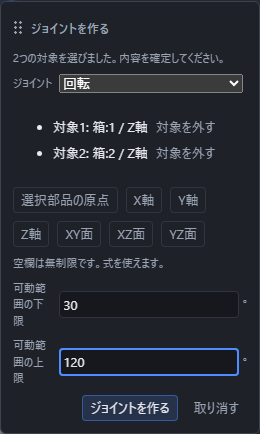
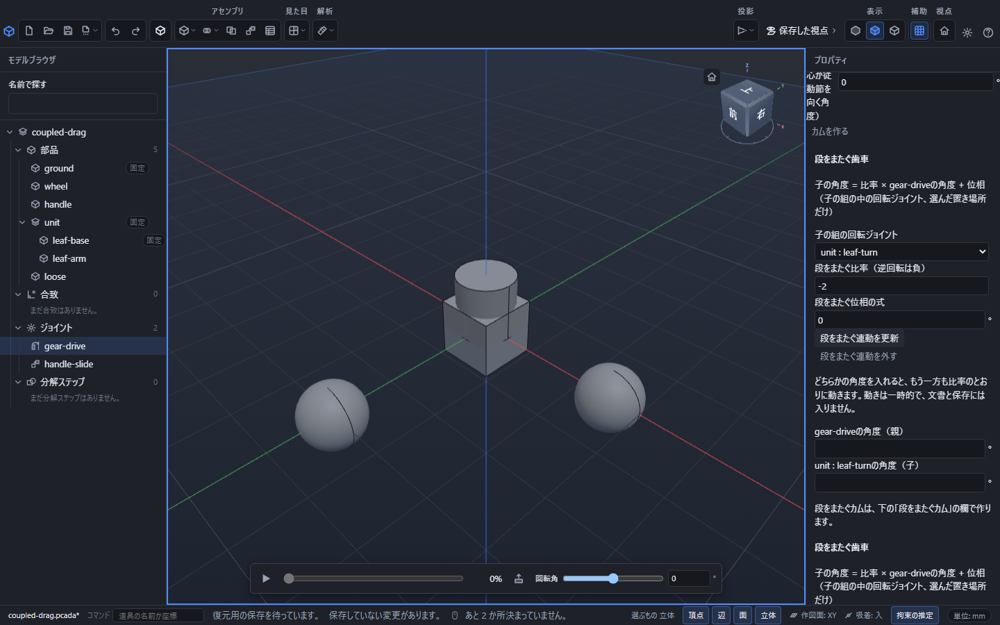

# ジョイントで動きを残す

ジョイントは、部品を合わせながら回転や移動を残す機能です。上の **合わせる** から回転・スライド・円筒・{{ui:assembly.tool.jointBall}}を選び、別々の部品から取付位置を1つずつ選びます。

左の **ジョイント** で行を選ぶと、右側に種類と可動範囲が出ます。つまみを動かすと、許された範囲で組み立ての動きを確認できます。範囲の端ではそれ以上動きません。

作成中はEnterで確定し、Escで取り消します。確定したジョイントは「元に戻す」1回で取り消せます。

## 動かす量の入力案内

ジョイントの回転角と移動量には、つまみと数値欄の両方があります。回転角は度、移動量はmmで指定し、設定した可動範囲の端で止まります。共通の時間軸は、分解とジョイントの動きを0%から100%まで一緒に動かします。各欄の説明は、マウスを置くかTabで欄へ移動して確認できます。

## うまくいかないとき

- **可動範囲の式を計算できないか、下限が上限を超えています。** … 可動範囲の下限・上限に計算できない式を入れる、または下限が上限を超えたまま確定しようとすると出ます。値を直すと作れます。
- つまみを動かして可動範囲の端まで来ると「可動範囲の端です」と、その下限・上限の値が表示されます。それ以上は動かせません。

取付位置を先に選んでからジョイントの種類を選んでも、種類を先に選んでから取付位置を選んでも、同じジョイントを作れます。ジョイントの種類・取付位置・可動範囲は組み立てに保存され、開き直しても保たれますが、つまみで動かした現在の位置(共通の時間軸の進み具合)は保存されないため、開き直すと最初の位置に戻ります。

## 歯車の回転を比率で連動させる

同じ組立の回転ジョイントどうしを、比率と位相で連動させられます。これは回転の関係を決める操作で、歯形を作ったり、歯が接触するかを確かめたりする操作ではありません。

1. 回転できる部品にそれぞれ回転ジョイントを作り、左の「ジョイント」で駆動する側の行を選びます。
2. 右の「{{ui:assembly.gear.title}}」で「{{ui:assembly.gear.peer}}」を選びます。
3. 「{{ui:assembly.gear.ratio}}」と「{{ui:assembly.gear.phase}}」を入れ、「{{ui:assembly.gear.create}}」を押します。画面の式は、相手の角度 = 比率 × 選んだジョイントの角度 + 位相です。比率を負にすると逆回転になり、位相は度で指定します。
4. ジョイントの角度を動かし、相手も連動することを確認します。関係を変えるときは「{{ui:assembly.gear.update}}」、連動だけを外すときは「{{ui:assembly.gear.remove}}」を使います。連動を外しても、部品やジョイントは削除されません。

## 偏心円板カムと従動節を連動させる

同じ組立で、回転ジョイントをカム、スライダーを直動の従動節として組み合わせます。左の「ジョイント」でカム側の回転ジョイントを選び、右の「{{ui:assembly.cam.title}}」を使います。

1. 「{{ui:assembly.cam.follower}}」でスライダーを選びます。
2. 「{{ui:assembly.cam.discRadius}}」「{{ui:assembly.cam.eccentricity}}」「{{ui:assembly.cam.rollerRadius}}」と「{{ui:assembly.cam.phase}}」を入力します。長さはmm、位相は度です。R > 0、r ≥ 0、0 ≤ e < R + rを満たす寸法にします。
3. 従動節の軸をカムの軸と直交して交わるようにし、スライダーをカムと同じ台に付けます。スライダーの原点がローラーの中心です。
4. 「{{ui:assembly.cam.create}}」を押し、カムの角度を動かします。変更には「{{ui:assembly.cam.update}}」、連動だけの解除には「{{ui:assembly.cam.remove}}」を使います。

円板の偏心とローラーの寸法から従動節の動きを計算します。立体どうしの接触、押す力、摩擦やばねの作用は確かめません。形を加工ソフトへ渡す場合は、[加工ソフトへの受け渡し](cam.md)を使ってください。

## 親と子の組立をまたいで連動させる

親の組立の回転ジョイントを選ぶと、「{{ui:assembly.crossGear.title}}」と「{{ui:assembly.crossCam.title}}」が表示されます。同じ子の組立を何か所にも置いている場合も、対象欄の所属を見て1つの配置を選びます。

- **歯車**: 「{{ui:assembly.crossGear.target}}」を選び、比率と位相を入力して「{{ui:assembly.crossGear.create}}」を押します。作成後は親または子の角度欄を動かすと、もう一方も比率に従って動きます。

作成後の右の欄には、同じ「{{ui:assembly.crossGear.title}}」の見出しの欄が、役目を分けて別々に並びます。上は設定済みの連動を変更する欄で、「{{ui:assembly.crossGear.update}}」と「{{ui:assembly.crossGear.remove}}」があります。その下は新しい連動を作る欄で、「{{ui:assembly.crossGear.create}}」があります。比率や位相を変えるときは上の欄で入力して更新します。欄が画面に収まらないときは右の欄をスクロールし、対象とボタンの名前を確かめてから押してください。

- **カム**: 「{{ui:assembly.crossCam.target}}」を選び、円板の半径・偏心・ころの半径・位相に加え、「{{ui:assembly.crossCam.offset}}」と「{{ui:assembly.crossCam.direction}}」を決めて「{{ui:assembly.crossCam.create}}」を押します。補正はmm、向きは+1または-1です。カムの角度から動かし、従節側からは動かせません。

段をまたぐカムの補正と向きは、利用者が決める運動の関係です。親子の部品が実際に接することは確かめません。同じ親ジョイントを同じ段の歯車・カムにも入れる組合せや、同じ子の配置への複数の段をまたぐ連動は受け付けません。子のジョイントが範囲内で関係を満たせない場合も、一部だけを動かさず、理由を表示して断ります。

## 連動の保存と元に戻す

連動の作成・更新・解除は文書の変更として記録され、「元に戻す」「やり直す」で戻せます。定義はアセンブリに保存され、開き直しても残ります。一方、角度や移動量で確かめた途中の動きは保存されません。入れ子の中だけを動かす場合も同じです。

部品やジョイントを変えた結果、段をまたぐ連動を外すか止める必要があると、「{{ui:assembly.crossGear.repairTitle}}」に案内が出ます。定義を残して止めた場合と、外した場合を確認してください。通常の自由な部品のドラッグは配置の変更ですが、ジョイントや連動を保って動かすドラッグは一時的な動作確認です。
