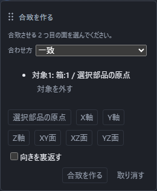

# 部品どうしを合わせる

上の **合わせる** から、一致・同心・距離・角度・平行・接線のいずれかを選びます。別々の部品から面、辺、頂点、または基準を1つずつ選んでください。

画面下には次に選ぶ対象と、まだ決まっていない動きの数が出ます。値が必要な合わせ方では式を入力し、Enterで確定します。Escを押すと作らずに戻ります。

左の **合致** で行を選ぶと、右側で種類、2つの対象、値の式、現在の状態を確認できます。両立しない合致や、対象を見つけられない合致には理由が表示されます。

## うまくいかないとき

- **この面は合致に使えません。平らな面か円筒の面を選んでください。** … 自由曲面など、平らでも円筒でもない面を選ぶと出ます。別の面を選び直してください。
- **この形からは軸が決まりません。** … 軸が定まらない辺や形を選ぶと出ます。直線・基準軸・円筒の軸など、向きが決まる要素を選んでください。
- **同じ部品どうしには合致を付けられません。別の部品を選んでください。** … 1つ目と同じ部品から2つ目の対象を選ぶと出ます。

対象を先に選んでから合わせ方を選んでも、合わせ方を先に選んでから対象を選んでも、同じ合致を作れます。確定した合致は対象・値の式・向きが組み立てに保存されますが、解いた結果の配置は保存せず、開き直すたびに解き直します。

## 対象の面や辺が見つからない・曖昧になったとき

形を編集した後に、合致で選んでいた面や辺が見つからなくなったり、似た面や辺が複数あって1つに決められなくなったりすることがあります。そのときは近い面や辺へ勝手に付け替えず、その合致を解いた結果には使いません。

- 左の **合致** のその行に「未確定」または「未解決」が出ます。行を選ぶと、右側の現在の状態が「未解決」になります。
- 行の注意の印にマウスを重ねると、「合致の対象が見つかりません。形が大きく変わったため、選び直してください。」と理由が出ます。
- 保存してある元の対象は書き換わりません。「元に戻す」「やり直す」を使っても、保存して開き直しても、未解決の状態と元の対象は変わりません。形の編集を戻して面や辺が1つに決まるようになれば、再び合致が成り立ちます。
- 付け直すときは、右側の「参照の修復」でその合致の対象の行を開き、元の参照・候補・影響先を確認します。正しい候補を選び「この参照で確定」を押し、計算後の「修復後の影響先」と合致の状態を確認してください。片側を直しても、もう片側の問題は残ることがあります。手順と制約は[図面に寸法を記入する](dimension.md)の「直せない・記入できないとき」を見てください。

ほかに両立しない合致があるときは、その理由が別に出ます。見つからない場合と曖昧な場合の考え方は[面・辺・頂点を選ぶ](select-subshape.md)にもあります。
