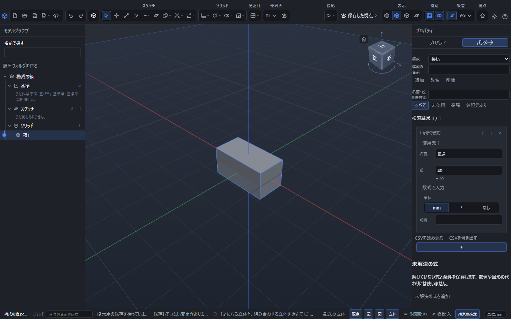

# 名前を付けた数値(パラメータ)

板の厚みや穴の直径のように、あちこちで同じ数を使うことがあります。その数に**名前**を付けておくと、どの数値の欄からも名前で呼び出せます。名前の値を 1 か所直せば、その名前を使っているところがすべて一緒に変わります。

構成「長い」を選んだ実画面です。パラメータ「長さ」の式40が箱へ反映されています。構成を切り替えると、登録した式と形が一緒に変わります。

## パラメータの表を開く

右の「プロパティ」の区画の上に「プロパティ」「パラメータ」の 2 つのタブがあります。「パラメータ」を押すと、名前を付けた数値の一覧が出ます。

## 名前を足す

1. 一覧の下の「+」を押します。
2. 空いている名前(「パラメータ1」など)の行が増えます。
3. 名前の欄を押して、使いたい名前(たとえば `板厚`)に書き直し、Enter を押します。
4. 式の欄に値(たとえば `3`)を入れて Enter を押します。

名前には日本語も使えます。`板厚` `穴径` `高さ` のように、後で読んで分かる言葉にしておくと迷いません。

**名前に使えないもの**

| 使えない名前 | 理由 |
|---|---|
| 数字で始まる名前(`2倍`) | 数と見分けが付かないため |
| `pi` `π` `e` | 円周率と自然対数の底に使う言葉のため |
| `sqrt` `cbrt` `abs` `rad` `root` | 計算に使う言葉のため |
| 空白・記号・かっこ・コンマを含む名前 | 式の途中で切れてしまうため |
| すでにある名前 | 同じ名前を 2 つ持てないため |

使えない名前を入れると、欄の下に赤い字で理由が出て、名前は変わりません。

## 名前を使う

数値を入れる欄なら、どこでも名前をそのまま書けます。

- 右の「プロパティ」の欄
- 図をかくときにその場に出る入力欄
- 画面の下のコマンドの欄

たとえば `板厚` を 3 にしておけば、押し出しの距離の欄に `板厚 * 2` と書くと 6 になります。図をかくときにその場に出る入力欄では、決める前に、欄の下へ「参照するパラメータ」として「板厚 (1文字目)：3 mm」と、その名前を使っている式の数「形・数式での使用箇所」が出ます。角度の単位にした名前は `30°` のように出ます。書き方を誤ると「入力中の誤りの位置」が出ます。見かたは[数値と式の入れ方](numeric-input.md#正しく書けているかの見かた)にまとめています。名前は式の一部として使えるので、`板厚 + 1` `板厚 * 2 + 穴径` のようにも書けます。

## 値を変える

式の欄を書き直して Enter を押すと、その名前を使っているところがすべて一緒に変わります。`板厚` を 3 から 5 にすれば、`板厚 * 2` と書いた押し出しの距離は 6 から 10 になり、立体もその場で作り直されます。

書きかけの途中では変わりません。**Enter を押すか、欄の外を押したとき**に決まります。

取り消し(Ctrl+Z)を 1 回押せば、変える前に戻ります。

## 名前を変える

名前の欄を書き直して Enter を押すと、その名前を使っている式もすべて一緒に書き直されます。`板厚` を `板の厚み` に変えると、`板厚 * 2` と書いてあったところは `板の厚み * 2` になります。値は変わりません。

似た名前(`板厚` と `板厚さ`)があっても、書き直されるのは変えた名前だけです。

## 名前を消す

行の右の「×」を押すと消えます。ただし**まだどこかで使われている名前は消せません**。「この名前は 押し出し1、穴1 から使われています。先にそちらを直してください。」のように、**使っているところの名前つき**で断られるので、そこを先に書き直してから消します。使っているところが多いときは「ほか N 件」とまとめて出ます。

## 並べ替える

行の「↑」「↓」で上下に動かせます。並び順は見やすさのためだけのもので、計算の結果は変わりません。

## 一覧の見かた

| 出るもの | 意味 |
|---|---|
| 名前 | 式から呼び出すときに書く言葉 |
| 式 | その名前の値。他の名前を使った式でもよい |
| `= 6` | その式を計算した値 |
| 単位 | `mm`は長さ、`°`は角度、「なし」は個数や倍率などを表します。長さの表示単位をinchへ変えても、角度・個数・倍率には長さの換算を掛けません |
| 説明 | 覚え書き。空のままでもかまいません |
| 「未使用」 | どこからも呼び出されていない名前 |
| 赤い行と「循環」 | 名前どうしがお互いを呼び合っていて、値が決められない |

一覧の上の「名前・説明を検索」の欄に文字を入れると、名前と説明のどちらかにその文字を含む行だけが残ります。大文字と小文字は区別しません。その下の「表示する係数」で「すべて」「未使用」「循環」「参照元あり」のどれかを選ぶと、検索語に一致した行をさらに絞り込めます(検索語と絞り込みは両方に合う行だけが残ります)。

- 「未使用」: どこからも呼び出されていない名前だけ。
- 「循環」: 名前どうしが呼び合っている名前だけ。
- 「参照元あり」: 他の名前の式・図形・拘束・立体・別の構成のどれかから使われている名前だけ。

絞り込んだ件数は「検索結果 31 / 100」のように、見えている行の数と全体の数で出ます。合う行が無いときは「一致する係数がありません。検索語または表示条件を変えてください。」と出るので、検索語を消すか「すべて」へ戻します。検索語や絞り込みは、名前の変更・「元に戻す」・構成の切り替えをしても残ります。名前を書き直している途中の行は、検索結果に合わなくなっても「編集中の行（検索結果には含めません）」として先頭に残り、Enter で決めると検索結果の判定へ戻ります。検索中も並べ替えは表全体の元の順番で動きます。100行ほどの表でも、検索語を入れてから一覧が変わるまでは0.1秒に届きません。

各行の「使用先」を開くと、その名前を使う別のパラメータ、文書の要素、別の構成の値が見られます。同じ持ち主の複数の欄は1件にまとめ、別スケッチに同じ要素IDがあってもスケッチIDで区別します。使用先の件数は式の本数や部品全体の影響数とは異なります。個別の欄への移動はまだできません。

## CSVでまとめて読み書きする

一覧の下の「CSVを書き出す」と「CSVを読み込む」で、パラメータの表をCSVファイルとしてまとめて出し入れできます。

**書き出す**: 「CSVを書き出す」を押して保存先を選ぶと、現在の表の名前、元の式、単位、説明をUTF-8のCSVに保存し、「CSVを書き出しました。」と出ます。保存先を選ばずにやめたときは「CSVの書き出しを取り消しました。」と出ます。表が空のときは「書き出す係数がありません。」と出ます。数学入力の参照IDを持つ行では、その定義とIDも列に含めます。書き出す前後で文書は変わらず、CSVの書き出し先は部品ファイルの保存先にもなりません。

**読み込む**: 「CSVを読み込む」を押してCSVファイルを選びます。従来のCSVは先頭行を `name,expression,unit,description` とし、必要なら `mathId` と `mathDefinition` の列を末尾に加えられます。数学定義がある行には参照IDが必要です。単位は `mm`、`degree`、`none` のいずれかです。引用符で囲めば、式や説明にコンマ・改行・引用符を含められます。日本語、UTF-8のBOMにも対応します。

**書き出したCSVを編集する**: 現在の書き出しはUTF-8のBOM付きで、見出しは `name,expression,unit,description,textEncoding` です。数学入力の定義があるときは `name,expression,unit,description,mathDefinition,mathId,textEncoding` になります。表計算ソフトで編集するときも列の見出しと並び、各行の `textEncoding` の値 `pointercad-text-v1` を残し、UTF-8のCSVとして保存してください。ソフトによって値が自動変換されることがあるので、再読込時の「変更の確認」で元の式や説明を確かめます。

名前・式・説明のうち、表計算の数式などと誤認される文字列には先頭に `text:` が付きます。たとえば式 `-1+2` は `text:-1+2` と保存され、再読込で元の式に戻ります。単独の有限な負数 `-2` はそのままです。元から `text:` で始まる文字列は `text:text:` で始まる形になります。編集するときは保護用の先頭の `text:` を残してください。

標識の値が違う行や、保護が必要なのに `text:` がないセルは読み込めません。ただし、保護文字を削ると別の文字列として読まれる場合もあります。`textEncoding` 列ごと削ると従来形式として文字列をそのまま読むため、`text:` が式や説明の一部になり、意味が変わることがあります。標識列に対応しない旧版へ渡すために列や保護文字を削らず、対応する版で再読込してください。

**上限**: データは1000行、ファイルは1MiB(1048576バイト)までです。1001行以上のCSVは「CSVは1000行までです。」、1MiBを1バイトでも超えるファイルは「ファイルが大きすぎるため開けません。」と出て、読み込みません。

**適用の前に確認する**: 読み込んでもすぐには表を書き換えません。全行を検査して、「変更の確認」に名前ごとの「追加」「更新」「変更なし」と、更新では前と後の式・単位・説明を並べて出します。同名の行は更新し、CSVにない既存の行は残します。重複する名前や数学ID、誤った単位・式、循環する式があれば、行ごとの理由を出して確認の一覧は出しません。

- 内容を確認して「変更を適用」を押すと、「CSVの変更を適用しました。」と出て、まとめて1回の変更になります。取り消し(Ctrl+Z)も1回で、CSV全体が元へ戻ります。
- 「取り消す」を押すと確認を閉じます。表も取り消し(Ctrl+Z)の履歴も変わりません。
- 確認している間に文書が変わったときは「文書が変わったためCSVを取り消しました。」と出て、適用しません。検査中に「取り消す」を押すと検査を止めます。

## 図形由来の係数

「図形の測定値」の一覧で「この値の係数を作る」を押すと、測った値を引き継いだ係数がこの表に加わります。このような係数と、それを使って計算した別の係数には、一覧に「図形由来」の印が付き、形を計算し直すと値も変わります。計算が終わるまでは値の代わりに「計算中」と出ます。図形由来の係数は、外観(色・質感)の欄には使えません。数式での使い方は「[図形の測定値を数式で使う](math-input.md#図形の測定値を数式で使う)」を参照してください。

## 呼び合ってしまったとき

`A` の式に `B + 1`、`B` の式に `A + 1` と書くと、どちらの値も決められません。この 2 行が赤くなり「循環」と出ます。アプリは止まらず、値は前のままで残るので、どちらかの式を直せば元に戻ります。

## うまくいかないとき

| 出ること | 直し方 |
|---|---|
| 名前の欄が赤くなり、名前が変わらない | 「名前に使えないもの」の表を見て、数字で始まる・`pi` `π` `e` などの言葉・空白や記号を含む・すでにある名前になっていないか確かめます |
| 「この名前は 押し出し1 から使われています。先にそちらを直してください。」と出て消せない | 挙げられた名前のところをすべて別の書き方に直すか、消すのをやめて名前を変えるだけにします |
| 一覧の 2 行が赤くなり「循環」と出る | お互いを呼び合っている式が無いか確かめ、どちらかの式を数値へ書き直します |
| 数値の欄に名前を書いても、期待した値にならない | 一覧の名前の欄と綴りを見比べます。全角文字や余分な空白が混ざっていると別の名前として扱われます |

## 開き直したとき

ファイルを開き直したり、新しく作り直したりすると、書きかけだった欄の文字は捨てられ、保存されている値が出ます。

## 保存されるもの

名前・式・単位・説明・並び順は、そのままファイルへ保存されます。式は文字のまま保存されるので、開き直しても書いたとおりに出ます。

## 寸法の組合せを構成として切り替える

同じ部品で「小」「中」「大」のように寸法の組合せを使い分けるときは、パラメータ表の先頭にある構成の操作を使います。

1. パラメータの式を、残したい組合せへ整えます。
2. 構成の名前を入力して追加します。現在のすべてのパラメータの式が複製されます。
3. 一覧から追加した構成を選び、必要なパラメータを書き換えます。
4. 別の構成を選ぶと、その構成の式へ切り替わり、式を使うスケッチや立体も作り直されます。

パラメータの通常の編集は、現在選択している構成に保存されます。別の構成の独自の式は変わりません。構成の追加・切替・改名・削除は、Ctrl+Zで1回ずつ取り消せます。

最初は「既定」が1つ入っています。古いファイルも、もとの式を持った「既定」として開きます。選択中の構成を削除すると、残った先頭の構成に切り替わります。最後の1つを削除した場合は、現在の式を保ったまま未選択になります。

パラメータの改名は別の構成の式にも反映されます。別の構成だけで使っているパラメータも、参照が残っている間は削除できません。構成名が重複するときや、切替先の式に循環・計算できない内容があるときは、理由を表示して変更を取り消します。
