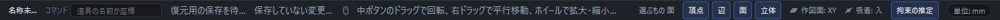

# 面・辺・頂点を選ぶ

穴や面取りなど、立体の一部だけに加工をするときは、まず対象を選びます。「選択」の道具のまま、立体の面・辺・頂点をクリックしてください。

## 何が選べるかは道具が決める

ツールバーの道具を選ぶと、選べるものが自動で切り替わります。

| 押した道具 | 選べるもの |
|---|---|
| 穴・ねじ穴 | 面 |
| R面取り・C面取り | 辺(頂点を選ぶと、その角に集まる辺がまとめて選ばれます) |
| 直線パターン・円形パターン・和・差・積など | 立体そのもの |

道具を切り替えて**選ぶものの種類が変わると**、それまでの選択は消えます。たとえば立体を選んだ状態から、面を選ぶ「穴・ねじ穴」に切り替えた場合です。同じ種類を選ぶ立体の加工道具へ切り替えたときは、選択を引き継ぎます。先に立体を選んでから、立体を使う別の道具を開くこともできます。なお、「面をつなぐ」や「ロフト」のように先に選んだものを材料にする道具は、選ぶ種類を切り替えず、選択を引き継ぎます。

## 手で切り替える

キーボードの数字キーで、選ぶものを直接切り替えることもできます。

| キー | 選べるもの |
|---|---|
| `1` | 頂点 |
| `2` | 辺 |
| `3` | 面 |
| `4` | 立体 |

入力欄(式や名前を打っているところ)に文字を打っている間は、数字キーは効きません。数字を打つ操作を邪魔しないためです。

## いま何を選ぶかは画面下に出ている

画面いちばん下の帯に、いま選べるものの種類が出ています。道具を選んだときや、`1`〜`4` で切り替えたときに、ここを見れば迷いません。

## 選ぶ・増やす

- クリックで 1 つ選びます。選んだところは青く光ります。
- Shift を押しながらクリックすると、選択にもう 1 つ足せます。同じところをもう一度クリックすると外れます。
- マウスを重ねると、いま指しているところが薄く光ります(まだ選んではいません)。

## 選んだ面・辺は、保存や並べ替えのあとも同じところを指す

穴・ねじ・面取りなどで選んだ面や辺は、「どの立体の、どの面か」を形の履歴から覚えています。次の操作をしても、加工は選んだ面・辺についたままです。

- 保存して開き直す、アプリを閉じて開き直す。
- 「元に戻す」と「やり直す」。
- 左の履歴で、関係のない立体の順序を入れ替える。

たとえば同じ位置・同じ大きさの円柱が2本あるとき、1本目の端面に穴をあけた加工は、保存して開き直しても、順序を入れ替えても、1本目の穴のままです。面の番号や見た目が似ていても、2本目へ移ることはありません。この参照は、保存したときの面・辺の情報を書き換えません。

形を編集した結果、選んだ面や辺が分かれたり、ほかとくっついて1つに決められなくなったりすることがあります。そのときは別の面や辺へ勝手に付け替えず、加工は計算できません。画面下に「穴をあけるもとの面が見つかりません。形が大きく変わったため、選び直してください。」のように、何を選び直すかが出ます(面取りやR面取りでは「もとの辺」)。履歴で編集を元に戻すと、同じ面へ再び付きます。付け直すときは、加工の面や辺を選び直してください。

STEPなどから読み込んだ立体には、作った履歴がありません。その立体の面や辺は、保存した位置・大きさ・向きなどの特徴から探し直します。似た面や辺が複数あって1つに決められないときは、推測して選ばずに、上と同じ「選び直してください」になります。

## 裏側の辺も選べる

立体を回転させなくても、画面に映っている手前の辺だけでなく、裏側にある辺も画面上の近さでクリックして選べます。ただし、裏側の辺と手前の辺が画面上でほとんど重なっているときは、狙いどおりに選べないことがあります。そのときは立体を少し回転させてから選び直してください。

## 似た面・辺が複数あるときや、見つからないとき

寸法・合致・穴などの加工・色(外観)は、選んだ面や辺の特徴(種類・向き・大きさ・位置)を保存しておき、形を編集した後も同じ面や辺を探し直します。探し直した結果が次のどちらかのときは、近いものへ勝手に付け替えず、正しい値としては使いません。

- **見つからない** … 特徴に合う面や辺がありません。
- **曖昧** … 特徴に合う候補が2つ以上あり、1つに決められません。たとえば長さ10mmの辺と40mmの辺がどちらも同じくらい当てはまるときは、どちらの長さも寸法にしません。

それぞれ、次のように画面へ出ます。

| 使っている場所 | 画面の表示 |
|---|---|
| 寸法 | 図面の寸法の文字が「？」になります。画面下に「未解決 1」のように件数が出て、左の「寸法」一覧の行に「!」が付きます。 |
| 合致 | 左の「合致」の行に「未確定」または「未解決」が出ます。行を選ぶと右側の状態が「未解決」になり、行の注意の印にマウスを重ねると「合致の対象が見つかりません。形が大きく変わったため、選び直してください。」と出ます。 |
| 加工(穴など) | 左の一覧のその加工の行に注意の印が付き、マウスを重ねると「穴をあけるもとの面が見つかりません。形が大きく変わったため、選び直してください。」のように出ます。加工は計算されません。 |
| 外観(色) | その立体を選ぶと、右の外観の欄に「見つからない割り当て」が出て、色が外れた面の数だけ並びます。その面は既定の外観で表示されます。 |

自動で探し直すだけでは、保存してある元の面や辺の情報は書き換えません。「元に戻す」「やり直す」を使っても、保存して開き直しても、未解決の状態と元の情報は変わりません。形の編集を元に戻して同じ面や辺が1つに決まるようになれば、再び正しく付きます。現在の候補を選び直すには、右の「参照の修復」を使います。元の参照・候補・影響先を見てから確定します。手順と確定できない場合は[図面に寸法を記入する](dimension.md)の「直せない・記入できないとき」、合致の状態は[部品どうしを合わせる](mate.md)を見てください。
