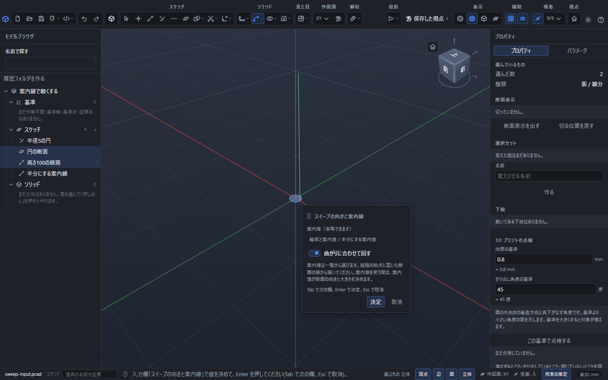
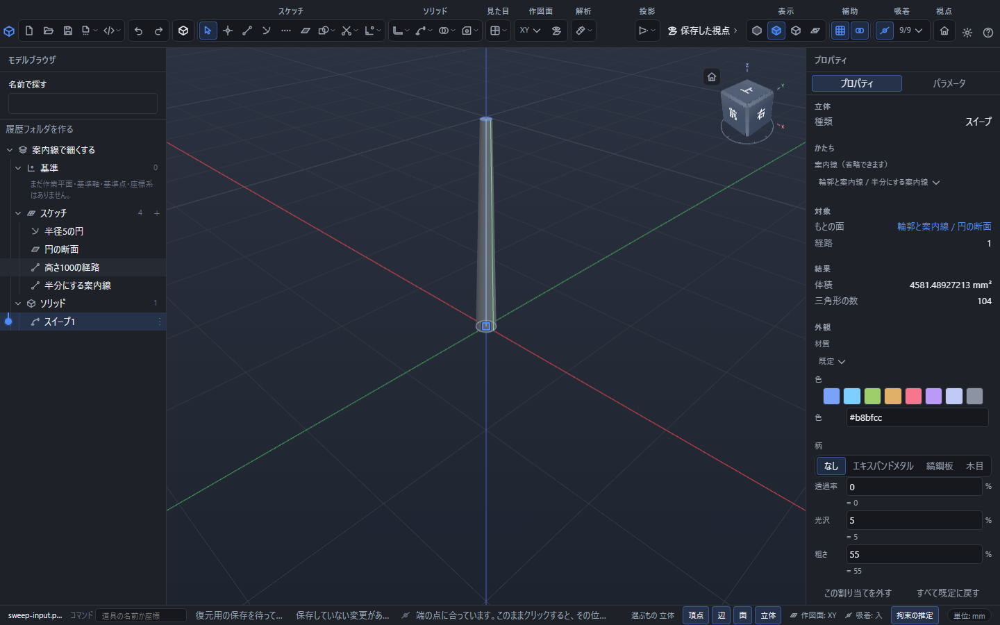

# 立体の形を変える・並べる

できあがった立体に手を入れたり、写したり、動かしたりする道具をまとめました。どれもツールバーの「ソリッド」の区画から選びます。

- 「作る」の一覧: スイープ・ミラー・曲面(もとの立体を消さずに、新しい立体を足します)
- 「加工」の一覧: 抜き勾配・穴の移動・面の回転・面の移動・くり抜き・リブ・エンボス・外ねじ・「移動・回転」・拡大縮小・点パターン(もとの立体に手を入れます)

ここで説明する「作る」「加工」の道具は、**先に対象を選んでから押す**と入力欄を開けます。先に道具を押して、画面下の案内に従って対象を選ぶこともできます。対象がそろったら、一覧から同じ道具をもう一度押します。小さな入力欄が出たら、数を入れて Enter を押します。何も入れずに Enter を押しても、ちょうどよい既定の値で作られます。

作ったものはすべて左の「モデルブラウザ」に 1 行として並びます。あとから右の「プロパティ」で値を直せて、直すとその場で形が作り直されます。式(`5*2` や `板厚*2`)もそのまま書けます。

## 傾きを付ける(抜き勾配)

型から抜けるように、側面を少しだけ倒します。

1. 「選択」で、動かしたくない**平らな面**を 1 枚クリックします(これが基準になります)。
2. Shift を押しながら、**倒したい側面**を 1 枚以上クリックします。
3. 「加工」の一覧から「抜き勾配」を押します。
4. 角度を入れて Enter を押します。

- 角度は 0 度より大きく 60 度以下です。型抜きでは 1〜3 度がよく使われます。
- **向きを反転**を入れると、外へ広がるかわりに内へすぼまります。
- 基準の面は動きません。倒れるのは選んだ側面だけです。

押し出すときにいっしょに傾けたいときは、押し出しの「側面を傾ける」のほうが簡単です(→ 「厚みをつける・回す」)。

## 鏡に映す(ミラー)

立体の鏡像をもう 1 つ作ります。

1. 「選択」で、映したい立体をクリックします。
2. 「作る」の一覧から「ミラー」を押します。
3. 「鏡にする面」から XY 面・XZ 面・YZ 面のどれかを選び、Enter を押します。立体の平らな面を選んでから押すと、その面を鏡にもできます。

**もとの立体は消えません。** 左右対称のものを作るときは、鏡像を作ってから「合わせる」の「和」でつなぐと 1 つの立体になります。

## まとめて動かす・回す(移動/回転)

1. 「選択」で、動かしたい立体をクリックします。
2. 「加工」の一覧から「移動・回転」を押します。
3. X・Y・Z の移動量を入れて Enter を押します。続けて回す角度を聞かれます。

- 回さずに動かすだけのときは、角度を 0 のままにします。
- 右の「プロパティ」では「回す軸」を「回さない」「X」「Y」「Z」から選び直せます。「回さない」にすると角度の欄は消えます。
- もとの立体は**動いたあとの 1 つだけ**になります(同じ形が 2 つに増えることはありません)。同じ形を残したいときは、先にミラーや「複写」で増やしてください。

## 大きさを変える(拡大縮小)

1. 「選択」で、大きさを変えたい立体をクリックします。
2. 「加工」の一覧から「拡大縮小」を押します。
3. 倍率を入れて Enter を押します。

- **軸ごと**を入れると、X・Y・Z それぞれの倍率を別々に入れられます。切り替えたときは、いまの倍率が 3 つにそのまま入ります。
- 倍率は 0.001 以上 1000 以下です。1 より小さくすると縮みます。
- 右の「プロパティ」の「動かさない点」は、大きさを変えても位置が動かない 1 点です。はじめは原点です。押すとその点が選ばれます。
- 軸ごとに違う倍率にすると、丸い面が楕円になります。そのあとの穴や面取りが付いてこないことがあるので、まずは全体の倍率で試してください。

## 断面を経路に沿って掃く(スイープ)

パイプや取っ手のような形を作ります。通常は一定の断面で掃き、案内線を指定すると断面の向きと大きさを変えられます。

1. 「選択」で、断面にする**スケッチの面**をクリックします。
2. Shift を押しながら、通り道にする**線や円弧**を選びます(つながっていれば何本でも構いません)。
3. 「作る」の一覧から「スイープ」を押します。
4. Enter を押します。

- 断面は経路の始点へ移されて、経路の向きに合わせて向きが変わります。
- **曲がりに合わせて回す**を入れると、経路の曲がりに合わせて断面も回ります。切のままだと、ねじれを抑えて掃きます。

### 案内線で細くしたり、途中の向きを変える

断面・経路のほかに、断面の縁が通る **案内線を1本** かきます。案内線は通常の線分・円弧・自由曲線などから選べます。構築線と、経路に使っている線は候補に入りません。

1. 例えばXY面に半径5mmの円の面を作ります。
2. 3Dスケッチで、経路を `(0,0,0)` から `(0,0,100)` へかきます。
3. 別の線分を `(5,0,0)` から `(2.5,0,100)` へかき、名前を「半分にする案内線」にします。始点は、経路の始点に置いた断面の縁です。
4. **円の面と経路だけ** を選び、「作る」→「スイープ」を開きます。
5. **「曲がりに合わせて回す」を入れます。** この例のような上下方向の経路では、案内線を後で外すときにもこの設定が必要です。
6. **「案内線（省略できます）」** の一覧で「半分にする案内線」を選び、「決定」を押します。入口の半径5mm、出口の半径2.5mm、高さ100mmの形になります。

経路から案内線までの距離が断面の倍率を決め、その方向が断面の向きを決めます。円以外の断面も、縦横の比率を保って変化します。案内線が向きを決める間は「曲がりに合わせて回す」を操作できません。「なし（一定の断面）」へ戻すと、それまでの向きの指定が復元されます。上下方向の経路でねじれを抑える指定が断られたら、右の「曲がりに合わせて回す」を入れてください。

**対応する位置を揃えてかいてください。** 経路と案内線の、それぞれの全長に対する割合が同じ位置どうしを対応させます。その2点は、経路に直角な同じ断面上にある必要があります。上の例では、どちらも高さ0から100へ同じ向きにかきます。円の経路なら、案内線も同じ始まり・終わりの角度の同心円弧にします。閉じた経路には閉じた案内線を使います。

案内線が経路と重なる、逆向きになる、区間がずれる、急に折り返す、断面が曲がりに対して大きすぎる場合は、理由を出して作成を断ります。対応しない2本を自動的につなぎ直したり、向きだけを変えた形として完成扱いにしたりはしません。

作成後は右の同じ一覧から案内線を変更・解除できます。もとの案内線の点や式を直すと立体が追従し、「元に戻す」と保存・再開でも指定を保持します。線を削除して参照が切れたときは、プロパティで選び直すか「なし」にしてください。

## リブ(補強の壁)を足す

薄い壁を立てて、部品を補強します。輪郭は**閉じていなくてかまいません**。

1. 「選択」で、リブを足したい立体をクリックします。
2. Shift を押しながら、壁にする線をクリックします。
3. 「加工」の一覧から「リブ」を押します。
4. 厚みを入れて Enter を押します。

- 右の「プロパティ」の「厚みを付ける側」で、両側へ半分ずつ/表側だけ/裏側だけを選べます。
- 「材料に届くまで伸ばす」は、はじめから入っています。切にすると、かいた線の長さぶんだけの壁になります。

## 彫る・浮き出す(エンボス)

平らな面に、文字や模様の輪郭を彫り込んだり浮き出させたりします。

1. 「選択」で、**平らな面**を 1 枚クリックします。
2. Shift を押しながら、彫る形の**閉じた輪郭(スケッチの面)**をクリックします。
3. 「加工」の一覧から「エンボス」を押します。
4. 高さ(彫るときは深さ)を入れて Enter を押します。

**浮き出す**を入れると、へこませるかわりに盛り上がります。曲がった面には使えません。平らな面を選んでください。

## 軸にねじを切る(外ねじ)

丸い軸の外側にねじを切ります。

1. 「選択」で、ねじを切りたい**丸い軸の面**をクリックします。
2. 「加工」の一覧から「外ねじ」を押します。
3. 「呼び」(M6 など)と長さを入れて Enter を押します。

- 呼びを選ぶとピッチも規格の値で入ります。あとから右の「プロパティ」で書き換えられます。
- **実際のねじ山を作る**を入れると本物の山を削り出します。時間がかかるので、ふだんは切のままにして、細い線 2 本の簡単な印で表しておくのがおすすめです。
- 呼びの太さと軸の実寸が食い違うときは、理由を出して作りません。軸の太さに合う呼びを選んでください。
- 「プロパティ」の「切り始める端」で、軸のどちら側から切るかを選べます。

## 面だけを作る(曲面)

厚みの無い、面だけのものを作ります。カバーの形を先に決めたいときなどに使います。

1. 「選択」で、材料になる**線**か、既にある立体の**面**をクリックします。
2. 「作る」の一覧から「曲面」を押します。
3. 「作り方」を選び、必要な数を入れて Enter を押します。

| 作り方 | 材料 | 入れるもの |
|---|---|---|
| 掛ける | 線 | 掛ける長さ |
| 回す | 線 | 回す角度 |
| 平らに張る | 閉じた線 | なし |
| つなぐ | 線を 2 組以上 | なし |
| 立体の面を写す | 立体の面 | なし |
| 立体の面を離す | 立体の面 | 離す距離 |

面だけのものには**体積がありません。** 右の「プロパティ」には体積のかわりに面積が出ます。穴や面取りは掛けられません。

右の「プロパティ」では、同じ材料で作り直せる範囲だけを選び直せます(線から作る 3 つのあいだ、面から作る 2 つのあいだ)。それ以外へ変えたいときは、道具から作り直してください。

## 点のある場所へ並べる(点パターン)

穴を、かいておいた点の場所へまとめて複製します。

1. 「選択」で、並べたい**穴かねじ穴**をクリックします。
2. Shift を押しながら、置き場所にする**点**を 2 つ以上クリックします。
3. 「加工」の一覧から「点パターン」を押します。
4. Enter を押します。

等間隔でよいときは「直線パターン」「円形パターン」のほうが簡単です(→ 「同じ加工を並べる」)。点パターンは、間隔がばらばらな穴を並べたいときに使います。

## 中を空にする(くり抜き)

壁の厚さだけを残して、立体の中身を抜きます。

1. 「選択」で、くり抜きたい立体をクリックします。
2. 開けたい面があるときは、選ぶものを「面」(`3`)にしてその面もクリックします。**面は選ばなくてもかまいません。**
3. 「加工」の一覧から「くり抜き」を押します。
4. 壁の厚さを入れて Enter を押します。

- 面を 1 枚も選ばないと、外から見た形はそのままで、中だけが空になります。
- 面を選ぶと、その面が開いた入れ物の形になります。
- **外向き**を入れると、内側を残したまま外へ肉を付けます。切のままなら外の大きさは変わりません。
- **厚さが大きすぎると作れません。** 「肉厚が大きすぎます。小さくしてください。」と出たら、小さくしてやり直してください。

## 押せないとき・作れないとき

対象が足りないときは、マウスを重ねると理由が出ます。道具を押しても、画面下の帯に選ぶものや理由が出るので、対象を選んで同じ道具をもう一度押してください。対象をそろえても作れなかったときは、画面下の帯と、左のモデルブラウザの赤い印に理由が出ます。**アプリは止まりません。** 値を直すか、選び直せば何度でもやり直せます。

| 出る文 | 直し方 |
|---|---|
| 対象になる立体が選ばれていません。 | 立体を 1 つクリックしてから押します |
| 基準にする平らな面が選ばれていません。 | 抜き勾配では、動かしたくない平らな面を先にクリックします |
| 傾ける面が選ばれていません。基準の面のほかに、傾けたい側面も選んでください。 | Shift を押しながら側面も選びます |
| 輪郭が選ばれていません。 | 断面にする面、または壁にする線を選びます |
| 通る経路の線が選ばれていません。 | スイープの通り道になる線や円弧を選びます |
| 平らな面が選ばれていません。 | エンボスは平らな面にだけ掛けられます |
| ねじを切れるのは丸い軸の面だけです。 | 平らな面ではなく、丸い軸の側面を選びます |
| 曲面のもとになる輪郭も面も選ばれていません。 | 線か、立体の面を選びます |
| 並べる加工が選ばれていません。 | 並べられるのは穴とねじ穴です。それを選んでから押します |
| 置き場所にする点を 2 つ以上選んでください。 | Shift を押しながら点を足します |
| 肉厚が大きすぎます。小さくしてください。 | くり抜きの厚さを小さくします |
| 移動する穴の円筒面を 1 枚だけ選んでください。 | 穴の移動では、「選ぶもの」を「面」にして、穴の内側の円筒面を 1 枚だけクリックします |
| 穴の移動量には、0 でない有限のベクトルを指定してください。 | X・Y・Z のどれかに 0 でない移動量を入れます |
| 回転する平らな面と、その面の直線辺を 1 つずつ選んでください。 | 面の回転では、平らな面を 1 枚と、Shift を押しながらその面の縁の直線の辺を 1 本選びます |
| 面と回転軸の辺は同じ立体から選んでください。 | 面と辺を同じ立体から選び直します |
| 回転軸には曲線でなく直線の辺を選んでください。 | 円や円弧の辺ではなく、まっすぐな辺を選びます |
| 回転する面の外周にある辺を選んでください。 | 選んだ面の縁にある辺を選びます |
| 面の回転角度には、0 でない有限の数を指定してください。 | 0 でない角度を入れます |
| 形を変更できませんでした。選ぶ面・辺と入力値を見直してください。 | 穴の移動・面の回転・面の移動の形を計算できませんでした。選ぶ面・辺と値を見直します |

うまくいかなくても、もとの立体はそのまま残ります。「元に戻す」(Ctrl+Z)でいつでも 1 つ前へ戻せます。

## 貫通穴の位置を変える（穴の移動）

一定の径の貫通穴が **1 つだけ** ある長方形の板で使います。板は、平らな面 6 枚（上下の面と 4 つの側面）と穴の内側の円筒面 1 枚だけでできている形に限ります。「選ぶもの」を「面」（`3`）にして穴の内側の円筒面を 1 枚選び、「加工」→「穴の移動」を押します。X・Y・Z に世界座標での移動量（mm）を入れ、Enter で決定します。空欄の既定は X が 1 mm、Y と Z が 0 mm です。

例えば 40×30×8 mm の板の半径 3 mm の穴を、中心 (10,15) から X に `2` mm 動かすと中心は (12,15) になります。`-2` なら (8,15) です。穴の径と板の外周は変わりません。動かせるのは穴の軸に直角な向きだけで、穴の軸の向きの成分を含む移動量は断ります（Z の向きの穴なら、Z は 0 のままにします）。

選び方と移動量が合っていても、次のときは入力の窓に理由を出して断ります。元の立体はそのまま残ります。

| 出る文 | どんなときか |
|---|---|
| 穴の移動量は、穴の軸に直角な 0 でない有限のベクトルで指定してください。 | 移動量が穴の軸の向きの成分を含む |
| 動かせるのは、内側が円筒になっている穴の面だけです。 | 丸い軸の側面のような、外側の円筒面を選んだ |
| 全周がつながった一定径の貫通穴だけ動かせます。 | 切り欠きなどで、穴の円筒面の一部が欠けている |
| この操作は、六つの平面と一つの円筒面からなる長方形の穴あき板だけに対応しています。 | 止まり穴、2 つ以上の穴、面取りや段のある板など、上の板の形でない |
| 穴を動かすと板の外周に届くため動かせません。移動量を見直してください。 | 動かした穴が板の外周に接する、または外へ出る |
| 選んだ面は元の立体に属していません。穴の面を選び直してください。 | 選んだ面が、加工する立体の面でない（同じ形の別の立体の面など） |

平らな面を選んだときや、移動量がすべて 0 のときは、画面下の帯に理由が出ます（→「押せないとき・作れないとき」）。

## 箱の面を辺のまわりに傾ける（面の回転）

箱の平らな面と、その面の外周にある直線辺を 1 つずつ選びます。「加工」→「面の回転」を先に押してから、画面下の「選ぶもの」を「面」「辺」に切り替え、Shift を押して追加選択します。面と辺のどちらを先に選んでも構いません。対象がそろったら同じ道具をもう一度押し、角度（度）を入れて Enter で決定します。既定は 5 度です。角度は 0 度でなく、絶対値が 90 度より小さい値にします。

**どちらへ傾くかは、選んだ辺の向きで決まります。** 辺の向きは画面に出ないため、正の角度で面が外へ持ち上がる（材料が増える）とは限りません。同じ位置の辺でも、立体の作り方によっては同じ角度で反対へ倒れます。思った向きと逆に傾いたときは、プロパティで角度の符号を逆にしてください（`5` なら `-5`）。

選んだ辺を固定して、面を含む平面（支持平面）を回し、隣の面との交わりで外周を作り直します。有限の面をそのまま切り離して回す操作ではありません。箱全体を回すときは「移動・回転」を使います。

面の外周にない辺、曲線の辺、別の立体の面や辺、平らでない面を選んだときや、角度が 0 のときは、画面下の帯に理由が出ます（→「押せないとき・作れないとき」）。選び方と角度が合っていても、次のときは入力の窓に理由を出して断ります。元の立体はそのまま残ります。

| 出る文 | どんなときか |
|---|---|
| 面を回す角度は、0 度でなく、絶対値が 90 度より小さい値にしてください。 | 角度が 90 度以上、または -90 度以下 |
| 面を回すと反対側の面に届くため回せません。角度を小さくしてください。 | 内側へ倒した面が、反対側の面（上面を回すときは底面）に届く |
| この操作は、六つの平面からなる直方体の面だけに対応しています。 | 箱（直方体）でない立体。穴のある板や、すでに面を傾けた形など |

両操作とも、計算が成功してからモデルブラウザへ 1 行を追加します。入力中の Esc、計算の失敗・取消では元の文書と立体を保ちます。「元に戻す」1 回で作成前、「やり直す」1 回で作成後へ戻れます。作成後はプロパティの X・Y・Z の移動量／回転角度を式で直せます。参照する面や辺が見つからなくなったときは、参照の修復で選び直してください。

**対応していない操作**: 「穴の移動」と「面の回転」は、上の限られた形（穴が 1 つの長方形の板、箱）だけに使えます。次の操作はできません。

- 平らな面を、面に沿った向き（接線の向き）へずらすこと。例えば箱の上面を横へずらして、斜めの角柱にすることはできません。
- 穴の径や深さを変えること、2 つ以上の穴をまとめて動かすこと。履歴に「穴」の行があれば、径はその行のプロパティで直せます。
- 上の条件に合わない任意の STEP 形状で、穴を動かすことや面を傾けること。

「面の移動」は、平らな面を面に直角な向き（法線の向き）へ平行に動かす別の操作です。平らな面を 1 枚選んで「加工」→「面の移動」を押し、距離（mm）を入れます。正の値で外へ足し、負の値で内へ削ります。動かせるのは、隣の面がすべて、動かす面に直角な平らな面か、軸が動かす向きにそろった円筒の面（穴の内側など）のときだけです。読み込んだ形の面も、この条件に合えば動かせます。隣に斜めの面があるとき、穴や出っ張りに当たる距離のとき、形が変わって面が見つからないとき、立体が 2 つ以上に分かれているときは、理由を出して断ります。

「面の移動」も、形の計算が成功したときだけ文書と履歴へ確定します。計算中は入力窓に知らせを表示します。穴との衝突などで断られたときは、元の立体・履歴・保存先と入力した距離を保ち、同じ窓で距離を直せます。Escで取り消した計算や、入力・文書が変わる前の古い結果は確定しません。成功した作成は「元に戻す」1回で戻り、「やり直す」1回で復元できます。

「穴の移動」「面の回転」「面の移動」を作成したあと、値の変更やファイルの開き直しで計算できなくなった場合は、モデルブラウザとプロパティに理由を表示し、加工前の立体を表示します。失敗した操作の以前の完成形は表示しません。同じ立体を別の成功した加工が取り込んでいる場合は、その加工の結果だけを表示します。失敗した行の値を直すか「元に戻す」で戻すと、形を作り直せます。

**同じ形を 5 つの作り方で作る例**: 次の 3 つの形は、下のどの作り方でも同じ外形・穴・体積になります。穴あき板は 40×30×10 mm の板に直径 6 mm の貫通穴、フランジ付き円筒は直径 30 mm・厚さ 5 mm のつばの上に直径 20 mm・高さ 20 mm の胴を重ねて直径 6 mm の貫通穴をあけた形、斜めの角柱は平行四辺形の断面を奥へ 10 mm 伸ばした形です。作り方どうしは組み合わせて使えます。

| 作り方 | 穴あき板 | フランジ付き円筒 | 斜めの角柱 |
|---|---|---|---|
| スケッチから積み上げる | 長方形の面を「押し出し」、「穴」をあける | 段の付いた半分の断面を「回転」で 360 度回す | 平行四辺形の面を「押し出し」 |
| 線・点から面を作って立体にする | 「点で面を張る」で 6 枚の面を張って「縫合」し、「穴」をあける | 円を「面をつなぐ」でつばと胴の立体にし、「和」で 1 つにして「穴」をあける | 「点で面を張る」で 6 枚の面を張って「縫合」 |
| 既存・読み込んだ形を直接編集する | 厚さ 8 mm の板の上面を「面の移動」で 2 mm 上げる | 胴の上端の輪の形の面を「面の移動」で 5 mm 伸ばす | 奥行 5 mm の形の奥の端面を「面の移動」で 5 mm 伸ばす |
| 数式・座標で作る | 「箱」の寸法と中心、穴の中心の点を式（`4*10` など）で入れる | 「円柱」2 つの寸法を式で入れて「和」で 1 つにし、「穴」をあける | 「作図面」を「3D」にして 8 つの点の座標を式で入れ、面を張って「縫合」 |
| 組立の中の別の部品を参照する | 穴の中心の点を基準点につなぎ、組立で別の部品の面の中心へ合わせる | 穴の中心の点を基準点につなぐ（穴あき板と同じ） | 角の 1 点を基準点につなぎ、残りの点をその点からの相対座標でかく |

直接編集では、斜めの角柱の上面・底面と斜めの側面は「面の移動」で動かせません（隣に斜めの面があるため）。手前や奥の端面のように、隣の面がすべて直角な面を選んでください。組立の中の参照の手順と、参照した部品を動かしたときの更新は、「部品を置いて組み立てる」の「置いた部品を操作する」を見てください。
