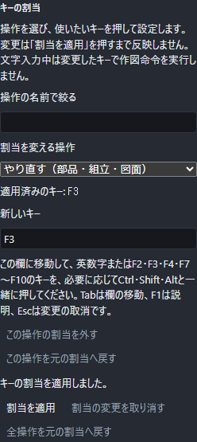

# ショートカット一覧

よく使う操作にキーを割り当てると、メニューを開かずに同じ操作を始められます。画面内のこの一覧には、現在設定しているキーが表示されます。

図はやり直す操作にF3を適用した例です。元に戻す操作をF2へ設定した後、やり直す操作をF3へ設定しています。

## キーを変更する

1. 上端の「設定」を開き、「{{ui:settings.shortcuts.title}}」まで移動します。
2. 「{{ui:settings.shortcuts.search}}」へ操作名を入力し、「{{ui:settings.shortcuts.command}}」から変更したい操作を選びます。
3. 「{{ui:settings.shortcuts.capture}}」の欄を選び、使いたいキーの組合せを押します。文字・数字やF2・F3・F4・F7〜F10に、必要に応じてCtrl/Cmd・Shift・Altを組み合わせられます。
4. 「{{ui:settings.shortcuts.apply}}」を押します。変更後は、古いキーではなく新しいキーで操作が始まります。

二つの操作のキーを交換するときは、両方を変更してから「{{ui:settings.shortcuts.apply}}」を押します。片方だけ変更した段階で重複していても、もう片方の編集を続けられます。重複が残っている間は適用できず、ぶつかっている操作名が表示されます。

入力中にF1を押すとこの説明を開きます。Tabは次の欄へ進み、Escは変更案を取り消します。「{{ui:settings.shortcuts.cancel}}」も、まだ適用していない変更だけを捨てます。適用前に別の場所でキー設定が変わったときは、古い変更案で上書きしません。取り消して、現在の設定から変更し直してください。

## 割当を外す・元へ戻す

「{{ui:settings.shortcuts.remove}}」を選んで適用すると、その操作にキーを割り当てない状態になります。操作自体はボタンやメニューから使えます。「{{ui:settings.shortcuts.restoreOne}}」は選択中の操作だけを、「{{ui:settings.shortcuts.restoreAll}}」はキー設定全体を元へ戻します。どちらも「{{ui:settings.shortcuts.apply}}」するまで現在のキーは変わりません。

設定は使用中のブラウザーまたはデスクトップアプリに残り、次回の起動にも引き継がれます。作図した形、入力途中の式、保存ファイル、元に戻す履歴は変更しません。他の端末へ作図ファイルを渡しても、渡した相手のキー設定は変わりません。

## 変更できないキー

F1のヘルプ、Ctrl/Cmd+Sの保存、入力確定や取消などの基本操作は固定です。ブラウザーを閉じる、再読込みする、アドレス欄へ移るなどのキーも割り当てられません。使用できない組合せには理由が表示されます。日本語変換中やAltGrによる文字入力を、割当キーとして記録することもできません。

## 現在の一覧

<!-- pointercad:current-shortcuts -->

## 入力中の扱い

自分で割り当てたキーは、文字入力・日本語変換・メニュー選択中には作図操作を始めません。入力欄では、文字の編集に使うUndo・Redo、数字、Space、Enter、Delete、Backspaceをそのまま使えます。既定の保存・名前を付けて保存・開く・新規は入力欄でも使えます。モーダル画面の中ではF1だけが共通操作として働き、ほかのキーはその画面へ渡します。

部品の数値入力、組立の合致入力、図面の文字注記で日本語を変換している間は、Enter や Esc で作図を確定したり入力の窓を閉じたりしません。変換を終えてから通常の確定・取消を行ってください。図面の文章欄の Enter は改行し、「{{ui:drawing.action.apply}}」で注記を決めます。

Tab と Shift + Tab は入力先を移します。Delete・Backspace・Ctrl/Cmd + Z は、焦点のある文字欄の編集に使います。確定した形の履歴を戻すには、作図画面へ焦点を移してください。

## 選んだ点をつなぐ・面を張るキー

部品の作図画面に焦点があるときは、メニューキーまたは Shift+F10 で右クリックの一覧を開けます。最初の道具に焦点が当たり、Tab で **{{ui:command.sketch.connectPoints}}**(3点以上を選んでいるときは **{{ui:command.sketch.faceFromPoints}}**)へ移り、Enter で実行、Esc で閉じます。文字を入力している欄や日本語を変換している間は、この2つのキーでも一覧を開きません。使えないときは、説明に選んだ点の数と理由が出ます。

点を追加・解除する Shift/Ctrl と、一覧を開く Shift+F10 は別の操作です。一覧では矢印キーでも道具へ移れます。使えない理由を直す手順は[選んだ2点をつなぐ](./sketch-tools.md#選んだ2点をつなぐ)を参照してください。入力欄に焦点があるときは、先に入力を終えて作図画面へ焦点を戻します。

## 文書による違い

部品・組立・図面のどれでも、既定のUndoはCtrl/Cmd+Z、RedoはCtrl/Cmd+YまたはCtrl/Cmd+Shift+Zです。入力欄にいる間は文字の編集に使い、作図の履歴は変えません。`1`～`4`とSpaceは部品・組立で使い、図面では図面固有のEnter、Delete、Backspace、Escを使います。

図面のDelete・Backspaceは、選んだ表・風船・寸法・注記などを1回の操作で削除し、「元に戻す」1回で戻せます。何も選んでいないとき、入力欄・日本語変換中・「図面を作り直しています。」の表示中は文書を変えません。投影図とレイヤーは対象外で、その理由を状態表示へ出します。

割り当てた操作が現在の画面に対応していないときは、何も作りません。対象の面や辺が必要な道具では、ボタンから始めた場合と同じように、選ぶものの案内を確認して操作を続けてください。

## 五つのキーを文書ごとに確かめる

次の表の入力欄は、部品の数値、組立の合致、図面の文字注記を指します。作図画面へ焦点を戻してから使うキーと、入力欄の文字を編集するキーを区別してください。

| 文書 | Tab | Enter | Esc | Delete | 元に戻す |
|---|---|---|---|---|---|
| 部品 | 次の欄へ進む | 数値を決める | 取りかけをやめる | 入力欄では文字を消す | 入力欄では文字、作図画面では形の履歴を戻す |
| 組立 | 次の欄へ進む | 合致の値を決める | 合致の取りかけをやめる | 入力欄では文字を消す | 入力欄では文字、作図画面では組立の履歴を戻す |
| 図面 | 次の欄へ進む | 文章欄では改行する | 注記の取りかけをやめる | 入力欄では文字、図面では選んだ要素を消す | 入力欄では文字、図面では図面の履歴を戻す |

作図画面で何も選んでいないときに Delete を押しても文書は変わりません。確定した作業を1回取り消す場合は、文字の欄から離れて作図画面へ焦点を移してから Ctrl/Cmd+Z を押します。日本語の変換候補を決める Enter と、作図を確定する Enter は別です。
