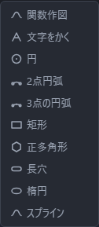
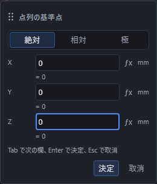

# 点・線・円弧をかく

画面の上の「スケッチ」から道具を選ぶと、ビューポートの中に小さな入力欄が出ます。数を入れて Enter を押すと形ができます。数の入れ方は「数値と式の入れ方」を見てください。

同じ道具をもう一度押すと、その道具をやめて「選択」に戻ります。

## 道具

| 道具 | できること | 入れるもの |
|---|---|---|
| 選択 | 作ったものをクリックして選ぶ | — |
| 点 | 点を 1 つ打つ | X・Y・Z、または基準からのずれ、または距離と角度 |
| 線分 | 2 点を結ぶ線を引く | 始点と終点 |
| 円弧 | 円弧・円をかく | 中心、半径、始まりの角度、終わりの角度 |
| 点列 | 等間隔に点をまとめて打つ | 基準の点、向き、間隔、個数 |
| 面 | 囲まれたところを塗る | 囲んでいる線、または点を順にクリック |

どの道具を選んでいるかは、ボタンの色と、画面の下の帯に出る案内で分かります。

## 「作図」「編集」「拘束」の一覧

よく使うこの 6 つの右に、**▾ の付いたボタンが 3 つ**並んでいます。押すと道具の一覧が下に開きます。

| ボタン | 中身 |
|---|---|
| 作図 | 関数作図・文字をかく・円・2点円弧・3点の円弧・矩形・正多角形・長穴・楕円・スプライン |
| 編集 | オフセット・トリム・延長・フィレット・面取り・ミラー・複写・直線配列・円形配列・投影・断面 |
| 拘束 | 線や点に「水平」「直角」「距離」などの条件を付ける 18 種類(「形を条件で決める(拘束)」を見てください) |

一覧の中は、図柄と名前が並んでいます。カーソルを重ねると、その道具の説明が出ます。使えない道具(たとえば線を選んでいないときのオフセット)は薄く表示され、説明のところに使えない理由が出ます。

キーボードでも選べます。ボタンを Tab で選んで ↓ を押すと一覧が開き、↑↓ で道具を移り、Enter で決まります。Esc を押すと決めずに閉じます。

道具を決めると一覧は閉じ、**ボタンの図柄がいま決めた道具のもの**に変わります。次にそのボタンを押すと、道具の一覧が開きます。同じ道具を使うときも、一覧からその道具を選んでください。たとえば矩形を使ったあとは「作図」のボタンが矩形の図柄になりますが、1 回押しただけでは矩形の入力は始まりません。一覧が開いているときに同じボタンを押すと、一覧が閉じます。まだ一度も使っていないあいだは、道具の図柄ではなく一覧そのものの図柄(作図は四角と丸の重なり、編集ははさみ)が出ています。

## 選んだ2点をつなぐ

「選択」で同じスケッチの点を1つ選び、Shift または Ctrl を押しながらもう1つの点を選びます。同じキーを押して選択済みの点を押すと、その点だけ選択を解除できます。ツリーでも Shift/Ctrl で追加できます。

立体の頂点を含めるときは、先に選択する種類を「頂点」にします。作図画面で立体の頂点とスケッチの点を選べます。頂点同士は別の立体でも構いません。点をツリーから Shift/Ctrl で追加することもできます。画面上で点が重なり選び分けられないときは、視点を変えてから選んでください。

作図画面で短く右クリックし、**{{ui:command.sketch.connectPoints}}**を選ぶと、選んだ順に始点・終点を持つ線分ができます。Shift/Ctrl を押したまま右クリックしても開けます。作図画面に焦点があるときは、メニューキーまたは Shift+F10 でも開けます。

元の2点は残り、できた線分が選ばれます。点の数値や式の係数を変更すると、線分の端も点に追従します。同じ作図面の点同士はその面に、異なる作図面の点や立体頂点を含む場合は3Dの自由な線分になります。1回の「元に戻す」で線分だけを取り消し、1回の「やり直す」で戻せます。

線・辺・面が混ざる、点が2つでない、同じ位置に重なる、点を計算できない場合は理由を表示します。別スケッチの点同士はつなげられません。

頂点を選んだ後で形を変更・再計算・取り消したときは、計算完了後に2点を選び直してください。作成した線分は元の参照を保存しますが、形の変更で頂点の番号が変わるなど一意に確認できなくなった場合は、参照先の確認が必要です。

### 使えない理由から操作を再開する

右クリックの一覧では、選んだ点の数と使えない理由が説明に出ます。メニューキーまたは Shift+F10 で開いた後は、Tab または矢印キーで道具へ焦点を移して説明を読めます。Enter で実行し、Esc で作らずに閉じます。

| 理由 | 次にすること |
|---|---|
| 点が2つでない、線・辺・面が混ざる | 「選択」で点または立体の頂点だけを2つ選びます。Shift/Ctrl で追加・解除できます |
| 異なるスケッチの点を選んでいる | 同じスケッチの点を選び直します |
| 同じ位置の点、重なる点や似た頂点を1つに決められない | 離れた別の点を選び、必要なら視点を変えて選び直します |
| 選択後に文書や形が変わった、計算中 | 計算が終わってから2点を選び直します |
| 頂点が見つからない、点の現在位置を確認できない | 計算結果と参照先を確認してから選び直します |
| 入力や編集の途中 | 入力・編集を終え、履歴の末尾で「選択」に戻ります |

理由が残っている間は線分を作りません。説明を読んだだけでは文書は変わらないため、条件を直してからもう一度道具を選んでください。

## 選んだ3点以上で面を張る

「選択」で点を1つ選び、Shift または Ctrl を押しながら残りの点を順に選びます。点は3つ以上で、1つの平面に乗っている必要があります。点の種類と選び方は[選んだ2点をつなぐ](./sketch-tools.md#選んだ2点をつなぐ)と同じで、同じスケッチの点と、「頂点」モードで選んだ立体の頂点を混ぜられます。ツリーでも Shift/Ctrl で追加できます。

3つ以上を選んで作図画面で短く右クリックすると、{{ui:command.sketch.connectPoints}}の位置に **{{ui:command.sketch.faceFromPoints}}** が出ます。これを選ぶと、選んだ順に点を線分で結び、最後の点から最初の点へ戻る線分も作って、囲んだ所を面にします。Shift/Ctrl を押したまま右クリックしても、メニューキーまたは Shift+F10 でも開けます。

選んだ順に結ぶと線が交差するときは、交差しない順に並べ直してから作り、そのことを下の帯に知らせます。元の点は残り、できた面が選ばれます。点の数値や式の係数を変更すると、線分と面も点に追従します。同じ作図面の点だけならその面に、異なる作図面の点や立体の頂点を含む場合は3Dの線分と面になります。1回の「元に戻す」で線分と面をまとめて取り消し、1回の「やり直す」で戻せます。

点が3つ未満、線・辺・面が混ざる、同じ位置に重なる、一直線に並ぶ、同じ平面に乗らない、並べ直しても線が交差する、点を計算できない場合は、説明に理由を表示し、面を作りません。別スケッチの点を含む場合も作れません。面の色の変え方や、点を順にクリックして張る方法は[面を張る・色を変える](face-and-color.md)を見てください。

## 続けてかく

線分の終点を決めるときに「交点でつなぐ」が入になっていると、交差する線分に共有の点を作り、各区間に分けます。点を動かして途中で曲げたり、不要な区間だけを消したりできます。操作の実画面は[交点で線をつなぐ・曲げる・区間を消す](sketch-intersections.md)を見てください。

「続けてかく」を入にしておくと、線や円弧をかいた後、その端から続けて次をかけます。切にすると、1 つかくたびに終わります。

## 円をかく

円弧の「始まりの角度」を 0、「終わりの角度」を 360 にすると、切れ目のない円になります。

## 点列でまとめて打つ

基準の点を決めて、向き(度)・間隔・個数を入れると、一直線に等間隔の点ができます。あとで穴の位置などにそのまま使えます。

## 面を張る

面の道具を選び、囲んでいる線を順にクリックするか、囲みたい形の角になる点を順にクリックして、Enter を押します。点を選んだときは、となりあう点のあいだに線が自動で引かれます。囲みが閉じていないときは、下の帯に理由が出ます。

## 3D スケッチ(作図面なし)

画面の上の「作図面」の一覧で、XY・XZ・YZ(と自分で作った作業平面)の下にある「3D」を選ぶと、作図面を使わずに空間へ直接かけます。選んでいるあいだ、画面の下の帯の作図面は「3D」になります。

**立体の頂点をクリックして点を作る。** 点の道具を選んで、立体の角(頂点)をクリックすると、その頂点に付く点ができます。あとで立体の大きさを変えても、点は同じ角に付いたまま動きます。線分・円弧・スプライン・3点の円弧の道具でも、頂点をクリックするとそこが始点・終点になります。

**頂点でないところをクリックしたとき**は、直前に置いた点を通り、画面に正対する面の上に点が置かれます。まだ 1 点も置いていないときは原点を通る面になります。見えているところにそのまま置ける代わりに、視点を変えると置かれる面も変わります。

**面を張る。** 3 つ以上の点を選んでから面の道具を押し、Enter を押すと面ができます。選んだ点が同じ平面に乗っていないときは、下の帯に理由が出ます。

**3D で使える道具**は、点・線分・円弧・スプライン・面・3点の円弧の 6 つです。矩形・正多角形・長穴・円・2点円弧・楕円・点列・オフセットは、形が作図面の中の並びで決まるので使えません。押すと「作図面を選んでから作ってください。」と出ます。

**3点の円弧**は、始点 → 終点 → 通過点の順に 3 か所をクリックすると円弧ができます(数を入れる欄はありません)。3D では立体の頂点をクリックすると、その頂点を通る円弧になります。3 点が一直線に並んでいると円弧にならず、下の帯に理由が出ます。この道具は作図面のあるスケッチでも同じように使えます。

**座標の指定方法**は「絶対」と「相対」の 2 つだけです。「極」は作図面の中の角度なので、3D スケッチでは出ません。

## 近くの点に合わせる

画面の上の「吸着」を入にしておくと、すでにかいたものの近くをクリックしたとき、ぴったりその点に合わせられます。合わせる先は「吸着」の右にある ▾ の付いたボタン(吸着の種別)を押して開く一覧で選べて、いらないものは切にできます。一覧には、点に合わせる 5 つ(端点・交点・中点・中心・方眼)と、向きをそろえる 4 つ(角度・延長線・垂線・平行線)が並びます。「吸着」そのものを切にすると、一覧のボタンは押しても効きません。くわしくは「点にぴったり合わせる(吸着)」を見てください。
