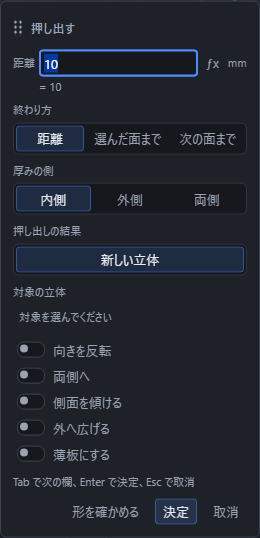
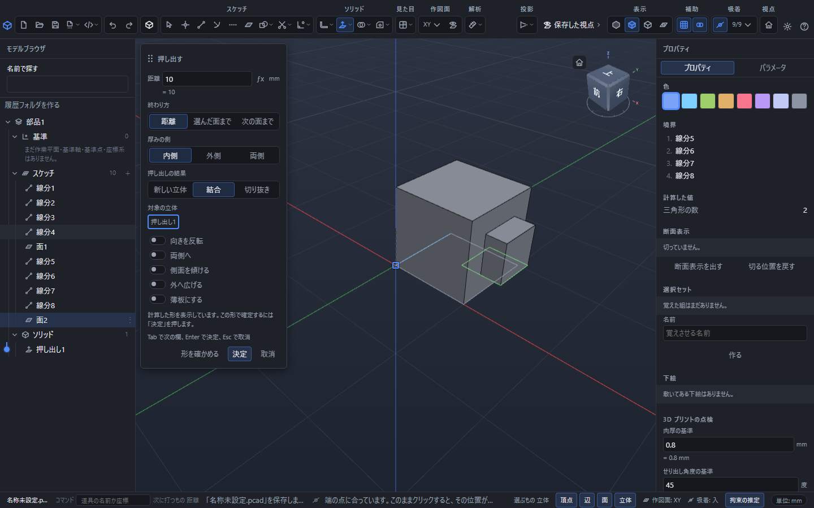
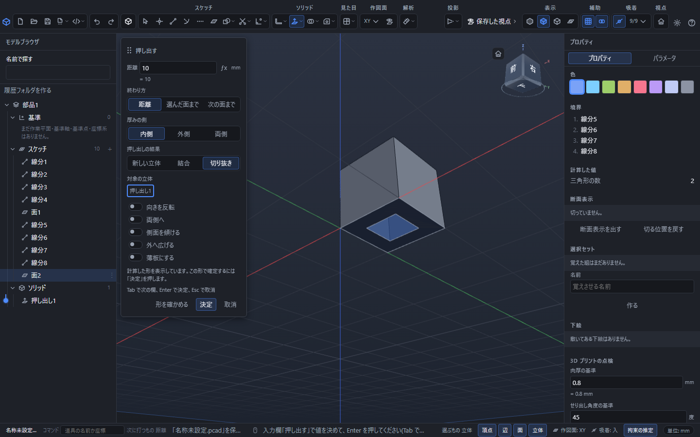
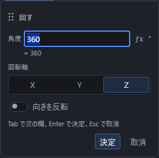

# 厚みをつける・回す

張った面から立体を作ります。上の「ソリッド」の区画に「板金」「作る」「合わせる」「加工」の 4 つのボタンが並んでいて、押すと一覧が開きます。「押し出し」「回転」「縫合」は「作る」の一覧の上のほうにあり、「和」「差」「積」は「合わせる」の一覧にあります。ここでは「作る」の一覧の前の 2 つを使います。

押し出し・回転は、**先に対象を選んでから押す**と、そのまま入力欄を開けます。面を選ぶ前でも道具を押せます。対象が足りないときは、画面下の帯に選ぶものや理由が出ます。案内に従って面を選び、「作る」の一覧からもう一度同じ道具を押してください。

## 面に厚みをつける(押し出し)

1. 「選択」で、厚みをつけたい面をクリックします。
2. 「ソリッド」の「作る」を押して一覧を開き、「押し出し」を押します。
3. 選んだ面のそばに小さな入力欄が出ます。厚み(距離)を入れます。
4. 「{{ui:numericInput.choice.extrudeOperation}}」で作り方を選びます。結合・切り抜きでは「{{ui:numericInput.choice.extrudeTarget}}」も選びます。
5. 必要なら「{{ui:numericInput.extrudePreview}}」を押して、確定前の形を見ます。
6. Enter を押すか「決定」を押します。計算が成功すると確定して入力欄が閉じます。

数を入れずにそのまま Enter を押すと 10 mm で作ります。`5*2` のような式も書けます。0 より大きい数だけを受け付けます。

「{{ui:numericInput.choice.extrudeOperation}}」は、押し出した形をどう使うかの選択です。

| 選ぶもの | どうなるか |
|---|---|
| {{ui:numericInput.extrudeOperation.new}} | 押し出した形を別の立体として作ります。対象の立体は要りません。はじめはこれです。 |
| {{ui:numericInput.extrudeOperation.join}} | 押し出した形を、対象の立体に足します。 |
| {{ui:numericInput.extrudeOperation.cut}} | 押し出した形を、対象の立体から取り除きます。 |

使える立体があるときに「{{ui:numericInput.extrudeOperation.join}}」「{{ui:numericInput.extrudeOperation.cut}}」を選べます。この 2 つでは「{{ui:numericInput.choice.extrudeTarget}}」の「{{ui:numericInput.extrudeTarget.none}}」を押し、一覧から相手の名前を選んでください。先にクリックした順や一覧の先頭から、対象が自動で決まることはありません。

入力欄には 5 つのつまみがあります。

- **向きを反転**: 面から出る向きを、反対側にします。思った向きと逆に伸びたときに入れてください。
- **両側へ**: 面を挟んで両方へ、半分ずつ伸ばします。まんなかを基準にしたいときに使います。
- **側面を傾ける**: 押し出すほど細く(または太く)なる形にします(→ 「側面を傾ける(型抜きの勾配)」)。
- **外へ広げる**: 「側面を傾ける」と組み合わせて、押し出すほど太くする向きにします。
- **薄板にする**: かいた輪郭をそのまま伸ばすかわりに、輪郭に沿った壁だけを作ります(→ 「薄い板にする(中を空にする)」)。

「{{ui:numericInput.extrudePreview}}」で出る形は予告で、まだ確定していません。文書と「元に戻す」の履歴は変わらず、予告の形はクリックで選べません。「{{ui:numericInput.extrudePreviewReady}}」と出たら形を確かめ、Enter または「決定」で確定します。計算中に確定を頼んだ場合は、成功してから確定します。

入力・対象・文書が変わったときは、その前に計算した形のまま確定しません。値と対象を確認して、もう一度「決定」を押してください。計算に失敗したときや対象を選んでいないときは入力欄が残り、下の帯に理由が出ます。

やめたいときは Esc を押します。予告と計算中の確定も取り消し、文書や「元に戻す」の履歴には何も足しません。

### 終わりの決め方を変える

入力欄の「終わり方」で、どこまで伸ばすかを選べます。

| 選ぶもの | どうなるか |
|---|---|
| 距離 | 入れた長さだけ伸ばします(はじめはこれです)。 |
| 次の面まで | 伸ばした先でいちばん手前にぶつかった材料の中まで伸ばします。長さは入れません。 |
| 選んだ面まで | あらかじめ選んでおいた面にぴったり届くまで伸ばします。 |

「次の面まで」と「選んだ面まで」を選ぶと、長さの欄は消えます。長さがもう関わらないからです。ぶつかる材料が無いときは「押し出す先に立体がありません。」と出て、何も作られません。

「両側へ」は終わり方とは別の**つまみ**です(上の「入力欄には 5 つのつまみがあります」を参照)。ほかの設定との組合せは次のとおりです。

| 組合せ | 使い方・断られる場合 |
|---|---|
| 結合・切り抜き + 薄板にする・側面を傾ける | 設定を組み合わせられます。ただし、計算した結果が有効な立体にならなければ確定しません。予告で形を確かめます。 |
| 新しい立体・結合・切り抜き + 両側へ | 終わり方が「距離」のときだけ効き、距離の半分ずつを面の両側へ伸ばします。「次の面まで」「選んだ面まで」では効きません。 |
| 結合・切り抜き + 選んだ面まで | 「対象の立体」の指定とは別に、止める面も選んでおきます。止める面が選ばれていないと確定できません。 |

「選んだ面まで」はプロパティからは選び直せません。どの面まで伸ばすかは画面で指すものなので、選び直したいときは面を選んでから作り直してください。

「{{ui:numericInput.extrudeOperation.cut}}」でも、この終わり方で取り除く範囲が決まります。距離を指定して貫通させたいときは、対象を抜ける長さと向きを予告で確かめてください。押し出しの入力欄に、対象を自動で貫く終わり方はありません。輪郭を使って対象を貫いて切る別の操作は、[立体を切る](cut.md)の「輪郭・曲線・曲面で切る」を参照してください。

### 側面を傾ける(型抜きの勾配)

「側面を傾ける」を入れると「側面の傾き」の欄が出ます。押し出すほど細くなる形になり、型から抜きやすくなります。

- 角度は 0 度以上 60 度以下です。0 度ならまっすぐです。
- **外へ広げる**を入れると、押し出すほど太くなります。
- 型抜きや 3D プリントでは、抜く向きへ 1〜3 度ほど付けるのがふつうです。

すでにできている立体の側面を後から傾けたいときは、「加工」の一覧の「抜き勾配」を使います(→ 「立体の形を変える」)。

### 薄い板にする(中を空にする)

「厚みの側」は入力欄に常に出ています。「薄板にする」を入れると、そこへ「板の厚み」の欄が加わります。かいた輪郭をそのまま伸ばすかわりに、輪郭に沿った**壁だけ**を作ります。箱・パイプ・カバーのような中空のものを、内側の輪郭をかかずに作れます。

- **厚みの側**: 内側(輪郭の内へ肉を付ける)/外側/両側 から選びます。はじめは内側です。「薄板にする」が切のときは使いません。
- 厚みが輪郭の幅の半分より大きいと、内側が無くなって作れません。理由が出るので小さくしてください。

厚み・傾き・終わり方は、あとから右のプロパティでも直せます。式のまま直せて、直すとその場で形が変わります。

## 面を回して立体にする(回転)

1. 「選択」で、回したい面をクリックします。
2. 「ソリッド」の「作る」を押して一覧を開き、「回転」を押します。
3. 入力欄で角度を入れ、下の「回転軸」から回す軸を選びます。
4. Enter を押すか「決定」を押します。

角度を入れずに Enter を押すと 360 度、つまり 1 周まわして輪のような立体を作ります。角度は 0 より大きく 360 以下です。

回転軸は X・Y・Z から選べます。はじめは Z(縦の軸)です。手順 1 で**線分もいっしょに選んでおく**と、「選んだ線分」が軸の候補に加わり、その線を軸にして回せます。「向きを反転」を入れると、回る向きが逆になります。

## 面を選び直す

入力欄が出ている間も、3D の絵の中をクリックして面を選び直せます。選び直してから Enter を押すと、あとから選んだ面で作られます。

## 作ったあと

できた立体は自動的に選ばれた状態になり、道具は「選択」に戻ります。左の「モデルブラウザ」の「ソリッド」に「押し出し1」「回転1」のように並びます。名前の数字は作った順です。

押し出しで結合した結果は「和」、切り抜いた結果は「差」の行になります。確定した押し出しは Ctrl+Z を 1 回押すと元へ戻り、結合・切り抜きでも押し出す前の状態へまとめて戻ります。Ctrl+Y でやり直せます。

## うまくいかないとき

下の帯に「立体を作れませんでした:」に続けて理由が出ます。

| 出る文 | 直し方 |
|---|---|
| 面が選ばれていません | 先に面を張り、その面をクリックしてから押します |
| 厚みが出ませんでした | 距離が小さすぎないか確かめます。「両側へ」を使っているときは、半分の長さになります |
| 回しても厚みが出ませんでした | 面と軸の向きが合っていません。別の軸を選ぶか、面を別の作図面にかき直します |
| {{ui:solidError.extrudeTargetRequired}} | 「{{ui:numericInput.choice.extrudeTarget}}」の一覧から、結合・切り抜きの相手の名前を選びます |
| {{ui:solidError.extrudeTargetUnavailable}} | 削除した立体や、すでに別の操作に使われた立体は対象にできません。一覧にある使える立体を選び直します |

うまくいかなくても、かいた面はそのまま残ります。選び直せば何度でもやり直せます。
