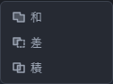

# 立体をつなぐ・組み合わせる

「ソリッド」の区画の「作る」の一覧にある「縫合」と、「合わせる」の一覧にある「和」「差」「積」を使います。どれも**先に対象を選んでから押す**のは同じです。

## 面をつないで 1 つの立体にする(縫合)

箱のように、まわりを面でぐるりと囲んであるときに使います。

1. 「選択」で、つなぎたい面を 1 枚クリックします。
2. Shift を押しながら、残りの面を順にクリックします。
3. 「ソリッド」の「作る」を押して一覧を開き、「縫合」を押します。
4. 入力欄が出ます。そのまま Enter を押します。

面は 2 枚以上必要です。1 枚しか選んでいないと、ボタンが薄いままで「縫合: つなぐ面を 2 枚以上選んでください。」と出ます。

入力欄の「つなぎ目の許容量」は、どれくらいのすき間まで「くっついている」とみなすかです。はじめは 0.01 mm です。角がぴったり合っているはずなのにつながらないときだけ、少し大きくしてみてください。

すき間なく囲めていれば中身の詰まった立体になります。囲めていないときは作れない理由が出ます。足りない面を足してもう一度試してください。

### 曲がった面もつなげられます

円筒の側面 1 枚と上下の端面 2 枚のように、曲がった面と平らな面で周囲を閉じれば、同じ「縫合」で 1 つの立体にできます。

1. 「選択」で、下の帯の「選ぶもの」を「面」にします。
2. 3D の絵でつなぎたい面をクリックし、Shift を押しながら残りの面を選びます。立体全体ではなく、面を選んでください。
3. 「ソリッド」の「作る」から「縫合」を押し、つなぎ目の許容量を確認して Enter を押します。

縫合すると、つないだ曲面は新しい立体に取り込まれて画面から消え、モデルブラウザでは「統合済み」と出ます。立体の面を直接縫合したときは元の立体は残り、新しい立体と重なります。

できた立体には「穴」などの加工を続けられます。縫合した直後に Ctrl+Z を 1 回押すと、縫合前へ戻ります。保存して開き直したときも、選んだ面を使って立体を作り直します。

スケッチで作った面と、既存の立体や曲面から選んだ面は、同じ縫合には混ぜられません。どちらか一方の選び方でそろえてください。元の形を変えて選んだ面が見つからなくなったときは、そのまま別の面には置き換えません。表示された理由を確認し、つなぐ面を選び直してください。

## 2 つの立体を組み合わせる(和・差・積)

1. 「選択」で、もとになる立体を 3D の絵の中でクリックします。
2. Shift を押しながら、組み合わせるもう 1 つの立体をクリックします。
3. 「ソリッド」の「合わせる」を押して一覧を開き、「和」「差」「積」のどれかを押します。

入力欄は出ません。押すとすぐにできあがります。

| ボタン | 何が残るか |
|---|---|
| 和 | 2 つを合わせた形。どちらかに入っているところが残ります |
| 差 | **先に選んだ立体から、後で選んだ立体を取り除いた**形。穴あけに使います |
| 積 | 2 つが重なっているところだけ |

**「差」は選ぶ順で結果が変わります。** 削られるのは先に選んだ方です。逆になってしまったら「元に戻す」(Ctrl+Z)で戻し、選ぶ順を入れ替えてください。

組み合わせに使った 2 つの立体は、画面から消えて 1 つになります。左の「モデルブラウザ」では、その 2 つに「統合済み」の印が付きます。消えたわけではないので、「元に戻す」でいつでも元の 2 つに戻せます。

できあがった立体は自動的に選ばれた状態になります。そのまま Shift でもう 1 つ選べば、続けて組み合わせられます。

## うまくいかないとき

下の帯に「立体を作れませんでした:」に続けて理由が出ます。

| 出る文 | 直し方 |
|---|---|
| 立体を 2 つ選んでください。 | 立体をクリックし、Shift を押しながらもう 1 つクリックします。面や線が選ばれていても数に入りません |
| 同じ立体どうしは組み合わせられません。 | 別々の立体を 2 つ選びます |
| つなぐ面を 2 枚以上選んでください。 | Shift を押しながら、面をもう 1 枚以上クリックします |
| 重なりが無いため、何も残りませんでした | 「積」は 2 つが重なっていないと何も作れません。位置を直してからもう一度試してください |

立体をクリックしにくいときは、上の「表示」を「面と稜線」にすると輪郭が見えて狙いやすくなります。マウスを重ねると、いま指している立体の輪郭が明るくなります。
