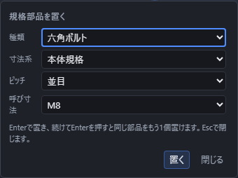

# 規格部品を置く

アセンブリを開き、上の **組む** から **規格部品を置く** を選びます。種類、呼び寸法を選びます。種類を **形鋼** にしたときは、鋼種と断面形状(平鋼・丸鋼・アングル・チャンネル・H形鋼・鋼管)と長さも選びます(下の「鋼材を置く」)。Enterを押すと部品が置かれます。

同じ選択のままEnterを繰り返すと、同じ規格部品を続けて置けます。別の種類へ移るときは一覧を選び直し、終わるときはEscで閉じます。

置いた規格部品は通常の部品と同じように固定、表示、合致、ジョイント、部品表の対象になります。

## 鋼材を置く

種類を **{{ui:assembly.standardPart.structuralSection}}** にすると、**{{ui:assembly.steel.material}}** の欄が出ます。鋼種、**{{ui:assembly.steel.shape}}**、**{{ui:assembly.standardPart.size}}**、**{{ui:assembly.standardPart.length}}** の順に選び、Enterか **{{ui:assembly.standardPart.place}}** で置きます。種類を切り替えた直後の長さは1000 mmです。鋼種を選ぶと、その鋼種で扱う断面形状と呼び寸法だけが一覧に出るので、規格に無い鋼種と断面の組み合わせは選べません。置いた鋼材の名前は「SS400 FB 50×6 長さ1000」のように、鋼種・呼び寸法・長さになります。

選んでいる鋼材の注記が欄の下に出ます。上から、材料規格と寸法・製品規格(例「JIS G 3101 / JIS G 3194」)、**{{ui:assembly.steel.materialStandardEdition}}** と **{{ui:assembly.steel.dimensionStandardEdition}}**(下の「出典と版」)、供給の条件、形の作り方、作図できる長さ、資料に記載された標準長さ、寸法の資料の名前の順です。資料の名前は掲載元へのリンクで、鋼種や断面の丸みの資料が別にあるときは「{{ui:assembly.steel.gradeSource}}」「{{ui:assembly.steel.profileSource}}」のリンクも出ます。最後に「{{ui:assembly.steel.referenceOnly}}」と出ます。

鋼材は、選んだ鋼材の指定(鋼種、材料規格、寸法・製品規格、供給の条件、寸法の資料)と長さが組み立てに保存され、開き直すと同じ鋼材に戻ります。置いた鋼材は1回の「元に戻す」で取り消せ、「やり直す」で同じ鋼材に戻ります。長さが正しくないときやEscで閉じたときは、組み立ても元に戻す履歴も変わりません。

選んだ鋼材は、**{{ui:assembly.steel.bend.enable}}** で曲げた部品として、**{{ui:assembly.steel.editable.enable}}** で切断や穴をあけられる部品ファイルとしても置けます。どちらにもチェックを入れないときは、通常の規格部品として置きます。

### 材質と熱処理の条件

**{{ui:assembly.steel.material}}** は SS400・S45C・SGP と **{{ui:assembly.steel.unspecified}}** から選びます。供給の条件は、注記に次の名前で出ます。

| 鋼種 | 材料規格 | 選べる断面形状 | 供給の条件 |
|---|---|---|---|
| SS400 | JIS G 3101(一般構造用圧延鋼材) | {{ui:assembly.steel.flatBar}}・{{ui:assembly.steel.roundBar}}・{{ui:assembly.steel.equalAngle}}・{{ui:assembly.steel.channel}}・{{ui:assembly.steel.hBeam}} | {{ui:assembly.steel.hotRolled}} |
| S45C | JIS G 4051(機械構造用炭素鋼鋼材) | {{ui:assembly.steel.roundBar}}・{{ui:assembly.steel.flatBar}} | {{ui:assembly.steel.brightBar}}、または{{ui:assembly.steel.hotRolled}} |
| SGP | JIS G 3452(配管用炭素鋼鋼管) | {{ui:assembly.steel.steelPipe}} | {{ui:assembly.steel.blackPipe}}、または{{ui:assembly.steel.whitePipe}} |

- {{ui:assembly.steel.s45c.treatmentUnspecified}}
- {{ui:assembly.steel.s45c.strengthSeparate}}強度計算の材料は[梁・軸・ボルトの簡易強度計算](strength.md#材料の選び方)で選びます。
- S45Cの丸鋼のφ25・φ30と、平鋼のFB 50×6・FB 50×9・FB 50×12には、みがき棒鋼と熱間圧延材の2つがあります。丸鋼の一覧と平鋼の **{{ui:assembly.steel.allSizes}}** の一覧では同じ呼び寸法が2つ並ぶので、選んだ後に注記の供給の条件で確かめます。切断リストとCSVでも別の行になります。
- SGPの白管は亜鉛めっきをした管です(図面などでは -ZN を付けて表します)。**{{ui:assembly.steel.shape}}** の欄の表示は「{{ui:assembly.steel.steelPipe}}」ですが、呼び寸法の一覧には黒管と白管が同じ呼び径で2つずつ並びます。選んだ後に注記の供給の条件で確かめます。
- **{{ui:assembly.steel.unspecified}}** を選ぶと、従来のL・溝・H形鋼の候補が出ます。鋼種は付かず、**{{ui:assembly.steel.shape}}** の欄も出ません。形は隅の丸みやフランジの勾配の無い簡略な形で作り、長さは0より大きい値で指定します。材質別の切断リストの合計には入りません。SS400の一覧に無い寸法(例 L 75×75×6、H 100×100×6×8)は、ここから選べます。一部の寸法には **{{ui:assembly.standardPart.unverifiedShort}}** が付き、注記に「寸法の出典を要確認: …」と理由が出ます。

### 断面の種類と呼び寸法

| 断面形状 | 呼び寸法の書き方 | 例 | 選べる寸法 |
|---|---|---|---|
| {{ui:assembly.steel.flatBar}} | FB 幅×厚さ | FB 50×6(幅50 mm・厚さ6 mm) | SS400: 厚さ4.5〜36 mm、幅25〜200 mmの132組。S45C: みがき棒鋼3組と熱間圧延材116組 |
| {{ui:assembly.steel.roundBar}} | φ径 | φ25 | SS400: φ5.5〜φ200の44径。S45C: みがき棒鋼3径(φ20・φ25・φ30)と熱間圧延材φ11〜φ200の36径 |
| {{ui:assembly.steel.equalAngle}} | L 辺×辺×厚さ | L 50×50×6 | SS400: L 40×40×5〜L 250×250×35のうち17寸法 |
| {{ui:assembly.steel.channel}} | [ 高さ×幅×ウェブの厚さ×フランジの厚さ | [ 100×50×5×7.5 | SS400: [ 75×40×5×7〜[ 380×100×13×20のうち11寸法 |
| {{ui:assembly.steel.hBeam}} | H 高さ×幅×ウェブの厚さ×フランジの厚さ | H 200×100×5.5×8 | SS400: H 100×50×5×7〜H 918×303×19×37のうち49寸法 |
| {{ui:assembly.steel.steelPipe}} | 呼び径(A) | 15A(外径21.7 mm・肉厚2.8 mm) | SGP: 6A〜500Aの24サイズ。それぞれ黒管と白管 |

- 平鋼の呼び寸法は「FB 幅×厚さ」の順です。FB 50×6は幅50 mm・厚さ6 mmで、資料の表の「厚さ×幅」とは並びが逆です。
- 平鋼は候補が100を超えるので、先に **{{ui:assembly.steel.selectThickness}}**、次に **{{ui:assembly.steel.selectWidth}}** を選びます。厚さを変えても、同じ幅と供給の条件があればそのまま残ります。S45Cで同じ幅にみがき棒鋼と熱間圧延材の両方があるときは、幅の後ろに条件名が付きます(例「50 mm / みがき棒鋼・加工方法と熱処理条件未指定」)。全部の寸法から選ぶときは **{{ui:assembly.steel.allSizes}}** を開きます。
- SS400の丸鋼のφ5.5〜φ8は、JIS G 3191では巻いた状態(バーインコイル)で作る径です。切った棒として手に入るかは確かめていません。
- H形鋼の呼び寸法は実際の寸法です。系列の呼びとは数が違うものがあります(例 H 198×99×4.5×7は200×100の系列、H 148×100×6×9は150×100の系列)。資料で「汎用品以外」の印が付いた寸法も一覧に含まれ、画面では区別しません。
- 等辺山形鋼・溝形鋼・H形鋼は資料の隅の丸みを含む断面で作り、溝形鋼はフランジの内側の5°の勾配も作ります。平鋼・丸鋼・鋼管は、公称寸法の単純な形です。
- 鋼管は、呼び径を選ぶと欄の下に「外径 21.7 mm × 肉厚 2.8 mm」のように外径と肉厚が出ます。

### 長さと切断リスト

長さはmmの数か式(例 `2*600`)で入れます。{{ui:assembly.steel.lengthBounds}}規格が決める長さや、手に入る長さではありません。範囲の外や計算できない式では「{{ui:assembly.steel.invalidLength}}」と出て、置きません。

注記の「{{ui:assembly.steel.catalogLengths}}」の後には、製造元の資料に書かれた長さが出ます(例 SS400のFB 50×6などの平鋼5寸法は4500 / 5000 / 5500 / 6000 / 6500 mm、φ13〜φ25の丸鋼5径は5500 / 6000 mm、SGPは5500 mm)。資料に無いときは「{{ui:assembly.steel.unknownLength}}」と出ます。これらはJISが決める長さではなく(例 JIS G 3452は長さを3,600 mm以上の指定の長さとしています)、在庫や供給を約束するものでもありません。

**{{ui:assembly.steel.stockList}}** は、種類が形鋼のときに小窓の下にあり、開くと組み立てに置いた鋼材を集計します。{{ui:assembly.steel.stockScope}}

表には **{{ui:assembly.steel.material}}**・**{{ui:assembly.standardPart.size}}**・**{{ui:assembly.steel.stockLength}} (mm)**・**{{ui:assembly.steel.finishedLength}} (mm)**・**{{ui:assembly.steel.quantity}}**・**{{ui:assembly.steel.totalLength}} (mm)**・**{{ui:assembly.steel.csv.catalogRevision}}**・**{{ui:assembly.steel.csv.generatorRevision}}** が並び、最後の行が **{{ui:assembly.steel.stockTotal}}** です。同じ鋼材・同じ長さは1行にまとめ、みがき棒鋼と熱間圧延材、黒管と白管は別の行にします。この表には供給の条件の列が無いので、どちらの行かはCSVの **{{ui:assembly.steel.csv.condition}}** の列で確かめます。完成長を確かめられないときは「{{ui:assembly.steel.finishedUnknown}}」と出ます。鋼種未指定の形鋼は「{{ui:assembly.steel.omittedMaterial}}」、確かめられない鋼材は「{{ui:assembly.steel.omittedUnknown}}」と表の下に出て、合計に入りません。

**{{ui:assembly.steel.stockLength}}** は、置いたときに指定した長さで、加工しても変わりません。**{{ui:assembly.steel.finishedLength}}** は、切断などの加工をしたあとの長さで、別の列に出ます。2つの長さを同じ列に混ぜることはありません。**{{ui:assembly.steel.totalLength}}** は 素材購入長 × 数量 で、完成長の合計ではありません。最後の行の合計は、数量と総延長を足したものです。集計できる鋼材が1つも無いときは、表の代わりに「{{ui:assembly.steel.stockEmpty}}」と出ます(集計できない配置があれば、その一覧は出ます)。図面の表は、見出しの行だけになります。

行は次のように分かれます。

- 鋼種・断面形状・呼び寸法・供給の条件のどれかが違う鋼材は、別の行です(同じ呼び寸法のSS400とS45Cなど)。
- カタログの版か形状生成の版が違う鋼材は、別の行です。古い版で置いた鋼材は、同じ形に見えても、新しく置いた鋼材とまとまりません。
- 素材購入長か完成長が違う鋼材は、別の行です。長さを式で入れたときも、値が同じなら同じ行になります(例 `2*500` と `1000`)。
- 同じ鋼材を複数置くと、数量に入ります。同じ部分組立を複数置いたときも、配置ごとに数えます。非表示の部品は数え、抑制した部品は(その中の部品も)数えません。

完成長を出せるのは、素材のままの鋼材と、棒の軸に直角な面で片側を残す切断を重ねたものだけです。何も選ばずに「{{ui:toolbar.machining.cut}}」を押して作るXY面の切断が、これに当たります([平面で切る](cut.md))。例えば素材購入長が1000の棒を、「{{ui:numericInput.field.planeOffset}}」を400にして切り、長いほうの600を残すと、完成長は600になります。素材購入長と数量は変わりません。

次の鋼材は完成長を求めず、完成長の欄に「{{ui:assembly.steel.finishedUnknown}}」と出ます。行は消えず、素材購入長と数量もそのままです。

- 斜めの切断(軸に直角でない面での切断)、面や点を選んで切った切断、「{{ui:numericInput.toggle.cutKeepBoth}}」で両側を残した切断
- 穴・面取りなど、切断以外の加工や、断面・元の長さの書き換え
- 素材購入長より長く直した部品(素材から切り出せないため)
- 切断の元が1つながりにならないなど、加工の履歴から長さを確かめられないもの

曲げた部品は、素材購入長にも完成長にも、下の「鋼材を曲げる」の「必要素材長と完成長」で説明する必要素材長が入ります。切断や穴などの加工をしたり、部品ファイルで半径や断面を書き換えたりすると、完成長は未確定になります。斜めの切り口の長さや、切断代を含めた長さを出す機能はありません。

画面の切断リストの上と、CSVの「{{ui:assembly.steel.csv.scope}}」の行には、集計の範囲と、素材購入長・完成長の扱いを説明する文が出ます。図面の表の中には説明文は出ず、列の見出しと「{{ui:assembly.steel.finishedUnknown}}」の表示だけが出ます。表を置く欄の **{{ui:assembly.steel.stockList}}** のチェックにカーソルを重ねると、同じ説明文が出ます。

集計できない配置があると、説明文の下に「{{ui:assembly.steel.stockPartial}}」と出て、表の下に配置の名前(部分組立の中なら「組の名前 › 部品の名前」)と理由が並びます。理由は次のとおりです。

| 表の下に出る理由 | 出る場面 |
|---|---|
| 「{{ui:assembly.steel.omittedUnknown}}」 | 鋼材として保存されているのに、寸法表の行・版・長さを確かめられない(新しい版のアプリで置いた鋼材、長さが0以下の鋼材など)。 |
| 「{{ui:assembly.steel.omittedMaterial}}」 | 鋼種を指定していない形鋼(従来カタログ)。 |
| 「{{ui:assembly.steel.omittedMissing}}」 | 部分組立のファイルが見つからない。 |
| 「{{ui:assembly.steel.omittedCycle}}」 | 同じ部分組立を、その内部で繰り返し参照している。 |
| 「{{ui:assembly.steel.omittedDepth}}」 | 部分組立の入れ子が8段を超える。 |

**{{ui:assembly.steel.csv.export}}** を押して保存先を選ぶと、切断リストをCSVファイル(最初の名前は steel-stock-list.csv)に保存し、「{{ui:assembly.steel.csv.saved}}」と出ます。保存先を選ばずにやめたときは「{{ui:assembly.steel.csv.cancelled}}」と出ます。保存している間は「{{ui:assembly.steel.csv.busy}}」と **{{ui:assembly.steel.csv.cancel}}** が出ます。CSVは日本語の表計算ソフトで開けるUTF-8(BOM付き)で、1行目が見出しです。その後に、次の行が続きます。

- 先頭の欄が「{{ui:assembly.steel.csv.scope}}」の行 … 「{{ui:assembly.steel.csv.notice}}」の列に、上の説明文が入ります。
- 先頭の欄が「{{ui:assembly.steel.csv.cut}}」の行 … 表の1行(同じ鋼材・同じ長さのまとまり)ごとです。「{{ui:assembly.steel.csv.paths}}」の列に、まとめた配置の部品のIDが、いちばん上の組から順に入ります。
- 先頭の欄が「{{ui:assembly.steel.stockTotal}}」の行 … 数量と総延長の合計です。集計できない配置があるときは、「{{ui:assembly.steel.csv.notice}}」の列に「{{ui:assembly.steel.stockPartial}}」が入ります。
- 先頭の欄が「{{ui:assembly.steel.csv.omitted}}」の行 … 集計から外れた配置ごとに、部品のIDと理由が入ります。部分組立にかかわる理由では、「{{ui:assembly.steel.csv.assemblyRef}}」の列にも入ります。

列は30列で、次のとおりです。切断明細の行以外では、15列目から30列目は空欄です。

| 列 | 見出し | 入るもの |
|---|---|---|
| 1 | {{ui:assembly.steel.csv.kind}} | 行の種類(上の4つ) |
| 2 | {{ui:assembly.steel.material}} | SS400・S45C・SGP |
| 3 | {{ui:assembly.steel.csv.materialStandard}} | 材料規格の名前(例 JIS G 3101) |
| 4 | {{ui:assembly.steel.csv.productStandard}} | 寸法・製品規格の名前(例 JIS G 3194。製造元の資料で確かめた寸法では資料の名前) |
| 5 | {{ui:assembly.steel.shape}} | 平鋼・丸鋼・鋼管・山形鋼・溝形鋼・H形鋼 |
| 6 | {{ui:assembly.standardPart.size}} | 「FB 50×6」「φ25」などの呼び寸法 |
| 7 | {{ui:assembly.steel.csv.condition}} | 熱間圧延材・みがき棒鋼・SGP黒管・SGP白管など |
| 8 | {{ui:assembly.steel.stockLength}} (mm) | 置いたときに指定した長さ |
| 9 | {{ui:assembly.steel.quantity}} | その行にまとめた配置の数 |
| 10 | {{ui:assembly.steel.totalLength}} (mm) | 素材購入長 × 数量 |
| 11 | {{ui:assembly.steel.csv.paths}} | まとめた配置の部品のID |
| 12 | {{ui:assembly.steel.csv.notice}} | 対象範囲の説明、または集計から外れた理由 |
| 13 | {{ui:assembly.steel.csv.assemblyRef}} | 理由が部分組立にかかわるときの、部分組立の参照 |
| 14 | {{ui:assembly.steel.finishedLength}} (mm) | 完成長。確かめられないときは「{{ui:assembly.steel.finishedUnknown}}」 |
| 15 | {{ui:assembly.steel.csv.catalogRevision}} | 置いたときの寸法表の版 |
| 16 | {{ui:assembly.steel.csv.generatorRevision}} | 置いたときの形状生成の版 |
| 17 | {{ui:assembly.steel.csv.geometry}} | 「{{ui:assembly.steel.csv.geometryProfile}}」「{{ui:assembly.steel.csv.geometrySimplified}}」「{{ui:assembly.steel.csv.geometryNominal}}」のどれか |
| 18 | {{ui:assembly.steel.csv.sourceTitle}} | 寸法の資料の名前 |
| 19 | {{ui:assembly.steel.csv.sourceEdition}} | 資料の版。記載が無いときは「{{ui:assembly.steel.csv.editionNotPrinted}}」 |
| 20 | {{ui:assembly.steel.csv.sourceLocator}} | 資料の中の掲載箇所 |
| 21 | {{ui:assembly.steel.csv.sourceUrl}} | 資料のURL |
| 22 | {{ui:assembly.steel.csv.sourceSha256}} | 取得したファイルのSHA-256 |
| 23 | {{ui:assembly.steel.csv.sourceFetchedDate}} | 資料を取得した日 |
| 24 | {{ui:assembly.steel.csv.profileSource}} | 断面形状の資料。使わない形状は「{{ui:assembly.steel.csv.profileSourceNone}}」 |
| 25 | {{ui:assembly.steel.csv.materialSource}} | 鋼種分類の資料。寸法の資料と同じときは「{{ui:assembly.steel.csv.sameAsDimensionSource}}」 |
| 26 | {{ui:assembly.steel.csv.productStandardSource}} | 寸法・製品規格の資料。寸法の資料と同じときは「{{ui:assembly.steel.csv.sameAsDimensionSource}}」 |
| 27 | {{ui:assembly.steel.materialStandardEdition}} | 「JIS G 3101:2024」のような、規格の番号と版 |
| 28 | {{ui:assembly.steel.materialStandardVerification}} | 「{{ui:assembly.steel.standardDraft}}」「{{ui:assembly.steel.standardFinal}}」「{{ui:assembly.steel.standardUnverified}}」のどれか |
| 29 | {{ui:assembly.steel.dimensionStandardEdition}} | 27列目と同じ形 |
| 30 | {{ui:assembly.steel.dimensionStandardVerification}} | 28列目と同じ形 |

このCSVは集計の書き出しで、読み込みには使えません。

鋼材の長さと数量は、次の場所で確かめられます。小窓の切断リスト・CSV・図面の表は、同じ集計から作ります。

| 場所 | 出るもの | 出ないもの |
|---|---|---|
| 小窓の **{{ui:assembly.steel.stockList}}** | 8列の表(上)・合計の行・集計できない配置の一覧 | 供給の条件、規格の発行年 |
| CSV | 30列(上の表) | なし |
| 組図の部品表の **{{ui:assembly.steel.stockList}}**([図面に部品表と部品番号を置く](drawing-bom.md)) | 断面形状と呼び寸法・鋼種・規格と版・素材購入長・数量・完成長の6列 | 総延長、合計の行、供給の条件、規格の発行年、集計から外れた配置の名前 |
| 組み立ての[部品表](bom.md) | 鋼材も通常の1行 | 素材購入長、完成長、総延長 |

次のことはできません。

- 図面の鋼材切断リストに、総延長の列と合計の行を出すこと。
- 部品表の列として、素材購入長・完成長・総延長を出すこと。
- 斜めの切断をした鋼材の完成長を求めること。

### 出典と版

**{{ui:assembly.steel.materialStandardEdition}}** と **{{ui:assembly.steel.dimensionStandardEdition}}** には「JIS G 3101:2024 / 原案で確認」のように、規格の番号:版と確認の程度が出て、その下に確かめた範囲の説明が出ます。確認の程度は次の3つです。

- **{{ui:assembly.steel.standardDraft}}** … 日本鉄鋼連盟が公開しているJISの改正原案で確かめました。2026-10-24の調査の時点で、日本規格協会(JSA)の規格票は確かめていません。公布された規格の本文との差は未確認です。
- **{{ui:assembly.steel.standardFinal}}** … 規格票で確かめた印です。今の版には、この印の付いた規格はありません。
- **{{ui:assembly.steel.standardUnverified}}** … 原案も規格票も確かめていません。

| 鋼種と断面 | 材料規格の版 | 寸法規格の版 |
|---|---|---|
| SS400の平鋼 | JIS G 3101:2024 | JIS G 3194:2024 |
| SS400の丸鋼 | JIS G 3101:2024 | JIS G 3191:2022 |
| SS400の等辺山形鋼・溝形鋼・H形鋼 | JIS G 3101:2024 | JIS G 3192:2024 |
| S45Cのみがき棒鋼(丸鋼・平鋼) | JIS G 4051:2026 | JIS G 3123:2004(未確認) |
| S45Cの熱間圧延材の丸鋼 | JIS G 4051:2026 | JIS G 4051:2026 |
| S45Cの熱間圧延材の平鋼 | JIS G 4051:2026 | JIS G 3194:2024 |
| SGPの鋼管 | JIS G 3452:2026 | JIS G 3452:2026 |

JIS G 3123(みがき棒鋼)だけは原案・規格票・寸法表を確かめていないので、**{{ui:assembly.steel.standardUnverified}}** と出ます。S45Cのみがき棒鋼の寸法は、製造元の資料で確かめたものです。注記の1行目は「材料規格 / 寸法・製品規格」で、SS400の平鋼のうちFB 50×6などの5寸法は「{{ui:assembly.steel.producerFlatDimensions}}」、丸鋼のうちφ13〜φ25の5径は「大阪製鐵 公表丸鋼寸法」と、製造元の資料の名前が出ます。

寸法の資料は、上の改正原案と製造元の資料(カタログ・寸法表)です。版と確認の程度は組み立てには保存せず、アプリが持つ記録から出します。CSVにも同じ版と確認の程度が出ます。

### 鋼材どうしをつなぐ(ボルト・溶接)

置いた鋼材は、通常の部品と同じように固定・合致の対象になり、ボルトで締結したり、すみ肉溶接でつないだりできます。選ぶ順や入力欄、断りの文は[部品を置いて組み立てる](assembly.md)の「ボルトで締結する」「すみ肉溶接を付ける」にあります。ここでは、鋼材に関わることだけを書きます。

- **{{ui:assembly.boltedJoint.tool}}** は、部品の履歴にある穴を選んで使います。規格のままの鋼材には穴が無く、面を選んでも「{{ui:assembly.boltedJoint.issue.holeFeatureUnknown}}」と出ます。穴をあけた鋼材を使うには、**{{ui:assembly.steel.editable.enable}}** にチェックを入れて置きます。先に部品ファイルが保存されるので、そのファイルを開いて穴を加え([穴をあける](hole.md)・[ねじ穴をあける](thread.md))、保存し、組み立てで **{{ui:assembly.refresh.action}}** を選びます。
- **{{ui:assembly.filletWeld.tool}}** は、鋼材の平らな面と、その面に接する直線の辺を使います。2つ目の部品の面には、全周の円筒の外面・内面も選べます。ほかの曲面や部分的な面を選ぶと「{{ui:assembly.filletWeld.reason.faceNotPlanar}}」と出ます。

合致・ジョイント、締結の記録、金物(ボルト・ナット・座金)、溶接のビードは、組み立ての中で別々に保存されます。

| 保存されるもの | 入っているもの |
|---|---|
| 合致・ジョイント | 部品や面どうしの関係です。締結と溶接は、合致やジョイントを増やさず、部品を互いに固定した組にします。 |
| 締結の記録 | 締結ごとの番号、選んだ穴と当てる面、入力した寸法系列・呼び・ねじの系列・座金・ねじ込み長さ・底のすきま・ナットの外へ出す長さと、足した金物の部品です。寸法表から求める候補など、あとから求められる値は入れず、直すときに選んだ穴から求め直します。 |
| 金物 | ボルト・ナット・座金です。それぞれ規格部品として、置いた位置とともに保存します。 |
| 溶接のビード | 区間ごとの部品です。どの溶接のビードかを表す番号、脚長・始点・長さ・溶接した2つの部品・材質を持ちます。 |

保存して開き直すと、部品の位置も、締結や溶接を直すための指定も、保存したときのまま戻ります。締結や溶接をした部品は、左の一覧に「{{ui:assembly.tree.fastened}}」の印が付き、組ごと動きます。

部分組立(サブアセンブリ)の中の鋼材どうしも、組の中の部品の面をそのまま押して、ボルトで締結したり、すみ肉溶接でつないだりできます。

- ボルトは、穴・当てる面・穴・当てる面の順に4つ選びます。順に合わない面は選べません。溶接は、1つ目の部品の面・その部品の辺・2つ目の部品の面の順で、組の外の部品と同じです。
- 足したボルト・ナット・座金やビードは、いちばん上の組み立てに部品として加わります。部分組立の元のファイルは書き換えず、同じ部分組立を置いた別の場所の部品も変わりません。
- 部分組立の中の部品は動かしません。ボルトは、2つの穴の軸が一致し、当てる面が接している位置のときだけ作れます。合っていないときは「{{ui:assembly.boltedJoint.reason.alignmentBlocked}}」に続けて、ずれの理由(例「{{ui:assembly.boltedJoint.reason.axesNotCoaxial}}」)が出ます。
- 作ったあとは、金物やビードと、2つの部品を含むいちばん上の部品が1つの組になり、一緒に動きます。
- 部分組立の元のファイルの中に、もとからあるビードを直すときは別です。その部分組立を置いたすべての配置が変わります。「{{ui:assembly.filletWeld.sharedDefinition}}」の後に影響する配置の数が出て、「{{ui:assembly.filletWeld.sharedDefinitionConfirm}}」に印を付けるまで確定できません。
- 選んでいる間に、別の組立へ切り替えると「{{ui:assembly.boltedJoint.nested.document}}」、選んだ部品の版が変わると「{{ui:assembly.boltedJoint.nested.partKey}}」、選んだ部品が見つからない・抑制している・重複しているときは「{{ui:assembly.boltedJoint.nested.occurrence}}」と出て、作りません。
- 2つの部品が同じ部分組立の中にあるとき、いちばん上の部品が合致やジョイントで動きを決められているとき、合致で解いた位置と保存した位置が違うときは作れません。ボルトでは「{{ui:assembly.boltedJoint.nested.command}}」と出ます。溶接では、それぞれ「{{ui:assembly.filletWeld.occurrence.same-owner-unsupported}}」「{{ui:assembly.filletWeld.occurrence.owner-constrained}}」「{{ui:assembly.filletWeld.occurrence.owner-pose-not-stored}}」と出ます。

交換や長さの変更のあとは、足したボルト・ナット・座金とビードを自動では作り直しません。

- 置いた鋼材の呼び寸法と長さは、置いたあとで書き換えられません。変えるときは、鋼材を置き直すか、加工できる部品にした鋼材の部品ファイルを直して **{{ui:assembly.refresh.action}}** を選びます。
- 取り込み直しや **{{ui:assembly.tool.replacePart}}** のあとも、金物とビードは作り直されず、今の位置のままです。保たれるのは、部品の配置と、合致・ジョイントの参照です。
- 新しい形で参照先が無くなった合致やジョイントは、別の面へ付け替えず、左の一覧のその行に「{{ui:assembly.tree.unresolved}}」の印が付きます([部品どうしを合わせる](mate.md)・[部品を差し替える・組を置く](replace-subassembly.md))。
- 穴や面の形が変わったときは、**{{ui:assembly.boltedJoint.release}}**(溶接は **{{ui:assembly.filletWeld.remove}}**)で外してから、作り直します。

直そうとして断られたときの文は次のとおりです。

| 画面の文言 | 出る場面 |
|---|---|
| 「{{ui:assembly.boltedJoint.issue.jointGeometryChanged}}」 | 締結を直すとき、締結のあとで板の位置か形が変わっていた。 |
| 「{{ui:assembly.boltedJoint.issue.jointPartsChanged}}」 | 締結を直すとき、足した金物が消えたか抑制されていた、板が消えていた、組が解かれていた、または金物が規格部品でなくなっていた。 |
| 「{{ui:assembly.boltedJoint.issue.jointRecordMissing}}」 | 締結を直すとき、直すための記録が無い。 |
| 「{{ui:assembly.filletWeld.reason.weldDamaged}}」 | 溶接を直すとき、ビードの記録と食い違っていた。 |
| 「{{ui:assembly.boltedJoint.reason.staleSource}}」 | ボルトの予告のあと、確定の前に部品の形や位置が変わった。 |
| 「{{ui:assembly.filletWeld.reason.staleSource}}」 | 溶接の予告のあと、確定の前に部品の内容か位置が変わった。 |
| 「{{ui:assembly.boltedJoint.reason.missingSourceRevision}}」「{{ui:assembly.filletWeld.reason.missingSourceRevision}}」 | 部品の版を確かめられない。 |
| 「{{ui:assembly.boltedJoint.reason.componentMissing}}」「{{ui:assembly.filletWeld.reason.componentMissing}}」 | 選んだ部品が見つからない。 |

締結する・溶接する・締結や溶接を直す・溶接を消すは、どれも「元に戻す」1回で操作の前に戻り、「やり直す」で同じ状態に戻ります。ボルトで締結するときに動かした相手の部品の位置も、1回で元に戻ります。やめた操作と、断られた操作では、組み立ても元に戻す履歴も変わりません。部分組立の中の鋼材の締結と溶接も同じです。

### できないこと

- 形は公称寸法の形です。製造公差・表面仕上げと、鋼管のねじ・ソケット・めっきの厚さ・管端の形は再現しません。SGPの300A以下はねじ付きかプレーンエンド、350A以上はプレーンエンドの管ですが、どれもねじの無い管として作ります。
- 鋼種と寸法の参照で、在庫・材料証明・強度・耐圧の保証ではありません。手に入る寸法や長さは、製造元や販売店で確かめてください。
- 鋼種はSS400・S45C・SGPの3つ、断面は上の6種類だけです。不等辺山形鋼・I形鋼・T形鋼・角鋼・六角鋼・角形鋼管・一般構造用炭素鋼鋼管などの断面や、SM400・SN400・S35Cなどの鋼種は選べません。
- SS400では鋼管を選べません(JIS G 3101の適用範囲に鋼管は含まれません)。SGPでは鋼管しか選べません(JIS G 3452は配管用の鋼管の規格です)。
- S45Cで選べる断面は丸鋼と平鋼だけです。{{ui:assembly.steel.s45c.sectionNotStandardized}}{{ui:assembly.steel.s45c.pipeOutsideScope}}保存した組み立てにこの組み合わせがあると、「標準断面が規定されていない（協定品）」などの理由が出て、その部品は作りません(下の「うまくいかないとき」)。
- S45Cの熱処理(焼ならし・焼なまし・焼入焼戻し)は選べず、鋼材を選んでも強度計算の材料や値は変わりません。
- [部品表](bom.md)の材質の欄は鋼種と結び付いていないため、S45CやSGPの鋼材でも「鋼(SS400)」と出ます。質量はこの材質の密度(7.85 g/cm³)で計算します。
- 切断リストは、歩留まり・切断代・必要な定尺の本数を計算しません。

## 鋼材を曲げる

鋼種を選んだ鋼材は、**{{ui:assembly.steel.bend.enable}}** にチェックを入れると、直線・円弧・直線の1か所だけ曲げた部品として置けます。**{{ui:assembly.steel.unspecified}}** の形鋼には、この欄は出ません。板を曲げる[板金](sheet-metal.md)とは別の機能で、K係数も展開板もありません。

### 曲げ部品を作る

1. **{{ui:assembly.standardPart.title}}** を開き、種類を **{{ui:assembly.standardPart.structuralSection}}** にして、鋼種・**{{ui:assembly.steel.shape}}**・**{{ui:assembly.standardPart.size}}** を選びます(上の「鋼材を置く」)。
2. **{{ui:assembly.steel.bend.enable}}** にチェックを入れます。**{{ui:assembly.standardPart.length}}** の欄は消え、下の表の欄が出ます。
3. 欄に数か式(例 `125*2`)を入れます。長さはmm、角度は度です。値が正しいと、欄の下に「幾何学上の必要素材長」と長さ(mm)が出て、**{{ui:assembly.steel.bend.place}}** が押せます。正しくないときは理由が出て、押せません(下の「曲げが断られるとき」)。
4. **{{ui:assembly.steel.bend.place}}** を押すか、欄でEnterを押すと、小窓が閉じて **{{ui:assembly.place.title}}** の欄が出ます。位置を入れて **{{ui:assembly.place.commit}}** かEnterで置きます([部品を配置する](assembly-place.md)と同じ欄です)。部品の名前は「SS400 FB 50×6 bend」のように、鋼種・呼び寸法の後ろに bend が付きます。置いた曲げ部品は1回の「元に戻す」で取り消せ、「やり直す」で同じ曲げ部品に戻ります。
5. やめるときは、小窓では **{{ui:assembly.standardPart.close}}** かEsc、位置の欄では **{{ui:assembly.place.cancel}}** かEscを使います。組み立ても元に戻す履歴も変わりません。

| 欄 | 入れるもの | 初めの値 |
|---|---|---|
| **{{ui:assembly.steel.bend.radius}}** | 曲げの半径です。内側の面の半径か外側の面の半径かは、**{{ui:assembly.steel.bend.radiusConvention}}** で決めます。 | 100 |
| **{{ui:assembly.steel.bend.angle}}** | 棒が向きを変える角度です。脚のなす角ではなく、90度なら直角のL字、60度なら脚のなす角が120度になります。0度より大きく180度より小さい値です。 | 90 |
| **{{ui:assembly.steel.bend.direction}}** | 断面のどちら向きへ曲げるかです。断面は動かさず、0度は+X、90度は+Y、180度は−X、270度は−Yへ曲げます。平鋼は0度が幅方向、90度が厚さ方向です。 | 0 |
| **{{ui:assembly.steel.bend.firstLeg}}** | 始端から曲げまでの直線部分の寸法です。 | 200 |
| **{{ui:assembly.steel.bend.secondLeg}}** | 曲げから終端までの直線部分の寸法です。 | 200 |
| **{{ui:assembly.steel.bend.radiusConvention}}** | **{{ui:assembly.steel.bend.inside}}** か **{{ui:assembly.steel.bend.outside}}** から選びます。 | {{ui:assembly.steel.bend.inside}} |
| **{{ui:assembly.steel.bend.legConvention}}** | **{{ui:assembly.steel.bend.tangent}}**・**{{ui:assembly.steel.bend.inside}}**・**{{ui:assembly.steel.bend.outside}}** から選びます。 | {{ui:assembly.steel.bend.tangent}} |

### 半径・向き・脚寸法の考え方

**{{ui:assembly.steel.bend.radiusConvention}}** で **{{ui:assembly.steel.bend.inside}}** を選ぶと、**{{ui:assembly.steel.bend.radius}}** は曲げの内側の面の半径になり、**{{ui:assembly.steel.bend.outside}}** を選ぶと外側の面の半径になります。図面や資料の半径が内側の面のものか外側の面のものかに合わせて選びます。どちらで入れても同じ曲げができ、外側の半径は次の式で内側の半径に直されます。

`外側の半径 = 内側の半径 + 曲げる向きの断面の全幅`

全幅は曲げる向きで変わり、板厚とは限りません。平鋼 FB 50×6では、0度(幅方向)が50 mm、90度(厚さ方向)が6 mmです。丸鋼は直径、鋼管は外径(15Aなら21.7 mm)、山形鋼・溝形鋼・H形鋼は曲げる向きの断面の広がりです。外側の半径で入れるときは、先に向きを決めてください。

曲げの位置は、**{{ui:assembly.steel.bend.firstLeg}}** と **{{ui:assembly.steel.bend.secondLeg}}** で決まります。始端の断面の重心が部品の原点で、最初の直線部分は+Z方向へ伸びます。**{{ui:assembly.steel.bend.legConvention}}** は、この2つの寸法をどこまで測った値として入れるかの選びです。

- **{{ui:assembly.steel.bend.tangent}}** … 直線部分そのものの長さです。
- **{{ui:assembly.steel.bend.inside}}** … 内側の面どうしを延長して交わる点まで測った寸法です。
- **{{ui:assembly.steel.bend.outside}}** … 外側の面どうしを延長して交わる点まで測った寸法です。

**{{ui:assembly.steel.bend.inside}}**・**{{ui:assembly.steel.bend.outside}}** のときの直線部分は、入れた寸法から `半径 × tan(曲げ角度 ÷ 2)` を引いた長さです。この半径は、**{{ui:assembly.steel.bend.inside}}** なら内側の半径、**{{ui:assembly.steel.bend.outside}}** なら外側の半径で、90度ならそのまま半径を引きます。例えば内側の半径30 mm・90度の曲げで、**{{ui:assembly.steel.bend.inside}}** の基準で130 mmと入れると、直線部分は100 mmです。外側の半径が80 mmなら、**{{ui:assembly.steel.bend.outside}}** の基準で180 mmと入れても100 mmです。

### 必要素材長と完成長

曲げ部品の長さ(画面の「幾何学上の必要素材長」。以下、必要素材長)は、断面の重心が通る道すじの長さです。

`必要素材長 = 第1脚の直線部分 + 第2脚の直線部分 + 重心の半径 × 曲げ角度(ラジアン)`

`重心の半径 = 内側の半径 + 重心から内側の面までの距離`

平鋼では、重心から内側の面までの距離は全幅の半分です。内側の半径30 mm、曲げ角度90度、第1脚100 mm・第2脚200 mm(**{{ui:assembly.steel.bend.tangent}}**)のSS400 FB 50×6では、次のとおりです。

| 曲げ方向 | 全幅 | 外側の半径 | 重心の半径 | 必要素材長 |
|---|---|---|---|---|
| 0度(幅方向) | 50 mm | 80 mm | 55 mm | 100 + 200 + 55 × π/2 = 約386.394 mm |
| 90度(厚さ方向) | 6 mm | 36 mm | 33 mm | 100 + 200 + 33 × π/2 = 約351.836 mm |

この長さは図形のうえの長さです。製造のための曲げ代・中立軸・スプリングバックを決めるものではなく、板金の展開長(K係数で決まる曲げの長さ)とは別の考え方です。

置いた曲げ部品は **{{ui:assembly.steel.stockList}}**(上の「長さと切断リスト」)に載り、CSVにも出ます。**{{ui:assembly.steel.stockLength}}** にも **{{ui:assembly.steel.finishedLength}}** にも上の必要素材長が入ります。同じ鋼材で必要素材長も同じ曲げ部品は1行にまとまり、数量と総延長は他の鋼材と同じに数えます。

曲げ部品に切断や穴などの加工を加えたり、断面・経路・向きの基準面を書き換えたりして、作ったときの形でなくなると、**{{ui:assembly.steel.finishedLength}}** は「{{ui:assembly.steel.finishedUnknown}}」になります。このとき **{{ui:assembly.steel.stockLength}}**・**{{ui:assembly.steel.quantity}}**・**{{ui:assembly.steel.totalLength}}** は変わりません。加工した部品ファイルを **{{ui:assembly.refresh.action}}** で取り込んだあと「元に戻す」を押すと、加工前の完成長に戻ります。

### 保存と再編集

置いた曲げ部品は、通常の規格部品と違い、形を寸法表から組み立て直しません。断面と経路のスケッチ・スイープ・鋼材の指定に加えて、入れた半径・角度・方向・脚寸法(式のまま)と2つの基準が、組み立ての保存ファイル(`.pcada`)の中に部品として一緒に残り、開き直すと保存した形がそのまま戻ります。

**{{ui:assembly.steel.editable.enable}}** も入れて **{{ui:assembly.steel.bend.place}}** を押すと、先に部品ファイルを保存します。そのファイルを開いて切断や穴を加えて保存し、組み立てで **{{ui:assembly.refresh.action}}** を選ぶと反映されます。保存先を選ばずにやめたときや保存できなかったときは、「{{ui:assembly.steel.editable.cancelled}}」「{{ui:assembly.steel.editable.failed}}」と出て、置きません。

置いたあとで半径や角度を直すには、再編集します。

1. 組み立てで曲げ部品を1つだけ選び、**{{ui:assembly.standardPart.title}}** を開きます。小窓の上に **{{ui:assembly.steel.bend.reedit.entry}}** が出ます。
2. 押すと **{{ui:assembly.steel.bend.reedit.title}}** が開き、保存してある値と基準が、入れたときの式のまま入っています。
3. 直して **{{ui:assembly.steel.bend.reedit.apply}}** を押す(またはEnter)と、形と素材購入長が更新されます。1回の「元に戻す」で更新前に、「やり直す」で更新後に戻ります。同じ部品を使う配置にもすべて反映され、元の部品ファイルへは書き戻しません。
4. **{{ui:assembly.steel.bend.reedit.cancel}}** かEscでやめると、曲げ部品も履歴も変わりません。日本語入力の変換を確定するEnterでは更新されません。

再編集できるのは、作ったときの内容のままの曲げ部品だけです。元の入力を保存する前の版で作った曲げ部品には、元の入力がありません。切断や穴を加えたり、スケッチやパラメータを書き換えたりした曲げ部品は、保存してある入力と今の形が合いません。どちらも値の欄は出ず、理由だけが出ます(下の「曲げが断られるとき」)。形から入力を推測して補うことはしません。

### 曲げが断られるとき

値を入れている間の理由は欄の下に出て、**{{ui:assembly.steel.bend.place}}** は押せません。組み立ても元に戻す履歴も変わらず、値を直すと押せます。

| 画面の文言 | 出る条件 |
|---|---|
| **{{ui:assembly.steel.bend.invalidExpression}}** | 半径・角度・方向・脚寸法のどれかが、計算できない式や、大きすぎて有限にならない値のとき。 |
| **{{ui:assembly.steel.bend.invalidRadius}}** | 半径が0以下のとき。**{{ui:assembly.steel.bend.outside}}** の基準で、入れた半径が曲げる向きの全幅以下で、内側の半径が0以下になるときも出ます。 |
| **{{ui:assembly.steel.bend.invalidAngle}}** | 曲げ角度が0度以下、または180度以上のとき。 |
| **{{ui:assembly.steel.bend.invalidLength}}** | 第1脚か第2脚が0以下のとき。 |
| **{{ui:assembly.steel.bend.insufficientLegLength}}** | **{{ui:assembly.steel.bend.inside}}**・**{{ui:assembly.steel.bend.outside}}** の基準で、寸法から `半径 × tan(曲げ角度 ÷ 2)`(上の「半径・向き・脚寸法の考え方」と同じ)を引くと直線部分が0以下になるとき。脚寸法を増やします。 |
| **{{ui:assembly.steel.bend.radiusTooTight}}** | 重心の半径(内側の半径 + 重心から内側の面までの距離)が、断面の重心から一番遠い点までの距離以下のとき。曲げた断面が自分に重なるおそれがあるため、向きによらず同じ基準で断ります。FB 50×6では距離が約25.18 mmなので、0度(幅方向)は内側の半径が約0.18 mm以下、90度(厚さ方向)は約22.18 mm以下のときです。材料ごとの最小曲げ半径を調べた値ではありません。 |
| **{{ui:assembly.steel.bend.invalidStockLength}}** | 必要素材長が1 mm未満か12,000 mm超のとき。 |
| **{{ui:assembly.steel.bend.unavailable}}** | **{{ui:assembly.steel.bend.place}}** を押したとき、別の配置や合致の途中、部品の移動中、計算中のときに出ます。実行中の操作を終えてから押します。 |

次の2つは、通常の操作ではほとんど出ない確認です。

- **{{ui:assembly.steel.bend.invalidSection}}** … 曲げに対応していない断面のときに出ます。
- **{{ui:assembly.steel.bend.unsupportedSource}}** … 鋼材の出自(カタログの版・形状生成の版)が曲げに対応していないときに出ます。

再編集の窓では、次の理由が出ます。最初の3つ(元の入力が無い・形が合わない・非対応)は、値の欄を出さず、理由だけを出します。

| 画面の文言 | 出る条件 |
|---|---|
| **{{ui:assembly.steel.bend.reedit.missing}}** | 元の入力を保存する前の版で作った曲げ部品のとき。 |
| **{{ui:assembly.steel.bend.reedit.modified}}** | 切断や穴を加えたり、スケッチやパラメータを書き換えたりして、作ったときの内容から変えた曲げ部品のとき。保存してある入力は残りますが、元の曲げとしては扱いません。 |
| **{{ui:assembly.steel.bend.reedit.unsupported}}** | 保存された曲げの版や鋼材の出自が、このアプリの対応しないものだったとき。 |
| **{{ui:assembly.steel.bend.reedit.unavailable}}** | 窓を開いたあとに、選択や文書が変わったか、別の操作中のとき。曲げを更新せずに閉じ、選び直します。 |
| **{{ui:assembly.steel.bend.reedit.failed}}** | 更新の途中で失敗したとき。元の部品も履歴もそのままです。 |

### 曲げ部品でできないこと

- この機能で作れるのは、直線・円弧・直線の1か所の曲げだけです。
- 曲げ角度は0度より大きく180度より小さい値です。負の角度は使えないので、反対向きに曲げるときは **{{ui:assembly.steel.bend.direction}}** を変えます。
- 置いてある鋼材を曲げ部品に変えることはできません。いつも新しい部品を作ります。
- 曲げ代・中立軸・スプリングバック、材料ごとの最小曲げ半径、曲げたことによる断面の変形は扱いません。曲げた形が成り立つことは、その材料を実際に曲げられることを保証しません。
- 加工した曲げ部品の完成長は計算しません。加工すると **{{ui:assembly.steel.finishedUnknown}}** になります。

## うまくいかないとき

- **長さは0より大きい式で入力してください。** … 長さの欄に0以下の値や計算できない式を入れて置こうとすると出ます。値を直すと置けます。
- **この呼び寸法は用意されていません。** … 呼び寸法の選択が定まらないまま置こうとすると出ます。一覧から呼び寸法を選び直してください。
- **{{ui:assembly.steel.invalidLength}}** … 鋼種を選んだ鋼材の長さを1 mm未満・12,000 mm超にしたときや、計算できない式を入れたときに出ます。範囲の中の値に直すと置けます。
- **S45Cの圧延形鋼はJIS G 4051（機械構造用炭素鋼鋼材）の7.5により標準断面が規定されていない（協定品）。（JIS G 4051（機械構造用炭素鋼鋼材） 7.5 その他の形状・寸法（受渡当事者間の協定））** … 保存した組み立ての中にS45Cの山形鋼・溝形鋼・H形鋼があると、開いたときに画面下に出て、その部品は作りません。S45Cの規格は、これらの形鋼の標準の断面を定めていない(受け渡す者どうしで決める協定品)ためです。SS400で選び直してください。SS400の鋼管や、SGPの鋼管以外の断面のときも、同じように理由と規格の箇条が出ます。
- **この鋼種・断面の呼び寸法はカタログにありません。** … 保存した鋼材の呼び寸法がこの版の一覧に無いときに、規格の箇条と一緒に出ます。
- **保存した鋼材の指定が寸法表と一致しません（…）。** … 組み立てファイルの中の鋼材の指定が書き換えられて一覧と合わないときに出ます。かっこの中は食い違った項目の名前です。その部品を削除して置き直してください。
- **{{ui:assembly.steel.rejection.unsupported-catalog-revision}}** または **{{ui:assembly.steel.rejection.unsupported-generator-revision}}** … 新しい版のアプリで保存した鋼材を開いたときに出ます。この版で開いて保存し直しても、保存した指定は変わりません。
- **{{ui:assembly.steel.rejection.steel-options-with-legacy-revision}}** … 従来カタログの形鋼に鋼材の指定が加わっているときに出ます。鋼種を選んで置き直してください。
- **{{ui:assembly.steel.rejection.unsupported-steel-catalog}}** … ボルト・ナットなど鋼材でない規格部品に鋼材の指定が加わっているときに出ます。置き直してください。
- **{{ui:assembly.steel.rejection.invalid-steel-length}}** … 保存した鋼材の長さが1〜12,000 mmの外のときに出ます。

置いた規格部品は種類・呼び寸法・長さなどの指定だけが組み立てに保存され、形は開き直すたびに寸法表から組み立て直します。
