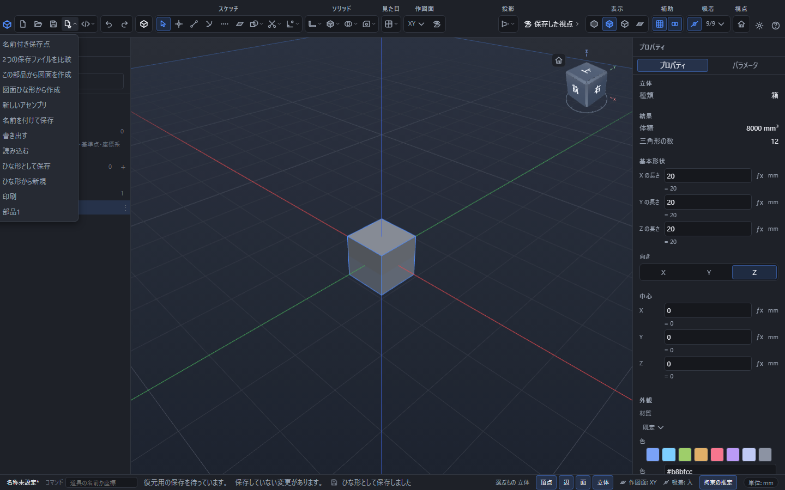
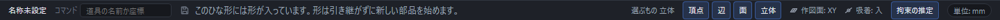

# ひな形を使う

いつも同じ決まりで部品を作るなら、その決まりを **ひな形** として残しておけます。次からは、ひな形を選ぶだけで同じ決まりの新しい部品を始められます。

## ひな形に入るもの

ひな形は **中身の入っていない部品** です。かいた線や作った立体は入らず、次の 4 つだけを覚えます。

| 覚えるもの | 中身 |
|---|---|
| パラメータ表 | 名前を付けた数値と、その説明 |
| 色と材質 | その部品に決めてあった見た目 |
| 長さの単位 | ミリメートルかインチか |
| 道具の既定値 | 押し出しの距離、穴の径、角を丸める大きさ、面を取る大きさ、円の半径 |

かいた線・面、作った立体、下絵、選んだ組に付けた名前は **引き継ぎません**。新しい部品は、まっさらな状態から始まります。

## ひな形として残す

1. 残しておきたい決まりを、いまの部品に入れておきます(パラメータ表を作る、単位を決める、色を決める)。
2. 画面のいちばん上の、保存のボタンの右にある▾の付いたボタン(**{{ui:toolbar.fileMenu.groupLabel}}**)を押すと一覧が開きます。
3. **ひな形として保存** を選びます。

ひな形の名前は、いまの部品の名前になります。

続けて、ひな形をファイルとしてどこへ置くか聞かれます。ファイルの名前の終わりは `.pcadt` です。**このファイルは、別のパソコンや別のブラウザへ持って行けます。** 置き場所を聞かれたところでやめても構いません。ひな形はこのアプリの中に残っているので、同じ画面からはそのまま使えます。

残しておけるひな形は **10 個まで** です。11 個目を残すと、いちばん古いものが落ちます。同じ名前でもう一度残すと、前のものに上書きされます。

## ひな形から始める

**{{ui:toolbar.fileMenu.groupLabel}}** の一覧を開くと、残してあるひな形の名前が新しい順に並びます。名前を選ぶと、そのひな形の決まりで新しい部品が始まります。

**ひな形から新規** を選ぶと、`.pcadt` のファイルを選ぶ窓が出ます。ほかのパソコンから持ってきたひな形は、こちらから始めてください。

新しい部品は、まだ一度も保存していない状態です。名前は **名称未設定** に戻るので、区切りのよいところで保存してください。ひな形のほうは何も変わりません。

## 形の入ったひな形を選んだとき

画面のいちばん下に **このひな形には形が入っています。形は引き継がずに新しい部品を始めます。** と出ます。

断られたわけではありません。そのまま新しい部品が始まり、ひな形に入っていた線や立体だけが引き継がれません。ひな形のファイルはそのまま残ります。

## 保存していない変更があるとき

ファイルの名前の右に `*` が付いているときは、保存していない変更があります。ひな形から始めようとすると、いまの変更をどうするか聞かれます。

- **{{ui:file.discardConfirm.save}}** … いまの文書を保存してから、新しい部品を始めます。保存を取り消したときや保存できなかったときは、元の文書にとどまります。
- **{{ui:file.discardConfirm.discard}}** … 保存していない変更を捨てて、新しい部品を始めます。
- **{{ui:file.discardConfirm.cancel}}** … 新規作成をやめます。いまの文書と変更はそのまま残ります。

## うまくいかないとき

- **PointerCAD の部品ファイルではないようです。** … ひな形ではないファイル(`.pcad` など)を選んでいます。名前の終わりが `.pcadt` のファイルを選んでください。名前を書き換えただけのファイルは、中身で見分けるので開けません。
- **選んだひな形が見つかりません。** … 別のタブで同じひな形を消したか、上書きしたときに出ます。一覧を開き直すと、いまあるひな形だけが並びます。

## 元に戻すとの関係

「ひな形から新規」で新しい部品を始めると、それまでの「元に戻す」「やり直す」の記録も新しい部品のものに入れ替わります。始めた後に「元に戻す」を押しても、ひな形を選ぶ前の部品には戻れません。切り替える前に元の部品を保存しておけば、後からそのファイルを開いて編集を続けられます。やめたいときは、前述の確認で **{{ui:file.discardConfirm.cancel}}** を選んでください。

## 形や作業の途中も残したいとき

ひな形は、同じ決まりで別の部品を作り始めるためのものです。線・立体・下絵も含めていまの部品を残したいときは、**{{ui:toolbar.file.saveAs}}** で別のファイルとして保存してください。

「試作A」「発注前」のように、同じ文書の途中の状態へ名前を付けておきたいときは、**{{ui:toolbar.history.savePoints}}** を使えます。保存点の一覧から比較したり、その状態へ戻したりできます。保存点を複製しても、いま編集中の文書は変わりません。ひな形から新規に始めることと、保存点へ戻すことは、元に戻すの扱いも異なります。[保存と読み込み](save-and-open.md)を参照してください。
