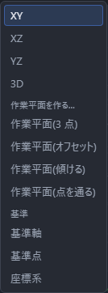

# 作図面を選ぶ

点や線は 3 次元の空間の中にかきますが、角度や円弧の向きは「作図面」を基準に決まります。画面の上の「作図面」のボタン(いま選ばれている面の名前が出ています)を押すと一覧が開くので、そこから選びます。

| 選ぶもの | どの面か | 角度 0 の向き | 角度 90 の向き |
|---|---|---|---|
| XY | 上から見た面(床の面) | 右 | 奥 |
| XZ | 前から見た面 | 右 | 上 |
| YZ | 横から見た面 | 奥 | 上 |

はじめは XY(床の面)が選ばれています。いま選ばれている面は、画面の下の帯にも出ています。

- 「極」で位置を決めるときの角度は、選んだ面の中で測ります。
- 円弧は、選んだ面の上にかかれます。
- 方眼に合わせる(吸着の「方眼」)ときも、選んだ面の方眼に合います。

作図面を変えても、すでにかいたものは動きません。これからかくものの向きだけが変わります。

右上の立方体(向きを示す箱)をクリックすると**見る向き**が変わりますが、作図面は変わりません。見る向きと作図面は別々に選べます。

## 見ている向きに合わせる

「作図面」の一覧のボタンの右に、目と面の図柄のボタンがあります。押すと、いま見ている向きに最も近い面(XY・XZ・YZ のどれか)に切り替わります。斜めから見ているときは XY になります。

このボタンには文字が付いていません。カーソルを重ねると「視点に合わせる」という名前と説明が出ます。

## 立体の平らな面を作図面にする

立体の平らな面の上に、そのままかけます。

1. 「選択」で選ぶものを「面」(`3`)にし、かきたい平らな面を1枚クリックします。
2. そのまま「点」「線分」「円弧」「点列」か、「作図」の一覧の図形の道具を押します。
3. 選んだ面が作図面になり、画面の下の帯に「{{ui:sketch.faceWorkPlane.chosen}}」と出ます。帯の作図面の札にも、その面の作業平面の名前が出ます。

- その面の作業平面(面から離さない平面)が無ければ、左の「基準」に作業平面を1つ作ります。同じ面の作業平面が既にあれば、それを使い、増やしません。
- 作業平面を作った分は、「元に戻す」(Ctrl+Z)1回で消え、作図面は XY に戻ります。
- 曲面を選んだとき、面を2つ以上選んでいるとき、3Dスケッチ(作図面なし)のときは、作図面は変わりません。

## 3Dスケッチ(作図面なし)を選んだとき

「作図面」の一覧では、XY・XZ・YZ(と自分で作った作業平面)の下にある「3D」も選べます。3Dを選ぶと作図面を使わずに空間へ直接かけますが、点列・文字・円・2点円弧・矩形・正多角形・長穴・楕円、オフセット、ミラー・直線配列・円形配列、投影・断面など、作図面の向きが要る道具は使えません。使おうとすると「3D スケッチではこの形をかけません。作図面を選んでから作ってください。」と表示されるので、XY・XZ・YZのいずれかを選び直してください。
